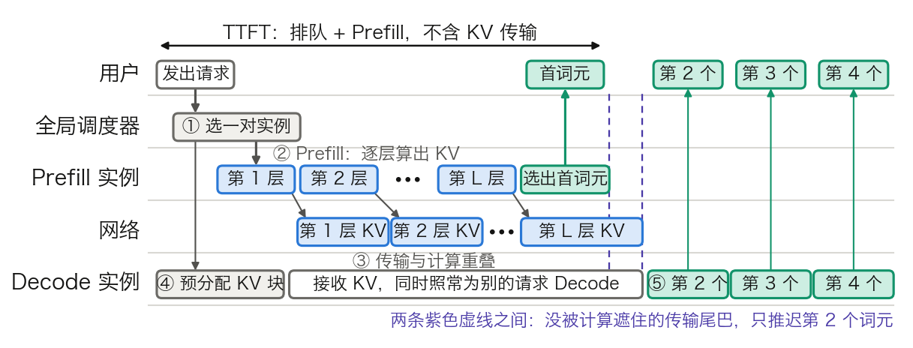

## 11.9 分离式 Prefill-Decode 架构

分离买的是词元间隔的尾部，不是吞吐。Prefill 受算力限制，Decode 受带宽限制，两者同处一步时，Decode 的间隔被 Prefill 块的计算时间拉长，[11.3 节](11.3_scheduler_loop.md)的分块 Prefill 只能把这种干扰切碎。**分离式推理**（Disaggregated Prefill-Decode）把两个阶段放到两组实例上，中间靠网络搬运 KV 缓存。代价有三项：KV 要过网络，Prefill 池的显存不参与驻留在途序列，两池的配比随流量形态漂移。

分离划算要同时满足四个条件：词元间隔的 SLO 紧到分块 Prefill 也压不住；网络速率高于 Prefill 的 KV 产生速率并留有数倍余量；规模大到两个池取整后仍各自保持较高利用率；流量形态稳定，或有能力动态调整配比。不满足时合置加分块 Prefill 更好，这也是引擎的默认配置（vLLM 默认开启分块 Prefill，[它的文档](https://docs.vllm.ai/en/latest/features/disagg_prefill/)写明分离式 Prefill 不提升吞吐，用途是分别调首词元延迟与词元间隔、压住词元间隔的尾部）。满足时再按有效输入长度逐请求决定走哪条路（11.9.5）。

算例沿用 [11.8 节](11.8_multi_gpu_inference.md)的 Llama 3 70B：80 层、`d_model = 8192`、`n_kv = 8`、`d_h = 128`，FP16 权重 141.1 GB。一个实例取 4 张 H100 做张量并行（TP4），显存带宽合计 `4 × 3.35 = 13.4 TB/s`。耗时都是上界估算：Decode 按“每步读一遍权重和 KV”计；Prefill 按单卡稠密 BF16 峰值 990 TFLOPS（[10.1 节](../10_inference_optimization/10.1_bottleneck.md)）乘 40% 的利用率，有效算力 `4 × 990e12 × 0.4 ≈ 1.58e15` FLOPs/s；通信与内核效率不计。

### 11.9.1 同卡混跑的代价

单实例架构里，一个请求的 Prefill 和 Decode 在同一组 GPU 上执行，由此带来三个问题：

1. **瓶颈不同**。Prefill 是计算密集型，算力先用满；Decode 是访存密集型，显存带宽先用满（3.8.8 的账）。同一张卡无法同时为两者选最优的批大小与并行度。
2. **延迟互相干扰**。一个 Prefill 块进入某一步，这一步里所有 Decode 请求都要等它算完。
3. **扩容粒度绑死**。长输入压的是 Prefill 算力与 KV 容量，长输出压的是 Decode 带宽与 KV 驻留时间；单实例只能整体加副本，不能只补短板。

**干扰有多大。** 设实例上有 32 条 4K 上下文的序列在 Decode。每个词元的 KV 是 `2 × 80 × 8 × 128 × 2 = 327,680` 字节，即 320 KiB；每条序列 `4096 × 320 KiB ≈ 1.34 GB`。纯 Decode 的一步要读 `141.1 + 32 × 1.34 ≈ 184 GB`，耗时 `184 GB ÷ 13.4 TB/s ≈ 13.7 ms`，其中权重读取 `141.1 ÷ 13.4 ≈ 10.5 ms`，KV 读取 `32 × 1.34 ÷ 13.4 ≈ 3.2 ms`。这就是这 32 个请求的词元间隔（TBT，定义见 [11.13.1](11.13_best_practices.md)）。

现在让一个 2048 词元的 Prefill 块进入同一步。块的计算量约 `2 × 70e9 × 2048 ≈ 2.9e14` FLOPs，耗时 `2.9e14 ÷ 1.58e15 ≈ 181 ms`。这一步的耗时按“块的计算时间加 KV 读取”计：线性层的权重只读一遍，10.5 ms 的读取被 181 ms 的计算遮住；32 条序列的 Decode 注意力要各自读 KV，这 3.2 ms 不与块的矩阵乘法重叠。合计约 184 ms。表 11-23 列出不同块大小的结果。

| 同一步里的 Prefill 块 | 块的计算时间 | 这一步的耗时 | 相对纯 Decode |
| --- | ---: | ---: | ---: |
| 无 | — | 13.7 ms | 1 倍 |
| 512 词元 | 45 ms | 48 ms | 3.5 倍 |
| 2048 词元 | 181 ms | 184 ms | 13.5 倍 |
| 8192 词元 | 724 ms | 727 ms | 53 倍 |
| 32K 词元，不分块 | 3.78 s | 3.78 s | 277 倍 |

表 11-23：Prefill 块与 32 条 4K 序列的 Decode 同批时，一步被拉长多少（Llama 3 70B FP16、4 张 H100、利用率 40% 的上界估算）。“这一步的耗时”= 块的计算时间 + 3.2 ms 的 KV 读取，权重读取被计算遮住。512 到 8192 三行只计线性项；32K 一行计入因果注意力的平方项，合计约 `6.0e15` FLOPs。

分块 Prefill 只能把干扰切碎，不能消除。若 TBT 上限定为 50 ms，扣掉 3.2 ms 的 KV 读取，留给块的计算时间是 46.8 ms。每个 Prefill 词元约 `2 × 70e9 = 1.4e11` FLOPs，块长等于可用时间乘有效算力再除以每词元运算量，最大为 `(50 − 3.2) ms × 1.58e15 ÷ 1.4e11 ≈ 530` 词元。

分块几乎不拉长 Prefill：一个 32K 的 Prompt 按 530 词元分块要 `⌈32,768 ÷ 530⌉ = 62` 步、约 3.1 秒，比不分块的 2.9 秒多 7%；计入注意力项后是 4.05 秒对 3.78 秒，同样多 7%。

代价落在 Decode 上。只要 Prefill 负载不断，每一步都带着块，32 个请求就长期按 50 ms 出词元（每流 20 词元/秒），而不是 13.7 ms（每流 73 词元/秒）。分离式架构要拿回的就是这一段差距。

### 11.9.2 分离后的一次请求：时序与交接

分离式架构把集群划成两个池：Prefill 池只做 Prefill，Decode 池只做 Decode。下文反复引用三个代表系统：[DistServe](https://arxiv.org/abs/2401.09670) 以 Goodput（满足 SLO 的最大到达率，见 [11.13.2](11.13_best_practices.md)）为目标优化分离式部署，[Splitwise](https://arxiv.org/abs/2311.18677) 主张两个阶段异构配卡，[Mooncake](https://arxiv.org/abs/2407.00079) 是 Kimi 的线上服务平台，以 KV 缓存池为中心组织调度。

下面以 **Prefill 首词元直返**用户的实现为例，按五步说明；图 11-20 对应这一返回策略。

1. **选一对实例**。全局调度器为请求同时选定一个 Prefill 实例和一个 Decode 实例。Mooncake 把这个角色称为 Conductor，选择时兼顾三件事：能复用多少已有的前缀 KV、各实例的负载、TTFT 与 TBT 的 SLO（三个指标的定义见 [11.13.1](11.13_best_practices.md)）。
2. **Prefill**。Prefill 实例对未命中前缀的部分做 Prefill，逐层写出 KV，并由最后一个位置的 logits 选出首词元（3.8.1）。代理在此策略下立即转发首词元，不等待 KV 交接完成。
3. **传输 KV**。KV 从 Prefill 实例搬到 Decode 实例。传输可以与计算重叠：第 ℓ 层的 KV 算完就发出，后面的层继续算。Splitwise 对短 Prompt 整体一次发送，对长 Prompt 逐层发送；Mooncake 则逐层流式写入目的节点。
4. **Decode 侧准入**。Decode 实例先为这个请求分配 KV 块（[11.4 节](11.4_kv_memory_management.md)），KV 收齐后请求进入连续批处理的运行队列。Mooncake 的本地调度器此时会再检查一次 TBT 的 SLO；若负载已变、无法满足，请求被拒绝，已做的 Prefill 作废。
5. **Decode**。此后与单实例无异，每步出一个词元，流式返回。

图 11-20：Prefill 首词元直返策略下的请求时间线（[生成脚本](https://github.com/yeasy/llm_internals/blob/main/tools/figures/ch11b_disagg_timeline.py)）。图中假设逐层传输能跟上 Prefill 计算且 Decode 侧无额外排队，因此传输的可见尾部落在第二个词元之前。

两个实现细节决定了这条时间线的形状。

**推还是拉。** Prefill 侧算完就推，Decode 侧可能被突发流量灌满显存。DistServe 改为由 Decode 实例按需拉取，把 Prefill 实例的显存当作排队缓冲；Prefill 实例保留这份 KV 直到被取走，其间照常处理别的 Prefill。

**传输开销落在哪个词元上。** 在首词元直返策略下，第二个词元要等 KV 到齐。Splitwise 的实测是：逐层传输时，未被计算遮住的传输时间在 A100 上约 8 ms、H100 上约 5 ms，第二个词元的延迟增加 16.5%；整体一次发送时增加 64%。返回策略因代理而异，压测和排障须同时记录返回策略与客户端计时边界。

> [!NOTE]
> **进阶：等交接完成再返回的代理。** [LMCache 的 NIXL 1P1D 示例](https://docs.lmcache.ai/disaggregated_prefill/nixl/1p1d.html)（一个 Prefill 实例配一个 Decode 实例）先等 Prefill 侧确认传输完成，再从 Decode 侧流出完整响应；此时交接就落在客户端 TTFT 内。

传输失败时，Decode 侧要么让请求报错，要么在本地重算这部分 Prefill。后者等于把 11.9.1 的干扰请了回来：Decode 实例按低延迟配置，临时插入的 Prefill 会拖慢同批的所有 Decode。vLLM 的连接器因此默认报错，重算要显式选择。

### 11.9.3 KV 传输要多久，和 Prefill 比贵不贵

**公式。** 传输时间等于 KV 字节数除以链路带宽，KV 字节数等于词元数乘每词元 KV 字节：

$$
t_{\text{传}} = \frac{T \times 2 \times L \times n_{kv} \times d_h \times \text{字节}}{W_{\text{net}}}
$$

**算例。** 32K 词元的 Prompt，Llama 3 70B：`32768 × 327,680 ≈ 10.7 GB`，即 10 GiB（FP16）；KV 用 FP8 存放则为 5 GiB。表 11-24 给出不同链路上的理想线速时间。

| 链路 | 单向带宽 | FP16 KV（10.7 GB） | FP8 KV（5.4 GB） |
| --- | ---: | ---: | ---: |
| 10 GbE | 1.25 GB/s | 8.6 s | 4.3 s |
| 100 GbE | 12.5 GB/s | 0.86 s | 0.43 s |
| 400 Gb/s InfiniBand，1 口 | 50 GB/s | 215 ms | 107 ms |
| 400 Gb/s InfiniBand，4 口并行 | 200 GB/s | 54 ms | 27 ms |
| 节点内 NVLink（H100，单向 450 GB/s） | 450 GB/s | 24 ms | 12 ms |

表 11-24：32K 词元的 KV 在不同链路上的传输时间，按理想线速计，未计协议开销。H100 的 NVLink 标称 900 GB/s 为双向合计，单向取一半。

**与 Prefill 本身比。** 同一个 32K 的 Prompt，Prefill 计算量约 `6.0e15` FLOPs（表 11-23 的注），4 张 H100 约 3.78 秒。单口 400 Gb/s 传 FP16 的 KV 要 215 ms，占 Prefill 的 5.7%；TP4 的四张卡各走一口网卡时是 54 ms，占 1.4%。换成 10 GbE 则是 8.6 秒，超过 Prefill 的两倍，分离的收益被传输吃光。DistServe 在 OPT-175B 上的实测与这个量级一致：KV 传输不到总延迟的 0.1%，95% 以上的请求传输时间低于 30 ms。

**速率判据。** 更通用的判据是比速率，不比单次时间。Prefill 实例每秒产生多少字节的 KV，网络就要每秒搬走多少：

$$
W_{\text{net}} \ge \text{Prefill 吞吐（词元/秒）} \times \text{每词元 KV 字节}
$$

本例 Prefill 吞吐约 `1.58e15 ÷ 1.4e11 ≈ 11,300` 词元/秒，乘 327,680 字节，约 3.7 GB/s，即 30 Gb/s。10 GbE 不够，100 GbE 有 3 倍余量，400 Gb/s 有 13 倍余量。链路速率高于这个值，逐层传输就能跟上计算，用户只会在末尾看到几毫秒的尾巴。DistServe 用同一种算法说明过不用 GQA 的代价：OPT-66B 在 10 请求/秒时要 90 Gbps 才能让传输不可见。

由此也能看出哪些模型结构天然适合分离。每词元 KV 字节越小，对网络的要求越低。Llama 3 70B 靠 GQA 降到 320 KiB。DeepSeek-V3 靠 MLA（[10.2 节](../10_inference_optimization/10.2_kv_cache.md)）每层只存 `512 + 64 = 576` 个数，61 层、BF16 合 `576 × 61 × 2 = 70,272` 字节，约 69 KiB，不到前者的四分之一；32K 词元只有 2.3 GB。

**工程手段。** 压低传输开销的做法有四类：用 RDMA 让数据从一侧显存直达另一侧显存，不经 CPU 内存与内核协议栈（DistServe 在跨节点带宽不足时把 Prefill 与 Decode 实例放进同一台机器，KV 走 NVLink，上文“95% 低于 30 ms”的实测就出自这种放置）；逐层流式传输，用计算遮住传输（11.9.2 的第 3 步）；FP8 的 KV 让传输量减半（[10.4 节](../10_inference_optimization/10.4_quantization.md)）；常见前缀的 KV 放进可共享的存储，新请求只算、只传增量，Mooncake 用各节点的 CPU 内存和 SSD 组成全局 KVCache 池（前缀复用见 [11.5 节](11.5_prefix_reuse.md)）。

### 11.9.4 两个池各配多少卡

分离之后，两个池的规模要按流量分别算。算错配比，一侧排队、另一侧空转，这是分离式架构最主要的运维代价。

**Prefill 池。** Prompt 长到一条就能把算力用满时，Prefill 不必合批，实例近似一个先到先服务的单服务台队列；短 Prompt 会合批，这个模型低估实例的能力。DistServe 用 M/D/1 队列给出平均 TTFT。M/D/1 是排队论的记号：到达是泊松过程（M），服务时间固定（D），服务台只有一个（1）。式中 D 是单请求的 Prefill 时间，R 是到达率，`RD` 是利用率：

$$
\text{TTFT}_{\text{avg}} = D + \frac{R D^{2}}{2\,(1 - R D)}
$$

第二项是排队时间，利用率趋近 1 时发散，Prefill 实例因此不能按满负荷规划。固定的服务时间是排队最轻的情形：真实 Prompt 长度是重尾分布，按 Pollaczek–Khinchine 公式，排队时间要再乘 `1 + CV²`（CV 是服务时间的变异系数），池的规模应按 TTFT 的高分位而不是平均值来定。

**Decode 池。** 约束是 KV 容量。在途序列数由 Little 定律给出：在途数 = 到达率 × 每请求的 Decode 时长 = 到达率 × 输出长度 × 每步耗时。在途数除以单实例能容纳的序列数，就是实例数。

**算例。** 到达率 10 请求/秒，平均输入 4000 词元、输出 500 词元。

- Prefill：单请求计算量 `2 × 70e9 × 4000 + 2 × 4000² × 8192 × 80 ≈ 5.8e14` FLOPs，`D ≈ 0.367 s`。利用率上限取 0.7，每实例可承接 `0.7 ÷ 0.367 ≈ 1.91` 请求/秒，需要 `⌈10 ÷ 1.91⌉ = 6` 个实例。此时实际利用率 0.61，平均 TTFT 为 `0.367 + 0.61 × 0.367 ÷ (2 × 0.39) ≈ 0.655 s`。0.7 是示意值，上限应由 TTFT 目标的分位数反推：[11.13.2](11.13_best_practices.md) 用同一个 D，要求 90% 的请求 TTFT 不超过 1 秒时，利用率只能到 0.54。
- Decode：KV 池为 `4 × 80 × 0.9 − 141.1 − 20 ≈ 127 GB`（显存利用率 0.9，每卡留 5 GB 工作区）。一条序列在途期间的平均长度是 `4000 + 500 ÷ 2 = 4250` 词元，合 1.39 GB，满池 `127 ÷ 1.39 ≈ 91` 条（向下取整）。满池时一步读 `141.1 + 127 ≈ 268 GB`，约 20 ms，每流 50 词元/秒。在途数 `10 × 500 × 0.020 = 100` 条，需要 `⌈100 ÷ 91⌉ = 2` 个实例。

配比是 6 : 2。把流量换成输入 500、输出 2000，同样的算法得到 Prefill `D ≈ 0.044 s`、1 个实例即可；Decode 每条平均 1500 词元、合 0.49 GB，满池 `127 ÷ 0.49 ≈ 258` 条，在途 `10 × 2000 × 0.020 = 400` 条，需要 2 个实例。配比翻成 1 : 2。

流量形态一变，最优配比就跟着变，固定配比迟早失衡。生产系统因此需要能在运行时增减两侧的实例数；NVIDIA Dynamo 称之为运行时可重配置的 xPyD，即 x 个 Prefill 实例配 y 个 Decode 实例。判断该往哪一侧加实例，Prefill 侧看排队时间，Decode 侧看 KV 占用率。

Mooncake 的实验给出了失衡的样子：同样 4 个实例，3 个 Prefill 加 1 个 Decode 在满足 SLO 时吞吐高于 vLLM 基线，2 加 2 的词元间隔更低，首词元延迟却不如前者，也不如基线。

**收益的来源。** DistServe 的图 1 是一个干净的例子：13B 模型、单张 A100，合置时满足 SLO 的最大到达率是 1.6 请求/秒；只做 Prefill 的卡可达 5.6，只做 Decode 的卡可达 10。配 2 张 Prefill 加 1 张 Decode，三张卡共 10 请求/秒，每卡 3.3，是合置的 2.1 倍。这里的收益以 **Goodput**（满足 SLO 的最大到达率，见 [11.13.2](11.13_best_practices.md)）计，不是原始吞吐。

**选卡。** 两个池买的不是同一种资源。Prefill 受算力约束，买的是 FLOPS；Decode 受访存约束，买的是显存带宽与容量。[11.12 节](11.12_hardware.md)的表 11-28 里，H100 与 H200 的稠密算力同为约 990 TFLOPS。H200 的升级全部落在显存上：80 GB、3.35 TB/s 变为 141 GB、4.8 TB/s。这部分溢价对 Prefill 几乎不兑现，对 Decode 直接兑现：把 H200 投给 Decode 池，Prefill 池用算力达标的卡即可。Splitwise 由此更进一步，主张 Decode 不需要最新一代的算力，可以用上一代的卡或限功耗运行，其异构方案用 H100 做 Prefill、A100 做 Decode。

这条法则只适用于同代之内的溢价。B200 相对 H100 算力与带宽同时翻倍有余，两个池都适用，这时要比的是单位成本下各自的算力与带宽（算法见 [11.12.7](11.12_hardware.md)）。

### 11.9.5 什么时候不该分离

分离有代价：多一次 KV 传输，多一层调度，而且 Prefill 池的显存不参与 Decode。以 11.9.4 的 6 : 2 配比为例，8 个实例若全部合置，KV 池合计 `8 × 127 = 1,016 GB`；分离后只有 2 个 Decode 实例的 `2 × 127 = 254 GB` 用来驻留在途序列，是前者的四分之一。下面几种情形，合置加分块 Prefill 更好。

- **规模不够**。两个池各按整数个实例取整，6 : 2 的配比至少要 8 个实例、32 张卡；流量小到两池各只需一两个实例时，取整的空转就吃掉收益，合置实例没有这笔开销，也没有传输。
- **要的是吞吐而不是尾延迟**。分离式 Prefill 不提升吞吐，它的用处是分别调 TTFT 与词元间隔，并压住词元间隔的尾部。
- **Decode 侧的 KV 容量才是瓶颈**。此时把 GPU 划给 Prefill 池，总服务能力反而下降，除非延迟上的收益抵得过这些 GPU。
- **网络达不到 11.9.3 的速率判据**。

**条件分离。** 同一个集群里，不同请求可以走不同路径。**条件分离**（Conditional Disaggregation）由路由器逐请求决定走哪条。一条是“Prefill 实例 → Decode 实例”；另一条是直接发给 Decode 实例，由它在本地做完 Prefill 再 Decode。NVIDIA Dynamo 的判据可以概括为三条：

- **看有效输入长度**。有效输入长度 = Prompt 长度 − 所选 Decode 实例上已缓存的前缀长度。它低于一个绝对阈值，且占 Prompt 长度的比例低于一个比例阈值时，在 Decode 实例本地做 Prefill：要算的很少，11.9.1 的干扰很小，还省掉一次传输。多轮对话和智能体负载的前缀大多已在 Decode 实例上，最适合这条路径。
- **看 Prefill 池是否繁忙**。所选 Prefill 实例的负载超过阈值时改走本地。
- **看 Decode 实例是否繁忙**。所选 Decode 实例的 KV 占用超过阈值时，不再往它身上加本地 Prefill，请求回到远端 Prefill 的常规路径。

阈值必须按自己的流量分布调，以有效输入长度的分位数为起点。Prefill 的饱和点随模型、量化、GPU 和长度分布变化，不能写死成一个通用的词元数。

### 11.9.6 两侧用不同的并行度

分离之后，两个池可以各选并行策略，Prefill 与 Decode 的张量并行度不必相同。vLLM 的连接器兼容性文档把这种配置记作 Hetero TP。

**各自偏好什么。** Decode 每步要读完整的权重，加大 TP 等于把带宽和显存成倍加起来，KV 池也更大。Prefill 的情形取决于负载，DistServe 用 11.9.4 的 M/D/1 公式比较了两种 2 路并行：到达率低时执行时间是主项，张量并行把 D 缩短到 `D/K`（`1 < K < 2`，通信使加速不完美），TTFT 更低；到达率高时排队是主项，流水线并行的两级各容纳一个请求，服务率近似翻倍，反而更优。“Prefill 用低 TP、Decode 用高 TP”因此只是常见结果。

**KV 要重新分片。** 张量并行按头切分 KV（[11.8.5](11.8_multi_gpu_inference.md) 的表）：Llama 3 70B 在 TP4 下每卡 2 个 KV 头、每词元 80 KiB，TP8 下每卡 1 个头、40 KiB。Prefill 用 TP4、Decode 用 TP8 时，Prefill 侧每张卡上的 KV 要按头拆成两半，分别发往 Decode 侧的两张卡；传输层因此必须知道两侧的切分方式，KV 在块内的维度排列也要允许按头切开。TP 超过 `n_kv` 后 KV 头只能复制，Decode 侧靠加大 TP 扩 KV 池的做法以 `n_kv = 8` 为上限。MLA 的压缩 KV 不分头，每张卡各存一份完整副本，两侧 TP 不同也无须拆头，接收侧只读一份即可。

**专家并行在两个阶段的差别。** 两个阶段的路由规则相同，差别在每一步的词元数：Prefill 一步处理上万个词元，all-to-all 受带宽约束；Decode 一步只有几百个词元，受延迟约束（[11.8.7](11.8_multi_gpu_inference.md)）。DeepSeek-V3 技术报告公开的部署按这一差别分别设计（表 11-25）。Prefill 的 32 张卡在注意力部分分成 8 组，组内做张量并行（TP4），组间各管各的请求（数据并行 DP8），到 MoE 部分合成一个专家并行组（EP32），让每个专家分到足够大的批；Decode 用 EP320，让每张卡只读一个专家的权重。

| 项目 | Prefill | Decode |
| --- | --- | --- |
| 最小部署单元 | 4 节点、32 张 GPU | 40 节点、320 张 GPU |
| 注意力部分 | TP4 加序列并行，DP8 | TP4 加序列并行，DP80 |
| MoE 部分 | EP32 | EP320，每卡只放 1 个专家 |
| 冗余专家 | 32 个，每卡在原有 8 个专家之外多放 1 个 | 64 张卡专门承载冗余专家与共享专家 |
| all-to-all 路径 | 跨节点走 IB，节点内走 NVLink 转发 | 经 IB 点对点直连，并用 IBGDA 压低延迟 |

表 11-25：DeepSeek-V3 技术报告公开的推理部署单元。序列并行（SP）见 [7.3.6](../07_distributed_training/7.3_model_tensor_parallel.md)，共享专家见 [14.2.4](../14_future_trends/14.2_moe.md)；[IBGDA](https://developer.nvidia.com/blog/improving-network-performance-of-hpc-systems-using-nvidia-magnum-io-nvshmem-and-gpudirect-async/) 让 GPU 不经 CPU 直接向网卡提交通信请求。

两侧的注意力都只用 TP4：小 TP 限制通信开销，而且 MLA 的 KV 在 TP 组内每卡各存一份（11.8.5），加大 TP 也扩不了 KV 池。冗余专家（11.8.7）按线上统计定期调整，报告举例为每 10 分钟一次。

**Decode 池内再拆一层：注意力与 FFN 分离。** **注意力与 FFN 分离**（Attention-FFN Disaggregation，AFD）把每一层的注意力与 FFN（MoE 模型中即专家）放到两组卡上，代表系统是 [MegaScale-Infer](https://arxiv.org/abs/2504.02263) 与 [Step-3](https://arxiv.org/abs/2507.19427)。拆的理由是专家的批不够大：注意力要读每条序列各自的 KV，批再大也受带宽限制；专家只读权重，批要达到“算力 ÷ 带宽”（A100 上约 156 个词元）才用满算力，而 MoE 把一批词元摊给多个专家，Mixtral 8x22B 在批 156 时每个专家平均只有 39 个。分离后多份注意力副本把词元汇到同一组专家。代价是隐藏状态每层在两组之间往返一次，消息只有几百 KiB，属于 [11.8.4](11.8_multi_gpu_inference.md) 中受延迟限制的一类，要靠微批交替推进来遮住。它只在 MoE 很稀疏、Decode 规模大到两组卡都能配满时划算：MegaScale-Infer 报告的每卡 Decode 吞吐至多为 TensorRT-LLM 的 1.90 倍；Prefill 不受益，单请求时延也不降。

### 11.9.7 对到实现

三个可对照的实现各有侧重。vLLM 用两个实例加一个连接器：连接器在调度器进程里的一半决定传哪些块，各 worker 进程里的一半执行传输，并与注意力层配合实现逐层存取。NVIDIA Dynamo 在引擎之外加一层路由，KV 经 NIXL 在两侧显存之间直传，由它选用 NVLink、InfiniBand 等可用的传输。Mooncake 以全局调度器和由 CPU 内存、SSD 组成的 KVCache 池为中心，过载时采用基于预测的早拒绝（[11.13.4](11.13_best_practices.md)）。各自的组件名、启动参数与交接元数据见[附录 A.7](../appendix/a7_framework_recipes.md)。
