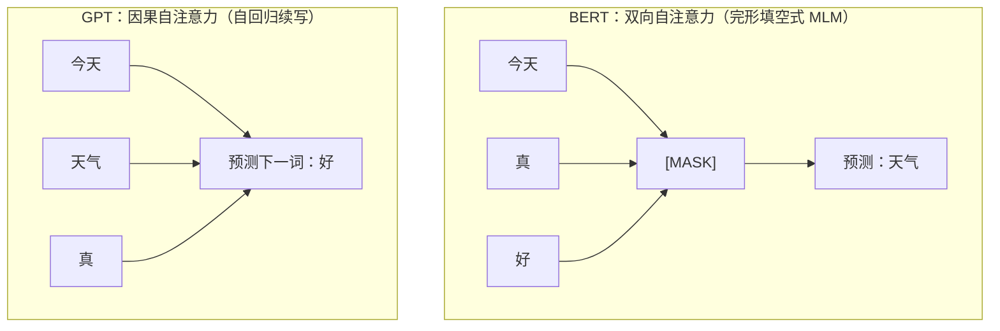
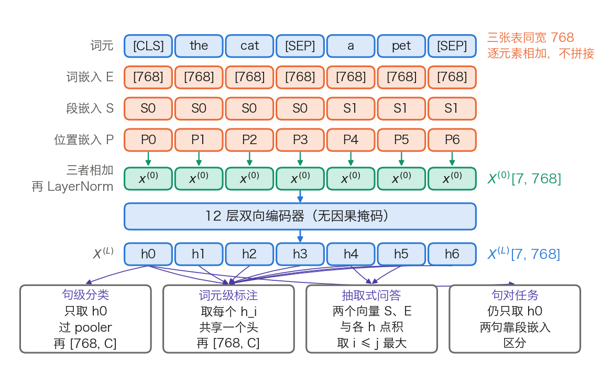

## 12.1 BERT：双向理解的突破

BERT（Bidirectional Encoder Representations from Transformers）出自 Google 2018 年的[论文](https://arxiv.org/abs/1810.04805)，是去掉因果掩码的 Transformer 编码器加掩码预训练（目标与损失见 [5.2 节](../05_pretraining/5.2_masked_lm.md)）。它用监督密度换上下文：每条序列只有约 15% 的位置有损失，换来每个位置都能读到左右两侧。它确立的范式是一次预训练、接一个极小的任务头、全部参数一起微调，这套做法此后数年是理解类任务的标准流程。双向结构带来两条硬边界：被遮位置各自独立预测，所以不能一步生成；追加一个词元会改变所有位置的 Key 与 Value，所以没有 KV 缓存。它的躯干与同规模的 GPT 逐层相同，差别只在掩码、位置方案和词表。今天新做理解任务已不从 2018 年的权重起步，但范式和输入形式都延续在现役的编码器与重排序器里（见 [12.3 节](12.3_longformer_bigbird.md)）。

### 12.1.1 双向与因果：可见范围的差别

BERT 的自注意力不加因果掩码，每个位置都可以读全序列；GPT 的每个位置只能读自己和左边（见 [2.4 节](../02_attention/2.4_self_cross_causal.md)）。图 12-1 用同一句话对比两者的可见范围。

图 12-1：同一句话下，BERT 的被遮位置可同时利用左右上下文，GPT 预测下一词只能利用左侧上下文。

这条差别落到矩阵上只有一处：3.8.3 第 4 步的因果掩码 M 被去掉，`[T, T]` 的分数矩阵从下三角变成满阵。代价是失去因果结构，也就失去了可复用的 KV 缓存（见 12.1.7）。

### 12.1.2 输入怎样构造：三张嵌入表与两个特殊词元

模型的输入是一条词元序列加三张查表结果。单句写成 `[CLS] A [SEP]`，句对写成 `[CLS] A [SEP] B [SEP]`。`[CLS]` 固定排在第一位，它那一行的最终隐状态是句级任务的取向量处；`[SEP]` 是分隔符。分词用 WordPiece，词表 30,522 项。

每个位置查三张表再相加，不是拼接：

- **词嵌入**（token embedding）：按词元 ID 取一行，形状 `[30522, 768]`。
- **段嵌入**（segment embedding）：只有两行，标记该位置属于句 A 还是句 B，形状 `[2, 768]`。
- **位置嵌入**（position embedding）：可学习的绝对位置表，形状 `[512, 768]`，与 3.3 节的正弦方案和第四章的 RoPE 是三条不同路线。

三者逐元素相加，再过一次 LayerNorm，得到进入第 1 层的 `X⁽⁰⁾[T, 768]`。图 12-2 上半幅把这条链画在一条 7 个词元的句对上，下半幅是 12.1.5 要讲的四类任务头。

图 12-2：BERT 的输入怎样构造，以及四类任务头各自从哪些位置取向量（[生成脚本](https://github.com/yeasy/llm_internals/blob/main/tools/figures/ch12_bert_io.py)）。橙色是训练好就固定的权重表，蓝色是随输入变化的数据，青绿是本步新算出的表示；配色沿用 3.8 节。

相加之后，每个位置的输入向量同时带着“是哪个词、排在第几位、属于哪一段”三项信息，第 1 层起的注意力据此就能区分两句并在句间相互读取，不需要另加结构。段嵌入只有两行，所以 BERT 只能区分两段；三段以上的输入要么截断，要么改用别的分隔约定。

### 12.1.3 模型规格与参数量：逐项算到 110M

论文给出两档规格，见表 12-1。前馈宽度按论文规定取 `4H`。

| 项目 | BERT-Base | BERT-Large |
| --- | ---: | ---: |
| 层数 L | 12 | 24 |
| 隐藏宽度 H | 768 | 1,024 |
| 注意力头数 A | 12 | 16 |
| 每头宽度 H/A | 64 | 64 |
| 前馈中间层宽度 | 3,072 | 4,096 |
| 词表 | 30,522 | 30,522 |
| 位置表行数 | 512 | 512 |
| 段嵌入行数 | 2 | 2 |
| 论文标称参数量 | 110M | 340M |

表 12-1：BERT 两档规格，取自 [BERT 论文](https://arxiv.org/abs/1810.04805)与发布权重的配置。

参数量由三块相加。一层有 4 个 `[H, H]` 的注意力矩阵和 2 个 `[H, 4H]` 的前馈矩阵，合 `12H²`，`H = 768` 时约 708 万，其中前馈占三分之二。嵌入侧是词表、位置表与段嵌入三张表。pooler 是 `[CLS]` 之后的一层 `[768, 768]` 变换。

| 组成 | 形状来源 | 参数量 | 占比 |
| --- | --- | ---: | ---: |
| 嵌入侧（词 + 位置 + 段 + LayerNorm） | `[30522, 768]` 等四项 | 23.8M | 21.8% |
| 编码器 12 层 | 每层约 7.09M | 85.1M | 77.7% |
| pooler | `[768, 768]` + 偏置 | 0.59M | 0.5% |
| 合计 | — | 109.5M | 100% |

表 12-2：BERT-Base 的参数量构成。同法算得 BERT-Large 为 335M，论文的 340M 是约数。逐项对账见[附录 A.3](../appendix/a3_model_reference.md)。

从表 12-2 读出两条规律。

**嵌入表占两成多，推理时却只做查表。** 23.8M 里有 23.4M 是词嵌入。它在预训练时兼作 MLM 头的输出投影（见 12.1.4），微调后的前向里只按词元 ID 取行，不参与矩阵乘法。存储占两成、计算贡献接近零，这是 [12.2.2 节](12.2_roberta_albert.md)里 ALBERT 要把它分解掉的动机。

**躯干与同规模 GPT 相同。** GPT-3 Small 也是 12 层、宽 768，躯干同为 85.1M；加上它自己的词表与位置表（`50257 × 768 + 2048 × 768`，约 40.2M）得 125M，正是 GPT-3 论文的标称值（配置见 [3.8.7 节](../03_components/3.8_gpt_inference_flow.md)）。编码器与解码器的区别不在层的形状，只在掩码、位置方案与词表大小。

### 12.1.4 预训练：MLM 头的形状与 NSP 的失效

预训练目标有两个，损失是两项之和。掩码语言模型的比例、80/10/10 的改写与信号密度已在 [5.2 节](../05_pretraining/5.2_masked_lm.md)算过，这里只补模型侧的形状。

**MLM 头。** 编码器交出 `X⁽ᴸ⁾[T, 768]` 后，先过一层同宽变换（线性层、GELU、LayerNorm），再用与词嵌入表共享的矩阵投回词表，得 `logits[T, 30522]`。新增参数约 62 万，是模型本体的 0.6%。全部 T 个位置都算出 logits，只有被选中的约 15% 参与损失。

**NSP 的构造。** 取两段文本 A 与 B，50% 的样本里 B 是 A 在原文中的下一段，标为 `IsNext`；另外 50% 从语料中随机抽一段，标为 `NotNext`。判别用 `[CLS]` 经 pooler 后接一个 `[768, 2]` 的线性层。

这个任务太容易。论文报告最终模型在 NSP 上达到 97% 到 98% 的准确率：随机抽来的负例多半来自完全不同的主题，靠词面主题就能分辨，模型不需要学会句间连贯性。RoBERTa 的消融给出了后果：去掉 NSP 损失、改用同一文档内连续采样的 FULL-SENTENCES 之后，MNLI-m（自然语言推理，匹配域上的准确率）从 84.0 升到 84.7，SQuAD 2.0（抽取式问答，F1）从 78.7 升到 79.1，持平或略升。[12.2.2 节](12.2_roberta_albert.md)里 ALBERT 的 SOP 是另一种回应：保留句间任务，把它变难。

**训练量。** 论文的配置是批 256 条序列、训练 100 万步。按每条 512 个词元计，是约 `1.31 × 10¹¹` 个词元位置，相当于在 33 亿词的语料上过约 40 遍。实际排布更省：论文把长序列的开销归因于注意力的二次项，前 90% 的步数只用 128 的长度，末 10% 才用 512，训练词元量因此只有 `4.26 × 10¹⁰`（算式见 [5.2.5 节](../05_pretraining/5.2_masked_lm.md)）。12.2.1 对比 RoBERTa 时两个数都要用到。

### 12.1.5 微调：四类任务头各从哪里取向量

微调只做两件事：在 `X⁽ᴸ⁾` 之上接一个很小的输出层，然后让全部参数一起更新。四类任务的差别只在从哪一行取向量，见图 12-2 的下半幅。

- **句级分类**（情感、自然语言推理）：取位置 0 的 `h₀`，过 pooler 的 `Dense(768→768) + tanh`，再接 `[768, C]`。C 是类别数，新增参数只有 `768C + C`。
- **词元级标注**（命名实体识别、词性标注）：取每个位置的 `hᵢ`，共用一个 `[768, C]` 的头，不经 pooler。
- **抽取式问答**：新增两个向量 `S, E ∈ R⁷⁶⁸`。答案起点的分布是 `softmax_i(S · hᵢ)`，终点同理用 `E`；预测答案取使 `S · hᵢ + E · hⱼ` 最大且满足 `i ≤ j` 的一对。新增参数只有 `2 × 768 = 1,536`。
- **句对任务**：输入拼成 `[CLS] A [SEP] B [SEP]`，靠段嵌入区分两句，仍从 `h₀` 取向量。两句在第 1 层就开始相互读取，这一点在 [12.3.6 节](12.3_longformer_bigbird.md)是“交叉编码器”的定义。

任务头小到可以忽略：四类里最大的一个也不到 100 万参数，占 110M 的不足 1%。更新的主体是那 109M 个预训练参数。这套做法在发布时刷新了 11 项任务的成绩：GLUE 中除 WNLI 外的 8 个子任务，加上 SQuAD v1.1、SQuAD v2.0 与 SWAG。

**微调怎样设置。** 论文给出的搜索范围至今仍是这类模型的起点：批大小 16 或 32，学习率 2e-5 到 5e-5，训练 2 到 4 轮。轮数很少，因为要更新的是已经训练好的全部权重。论文同时报告两条经验：标注超过 10 万条的数据集对超参不敏感；小数据集上 BERT-Large 的微调有时不稳定，要换随机种子多跑几次再按验证集挑选。今天沿用的是这套流程，起点权重则换成了后继模型：DeBERTaV3 把同类结构的 GLUE 成绩推到新高，ModernBERT-base 在 GLUE 上又超过了 DeBERTaV3-base（见 [12.2.4 节](12.2_roberta_albert.md)与 [12.3.5 节](12.3_longformer_bigbird.md)）。

### 12.1.6 为什么是深层双向

BERT 用监督密度换上下文。表 12-3 把当时的四条路线按上下文、监督密度、能否生成三项并排。ELMo 用两个方向相反的单向 LSTM 各自算到顶层再拼接（即 [5.2.1 节](../05_pretraining/5.2_masked_lm.md)的浅层拼接），任何一层里左侧信息与右侧信息都没有相互作用，称为浅层双向；BERT 的每一层注意力都同时读两侧，称为深层双向。XLNet 随机打乱一条序列的预测顺序（即因式分解顺序），再按打乱后的顺序做自回归，每个位置看到的上下文因此可能同时来自左右两侧。

| 路线 | 每个位置看到的上下文 | 每条序列的监督位置 | 能否增量生成 | 主要代价 |
| --- | --- | --- | --- | --- |
| ELMo（两个单向 LSTM 拼接） | 两个方向各自完整，但从不在同一层交互 | 全部位置 | 能（按单向模型用） | 浅层双向，表达力弱于深层双向 |
| GPT-1（单向 Transformer） | 只有左侧 | 全部位置，512 长度下 511 个 | 能，KV 缓存成立 | 理解任务上拿不到右侧上下文 |
| BERT（深层双向编码器） | 左右同时，逐层交互 | 只有被遮的约 15%，512 长度下约 77 个 | 不能 | 监督密度低，且预训练见 `[MASK]`、微调不见 |
| XLNet（置换语言模型） | 按采样出的顺序看到部分上下文 | 只预测顺序靠后的约 `1/K`，论文取 `K = 6`，512 长度下约 85 个 | 能 | 监督密度与 BERT 同量级，另需双流注意力 |

表 12-3：四条预训练路线的对照。监督位置数的算法见 [5.2.5 节](../05_pretraining/5.2_masked_lm.md)；XLNet 的做法见 [XLNet 论文](https://arxiv.org/abs/1906.08237)，它换来的是去掉被遮位置之间的条件独立假设，监督密度并不更高。

这笔交换在理解任务上是划算的。每次前向 BERT 只在约 77 个位置上拿到梯度，自回归同长度能拿到 511 个，所以按预训练步数看 MLM 收敛略慢；但论文的消融显示，微调后的 MNLI 准确率几乎从一开始就高于从左到右的模型。同一数据、同一微调流程下，把 MLM 换成从左到右的目标，MNLI-m 从 83.9 降到 82.1，SQuAD v1.1 的 F1 从 87.9 降到 77.8。这里评的都是理解任务，问答的答案片段要靠两侧上下文定位，双向表示在这类任务上占优；评的若是生成，这笔交换就不成立，原因见下一小节。

### 12.1.7 边界与常见误解

**不能一步生成，根因是被遮位置之间条件独立。** MLM 在被遮的各个位置上各自预测。对 `New [MASK] [MASK]`，两个位置各自最大化自己的边缘概率，模型没有建模它们的联合分布，因此可能一个位置填 `York`、另一个填 `Jersey`。分多步迭代去掩码可以生成，[9.6 节](../09_decoding/9.6_diffusion_lm.md)的掩码扩散模型走的就是这条路；BERT 只在约 15% 这一种损坏程度上训练过，从接近全遮的起点出发做不好，而且每填一步都要把整段重算一次。

**没有可复用的 KV 缓存。** 双向注意力下，序列末尾追加一个词元会改变所有位置的 Key 与 Value，缓存里的旧行全部失效。解码器能复用缓存，靠的是每个位置从不读右边（见 [3.8.6 节](../03_components/3.8_gpt_inference_flow.md)）。12.3.7 节里编码器的推理特性由此而来。

**512 是硬上限。** 位置嵌入表只有 512 行，第 513 个位置查不到向量，前向会直接越界，不是效果变差。要支持更长的输入，必须先把这张表加长或换掉位置方案（见 [12.3 节](12.3_longformer_bigbird.md)）。

**未经微调的 `[CLS]` 不是句向量。** 这是最常见的误用。Sentence-BERT 的实测是：七个语义相似度数据集上，直接取原始 BERT 的 `[CLS]` 向量做余弦相似度，平均相关系数只有 29.19；对所有位置取平均是 54.81；而平均 GloVe 词向量能到 61.32。原因有两层。其一，`[CLS]` 只被 NSP 这个二分类任务训练过，MLM 从未要求任何一个位置去概括整句。其二，[一项对预训练句向量的分析](https://arxiv.org/abs/2011.05864)发现，未经微调的 BERT 句向量空间是各向异性的（向量挤在一个狭窄的锥形区域里），点积或余弦相似度难以反映语义相似度。针对性微调之后的情形见 [12.3.6 节](12.3_longformer_bigbird.md)。

**预训练与微调的输入分布不一致。** `[MASK]` 只在预训练出现，80/10/10 只是缓解，没有消除。这笔账不大：ELECTRA 的消融把 `[MASK]` 换成生成器采样的真词后，GLUE 只从 82.2 升到 82.4（见 [12.2.3 节](12.2_roberta_albert.md)的表 12-6）。

**留下了什么。** 延续到今天的有三项：预训练加全参微调的流程，句对拼接后从第 1 层起交互的输入形式（今天的重排序器仍是这个形状），子词分词加输入输出嵌入共享。被换掉的是具体部件与配方：NSP 与 15% 的遮盖率在 12.2 节被修正，Post-LN（见 [3.6 节](../03_components/3.6_layer_norm.md)）、GELU 前馈（见 [3.4 节](../03_components/3.4_feedforward.md)）与可学习的绝对位置表在 [12.3.5 节](12.3_longformer_bigbird.md)被 ModernBERT 逐条替换。模块与配置键的对照见[附录 A.7](../appendix/a7_framework_recipes.md)。
