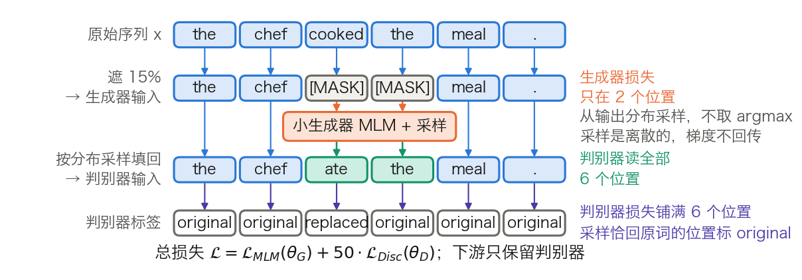

## 12.2 RoBERTa、ALBERT 与 ELECTRA：BERT 的改进之路

BERT 之后的改进落在三条互不相干的轴上：RoBERTa 改训练配方，ALBERT 改参数的存放方式，ELECTRA 改预训练目标。RoBERTa 一个模块没改，证明 BERT 是欠训练的：计算预算多出十几到几十倍，再去掉太容易的 NSP，成绩就上去了。ALBERT 说明参数量与计算量是两回事：嵌入分解与跨层共享省的是存储，前向的矩阵乘法一次不少。ELECTRA 说明监督密度是真瓶颈：把损失从约 15% 的位置铺到全部位置，是它收益的主要来源。留到今天的是 RoBERTa 的配方和 ELECTRA 的目标，跨层共享没有延续。12.1 留下的另一项限制，512 的长度上限，放在 [12.3 节](12.3_longformer_bigbird.md)。

### 12.2.1 RoBERTa：把同一个架构训练充分

[RoBERTa](https://arxiv.org/abs/1907.11692)（Liu 等人，2019 年）只改训练配方。表 12-4 把两者并排。

| 项目 | BERT | RoBERTa | 改动带来什么 |
| --- | --- | --- | --- |
| 批大小 | 256 条序列 | 8,192 条序列 | 梯度估计更稳，可用更大的学习率 |
| 训练步数 | 1,000,000 | 500,000 | 见下文的词元总量 |
| 预训练数据 | 16 GB | 160 GB | 数据不再是重复过 40 遍的同一批 |
| 遮盖 | 静态，预处理时定好 | 动态，每次送进模型时现场生成 | 同一条序列不再反复做同一道填空 |
| 句间任务 | NSP，输入是两个片段 | 无 NSP，输入是连续采样的 FULL-SENTENCES | 去掉一个太容易的任务 |
| 分词 | WordPiece，词表 30K | 字节级 BPE，词表 50K | 不再产生未登录词，代价是参数变多 |

表 12-4：BERT 到 RoBERTa 的配方对照，取自 [RoBERTa 论文](https://arxiv.org/abs/1907.11692)的最终配置（160 GB 数据、批 8K、50 万步）。

**训练词元总量。** 配方的差别可以收成一个数：批大小 × 序列长 × 步数。两边都按每条 512 个词元计，BERT 是 `256 × 512 × 10⁶ = 1.31 × 10¹¹`，RoBERTa 是 `8192 × 512 × 5 × 10⁵ = 2.10 × 10¹²`，相差 16 倍。BERT 实际有九成步数用的是 128 的短序列，训练词元量只有 `4.26 × 10¹⁰`（见 [12.1.4 节](12.1_bert.md)），RoBERTa 则全程满长度；按两边各自的真实排布，差距接近 49 倍。“训练更充分”指的是几十倍的计算预算。

**动态遮盖与词表。** 原版 BERT 在预处理阶段把数据复制 10 份、各遮一种，40 遍训练中每种遮盖被看到 4 次；RoBERTa 改为每次送进模型时现场采样。这项改动本身的收益很小，论文的结论是相当或略好，采用它是因为数据更大、步数更多时静态副本的重复率无法接受。词表从 3 万换成 5 万的字节级 BPE 后，base 多出约 15M 参数、large 多出约 20M，全在嵌入表里，前向的矩阵乘法没有变多。

**方法论上的教训。** 论文的结论是 BERT 明显欠训练：只把同一个架构训够，成绩就追平或超过了此后发表的各个改进模型，那些改进报告的收益究竟来自哪里因此要重新审视。这条教训对评价任何架构或目标的改动都适用：先确认基线训够了，再确认两边的计算预算对齐。

### 12.2.2 ALBERT：省参数不等于省计算

[ALBERT](https://arxiv.org/abs/1909.11942)（Lan 等人，2019 年）针对的是另一笔账：同样的下游成绩，能不能少存一些参数。论文提了三项改动，前两项减参数，第三项换句间任务。

**嵌入分解。** 词嵌入是上下文无关的查表结果，隐状态是上下文相关的表示，两者没有理由等宽。ALBERT 把 `[V, H]` 的一张表拆成 `[V, E]` 与 `[E, H]` 两个矩阵，`E ≪ H`。取论文的 `V = 30000, E = 128`：

$$
H = 768:\quad 30000 \times 768 = 23{,}040{,}000 \;\longrightarrow\; 30000 \times 128 + 128 \times 768 = 3{,}938{,}304
$$

缩到 1/5.85。宽度越大收益越大，`H = 4096` 时缩到 1/28.2。分解等于把这张表的秩限制在 E 以内，E 取多大要靠实验：论文扫描后固定用 128。

**跨层参数共享。** 12 层用同一套权重，只存 1 层的约 709 万参数。两项改动合起来，ALBERT-base 是嵌入侧约 4.0M、一层 7.09M、pooler 0.59M，合计约 11.7M，即论文表中的 12M，约为 BERT-base 的 1/9。逐项对账见[附录 A.3](../appendix/a3_model_reference.md)。

**省存储不省计算。** 前向仍要依次走 12 次同一层，矩阵乘法一次不少，省下的只有存储与通信。表 12-5 的训练吞吐一列说明了这一点（以 BERT-large 为 1.0）。

| 模型 | 参数量 | 层数 | 隐藏宽度 | 嵌入宽度 E | 训练吞吐（相对 BERT-large） | GLUE 等五项均值 |
| --- | ---: | ---: | ---: | ---: | ---: | ---: |
| BERT-base | 108M | 12 | 768 | 768 | 4.7× | 82.3 |
| BERT-large | 334M | 24 | 1,024 | 1,024 | 1.0× | 85.2 |
| ALBERT-base | 12M | 12 | 768 | 128 | 5.6× | 80.1 |
| ALBERT-large | 18M | 24 | 1,024 | 128 | 1.7× | 82.4 |
| ALBERT-xlarge | 60M | 24 | 2,048 | 128 | 0.6× | 85.5 |
| ALBERT-xxlarge | 235M | 12 | 4,096 | 128 | 0.3× | 88.7 |

表 12-5：ALBERT 与 BERT 的参数量、训练吞吐与下游均值，取自 [ALBERT 论文](https://arxiv.org/abs/1909.11942)。均值一列是 SQuAD v1.1、SQuAD v2.0、MNLI、SST-2、RACE 的平均。

最后一行是关键：ALBERT-xxlarge 的参数量（235M）少于 BERT-large（334M），下游均值高出 3.5 分，训练吞吐却只有它的 0.3 倍。它把省下来的参数换成了 4,096 的隐藏宽度，每层的矩阵乘法因此大了 16 倍。“大幅减小模型体积”只在显存与分发的意义上成立，推理时间反而更长。

**共享的代价。** 论文的消融是：全共享相对不共享，`E = 128` 时下游均值降 1.5 分，`E = 768` 时降 2.5 分；降幅主要来自共享前馈层，只共享注意力参数在 `E = 128` 下几乎没有损失。共享在给定参数预算下划算，在给定层数下有损。

**SOP。** 第三项改动是把 NSP 换成句序预测（Sentence Order Prediction）：正例是原顺序的相邻两段，负例是同样两段交换顺序。两个候选来自同一篇文档，主题完全相同，模型只能去学连贯性。论文的观察是按 NSP 训练的模型在 SOP 上只有随机基线水平，反过来 SOP 能在相当程度上解出 NSP，这是对 12.1.4 中 NSP 失效原因的直接回应。

### 12.2.3 ELECTRA：把损失铺满每个位置

[ELECTRA](https://arxiv.org/abs/2003.10555)（Clark 等人，2020 年）动的是目标函数：模型不再填空，而是判断每个位置的词是不是被换过，称为替换词检测。图 12-3 是完整的数据流。

图 12-3：ELECTRA 的生成器、采样与判别器数据流（[生成脚本](https://github.com/yeasy/llm_internals/blob/main/tools/figures/ch12_electra_flow.py)）。橙色是生成器一侧，蓝色是判别器读到的序列，青绿是被生成器改写过的位置；两处损失覆盖的位置数不同，这是全节的要点。

流程分三步：

1. 随机选约 15% 的位置换成 `[MASK]`，一个**小生成器**在这些位置上做普通的 MLM，输出词表分布。
2. 从分布里**采样**填回原位，不取 argmax，使替换词似是而非。采样结果与原词相同的位置标 `original`，不同的标 `replaced`；图 12-3 里 `cooked` 被采样成 `ate`，标 `replaced`，`the` 被遮后又采样回 `the`，标 `original`。
3. **判别器**读这条被改写过的序列，对全部 n 个位置做二分类。总损失是 `L = L_MLM(θ_G) + λ · L_Disc(θ_D)`，论文取 `λ = 50`，因为二分类的损失天然远小于 3 万类的 MLM，不放大就被淹没。

二分类学到的表示同样可用于下游：要判断一个词是不是被换过，就得判断它与上下文是否相容，这与填空需要的是同一种对上下文的理解，而且每个位置都要判断一次。

有两处容易误解。其一，生成器按最大似然训练，不是对抗训练：采样是离散操作，判别器的梯度回传不到生成器。其二，下游只保留判别器，生成器训练完就丢掉。

**生成器为什么要小。** 论文扫过两者的宽度比，生成器取判别器的 1/4 到 1/2 时最好；发布的 base 配置取 1/3。生成器太强，替换词就难以分辨，判别器不得不把参数花在建模生成器的分布上，而不是建模真实数据。

**“效率提升约 4 倍”是什么意思。** 这是论文摘要的说法：ELECTRA 用不到 RoBERTa 与 XLNet 1/4 的计算量达到相当性能，同等计算量下则超过它们。它不是由 `1 / 0.15 ≈ 6.7` 推出来的。论文的消融把收益拆开了：

| 预训练目标 | 损失覆盖的位置 | 输入里有没有 `[MASK]` | GLUE 分数 |
| --- | --- | --- | ---: |
| BERT | 15% | 有 | 82.2 |
| ELECTRA 15% | 15% | 无 | 82.4 |
| Replace MLM | 15% | 无 | 82.4 |
| All-Tokens MLM | 100% | 无 | 84.3 |
| ELECTRA | 100% | 无 | 85.0 |

表 12-6：ELECTRA 的目标函数消融，取自 [ELECTRA 论文](https://arxiv.org/abs/2003.10555)。ELECTRA 15% 是把判别器损失限制在被遮的位置上；Replace MLM 是把 `[MASK]` 换成生成器采样但仍做 MLM；All-Tokens MLM 是在全部位置上做 MLM。

消除 `[MASK]` 失配只值 0.2 分（82.2 到 82.4），把损失从 15% 铺到 100% 值 1.9 分（82.4 到 84.3），判别式目标本身再值 0.7 分（84.3 到 85.0）。大部分收益来自从所有词元学习。收益不按位置数的 6.7 倍折算，可以这样理解：新增的那 85% 位置上输入里放的就是原词，多数很容易判对，单个位置的监督价值低于被改动的位置。这与每个位置预测几类无关：All-Tokens MLM 在全部位置上做 3 万类预测，成绩反而低于二分类的 ELECTRA。

**边界。** 判别器没有词表输出头，不能直接做填空或生成。生成器与判别器共享词嵌入，两者的训练进度要一起调度，生成器太弱或太强都会让判别任务退化。

### 12.2.4 DeBERTa：把内容与位置拆开算

[DeBERTa](https://arxiv.org/abs/2006.03654)（He 等人，2020 年）改的是注意力怎样读位置，与前三条轴正交。BERT 把词嵌入与位置嵌入相加成一个向量，位置信息从第 1 层起就和内容混在一起。DeBERTa 给每个词保留两个向量，一个编码内容、一个编码相对位置，分数由内容-内容、内容-位置、位置-内容三项相加得到，展开与略去位置-位置项的理由见 [4.4 节](../04_position_encoding/4.4_alibi_others.md)的 4.4.2。第二项改动叫增强掩码解码器：绝对位置不在输入层注入，而是放到预测被遮词元的那一层。这里的“解码器”指 MLM 输出 softmax 之前的那一段，不是生成用的解码器。动机是只靠相对位置会丢信息。论文的例子是“a new store opened beside the new mall”，遮住 `store` 与 `mall` 后，两处的局部上下文相近（都跟在 `new` 之后），句法角色却不同，要区分谁是主语得知道绝对位置。

这条线的重要性在它的后继。[DeBERTaV3](https://arxiv.org/abs/2111.09543) 把预训练目标从 MLM 换成 ELECTRA 的替换词检测，并改掉了 ELECTRA 的嵌入共享方式：生成器与判别器的损失把同一张词嵌入表往不同方向拉，V3 让判别器的梯度不回传到共享的嵌入。Large 档在 GLUE 上平均 91.37，比 DeBERTa 高 1.37、比 ELECTRA 高 1.91。2024 年底的 ModernBERT-base 在 GLUE 上以 88.4 对 88.1 超过了 DeBERTaV3-base；large 档的 ModernBERT 仍低约 1 分，90.4 对 91.4（见 [12.3.5 节](12.3_longformer_bigbird.md)）。

### 12.2.5 三条轴的横向对照

| 模型 | 改了什么 | 没改什么 | 参数量（base） | 预训练目标 | 计损失的位置 | 主要代价 |
| --- | --- | --- | ---: | --- | --- | --- |
| BERT | — | — | 110M | MLM + NSP | 约 15% | 监督密度低，NSP 太易 |
| RoBERTa | 批、步数、数据、遮盖、词表 | 架构与目标（除去 NSP） | 125M | MLM | 约 15% | 计算预算高出 16 倍（按真实排布接近 49 倍） |
| ALBERT | 嵌入分解、跨层共享、SOP | 层结构与 MLM | 12M | MLM + SOP | 约 15% | 省存储不省计算，同层数下精度有损 |
| ELECTRA | 预训练目标 | 架构 | 110M | 替换词检测 | 100% | 要同时训练两个模型，判别器不能填空 |

表 12-7：三条改进的横向对照。参数量是近似值；ALBERT 的 12M 见表 12-5。

三条轴可以叠加，但收益不相加，各自的去向也不同。

- **配方留下了。** 大批、长训练、动态遮盖、去掉 NSP、字节级 BPE，成为此后编码器预训练的默认起点。
- **目标一轴继续演进。** 替换词检测被 DeBERTaV3 继承。仍用 MLM 的模型则提高了遮盖率：[一项遮盖率研究](https://arxiv.org/abs/2202.08005)发现 15% 并非普遍最优，BERT-large 规模上遮 40% 在 GLUE 与 SQuAD 上好于 15%；12.3.5 的 ModernBERT 取 30%。
- **跨层共享没有延续。** 推理受算力约束而不受参数量约束，共享一次矩阵乘法也没有减少；同样的层数与宽度下，不共享的模型成绩更好。它解决的存储问题，在部署侧由另一条路线承担：把大编码器蒸馏成层数更少的小模型，计算量随层数同比下降。[DistilBERT](https://arxiv.org/abs/1910.01108) 把 BERT 缩小 40%、提速 60%，保留 97% 的理解能力（蒸馏的原理见 [10.5 节](../10_inference_optimization/10.5_pruning_distillation.md)）。
