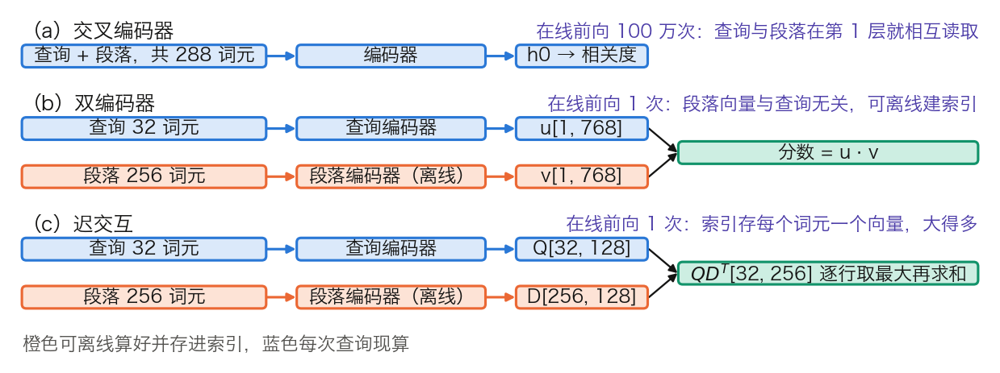

## 12.3 长文本编码器：Longformer 与 BigBird

编码器今天的主要用途是向量检索、重排序与分类：这类负载每次只要一个向量或一个分数，一两亿参数的模型一次前向就够，生成能力用不上。检索的三种结构按交互发生的位置分工：双编码器可以离线建索引，负责全库召回；交叉编码器从第 1 层起交互，只能重排几十到几百条候选；迟交互介于两者之间。把编码器训成检索器靠对比学习，训练信号主要来自难负例。输入长度是 12.2 的三条改进都没有碰过的限制：稀疏注意力（Longformer、BigBird）在 4K 长度上只买到六到八倍的常数因子，代价是专用内核和同等深度下更弱的表达力；FlashAttention 拿掉显存这个动机之后，主流改成多数层局部、少数层全局的层间交替。

### 12.3.1 512 的两个来源

BERT 的 512 有两个不同性质的来源。

硬上限来自位置嵌入表：表只有 512 行，第 513 个位置查不到向量。这是越界错误，不是效果变差。

512 这个取值要从训练显存与预算上理解。BERT 论文把长序列的开销归因于注意力的二次项，但这一项在计算量上来得很晚：编码器一层的注意力项与权重项之比是 `T / (6d)`（见 [1.4.5 节](../01_introduction/1.4_transformer_idea.md)），BERT-Base 的 `d = 768`，`T = 512` 时比值是 0.11，一次前向约 96.6 GFLOPs，注意力只占 10%；`T = 4096` 时比值升到 0.89，注意力占 47%，两项要到 `T = 6d = 4608` 才持平。二次项先在训练显存上显现：反向传播要为每层保留 `[A, T, T]` 的注意力矩阵，它与前馈中间激活 `[T, 4H]` 的大小之比是 `T · A / 4H`，BERT-Base 在 `T = 256` 时已经打平，512 时是 2 倍，4,096 时是 16 倍。稀疏注意力要省的首先是这块显存。

### 12.3.2 Longformer：窗口加十字

[Longformer](https://arxiv.org/abs/2004.05150)（Beltagy 等人，2020 年）把满阵的注意力换成两种模式的叠加，见图 12-4 的第二、三幅。

图 12-4：四种注意力模式在同一张 `[n, n]` 矩阵上的形状（[生成脚本](https://github.com/yeasy/llm_internals/blob/main/tools/figures/ch12_sparse_patterns.py)）。蓝色格表示这一对要算分数。为了画得出来取 n = 36，窗口与块按比例放大，第四幅的全局块与随机块各只画 1 块；真实配置稀疏得多，见表 12-8。

**滑动窗口**让每个位置只看自己两侧各 `w/2` 个位置，Longformer-base 取 `w = 512`。**全局注意力**让少数位置看所有人、同时被所有人看，在矩阵上是一个对称的十字；全局位置按任务选，分类任务给 `[CLS]`，问答任务给全部问题词元。表 12-8 是 `n = 4096` 时一个头一层要算的分数个数。

| 模式 | 每头的分数个数 | 相对全注意力 | 12 头 fp16 的单层分数矩阵 |
| --- | ---: | ---: | ---: |
| 全注意力 | `4096² = 16,777,216` | 1 | 384.0 MiB |
| 滑动窗口 `w = 512` | `4096 × 513 = 2,101,248` | 1/7.98 | 48.1 MiB |
| BigBird 块稀疏（含全局查询块） | `2,547,712` | 1/6.59 | 58.3 MiB |

表 12-8：`n = 4096` 时三种模式要算多少个注意力分数。显存一列只数分数本身（`分数个数 × 12 头 × 2 字节`），不代表内核执行时的峰值显存；BigBird 一行的算式见[附录 A.3](../appendix/a3_model_reference.md)。

窗口买到的是约 8 倍的常数，代价是远距离信息传得慢：每层最多向一侧传播 256 个位置，序列两端相距 4,095，最少需要 `ceil(4095 / 256) = 16` 跳，12 层不够。全局词元补上一条两跳捷径：信息先汇入全局位置，下一层再传给其他位置。权重不必从头训：从 RoBERTa 出发，把位置表复制 8 次扩到 4,096 行，再做少量 MLM 续训。

### 12.3.3 BigBird：块稀疏与随机图

[BigBird](https://arxiv.org/abs/2007.14062)（Zaheer 等人，2020 年）在窗口与全局之外加了随机连接，三者叠起来是图 12-4 的第四幅：窗口负责局部性，随机边把十几跳才能连通的两个位置缩到几跳，全局位置充当枢纽。逐个位置随机查表是 GPU 上最坏的访存模式，所以它按 64 个词元一块对齐，同一块里的查询读同一批键块，稀疏注意力变成一串稠密的小矩阵乘法；发布配置下内部的块每个词元读 512 个键，加上首尾两个全局块，每头的分数是满阵的 1/6.59（表 12-8）。序列短到放不下这些块时，实现自动退回全注意力。

表达力上有一条明确的限制。论文证明了 BigBird 是通用逼近器并且图灵完备，但同一篇论文给出反例：存在全注意力 `O(1)` 层可解的任务，任何每层只有 `Õ(n)` 条边的稀疏注意力都需要 `Ω̃(n)` 层（`Õ`、`Ω̃` 表示忽略对数因子）。表达力等价只在不限层数时成立，同等深度下稀疏注意力严格弱于全注意力。

### 12.3.4 稀疏注意力的代价，以及这条路线的去向

稀疏模式省的是理论计算量，墙钟时间不会自动跟着省。这条路线让位于后来的做法，原因有三条。

**要自己写内核。** 用掩码把不需要的格子置 `-∞`，算得一点不少，收益要由专门的分块实现兑现。

**FlashAttention 改变了对照组。** FlashAttention 分块计算注意力，不把 `[n, n]` 的分数矩阵落回显存，显存占用从平方降到线性，计算量仍是平方（见 [10.3 节](../10_inference_optimization/10.3_flash_attention.md)）。它省掉的正是表 12-8 里那 384 MiB，也就是 12.3.1 所说先到来的那个二次项。在 8K 以内，全注意力配 FlashAttention 往往比稀疏注意力更快也更简单。

**主流改成了层间交替。** 与其让每一层都稀疏，不如让多数层局部、少数层全局，叠加后既有局部分辨率又有全局通路，全局层仍是精确的全注意力。12.3.5 的 ModernBERT 这样做，解码器一侧的滑动窗口混合层是同一思路（见 [14.1 节](../14_future_trends/14.1_efficient_attention.md)）。

留下来的有两样：局部窗口加少量全局通路这个想法，以及从已有权重扩位置表续训的做法。两个模型的配置键与回退门槛见[附录 A.7](../appendix/a7_framework_recipes.md)。

### 12.3.5 ModernBERT：把解码器时代的部件搬回编码器

[ModernBERT](https://arxiv.org/abs/2412.13663)（Warner 等人，2024 年）把 BERT 的旧部件逐条换掉，换上的多数是解码器一侧已经验证过的做法。表 12-9 的第三列可以当作今天新建一个编码器的参考配方。

| 部件 | BERT-Base | ModernBERT-base |
| --- | --- | --- |
| 位置编码 | 可学习绝对位置表，512 行 | RoPE，全局层 θ = 160,000、局部层 θ = 10,000 |
| 归一化位置 | Post-LN | Pre-LN，并在嵌入层后补一个 LayerNorm |
| 前馈 | GELU，中间层 3,072 | GeGLU，中间层 1,152、GLU 上投影 2,304 |
| 偏置项 | 各线性层都有 | 除最后的解码线性层外全部关闭 |
| 注意力 | 每层都是全注意力 | 每 3 层一层全局，其余为 128 词元的局部滑动窗口 |
| 层数与宽度 | 12 层 / 768 | 22 层 / 768 |
| 词表 | 30,522 | 50,368 |
| 序列长度 | 512 | 8,192 |
| 句间任务 | NSP | 无 |
| 遮盖率 | 15% | 30% |
| 训练词元量 | 约 `1.31 × 10¹¹`（按全程 512 计） | `2 × 10¹²` |
| 参数量 | 110M | 149M |

表 12-9：ModernBERT-base 相对 BERT-Base 的逐项替换，取自 [ModernBERT 论文](https://arxiv.org/abs/2412.13663)与发布配置；large 档为 28 层、395M。配置键与 149M 的逐项对账见[附录 A.7](../appendix/a7_framework_recipes.md)与[附录 A.3](../appendix/a3_model_reference.md)。

前五行换的是部件（RoPE 见 [4.3 节](../04_position_encoding/4.3_rope.md)，Pre-LN 见 [3.6 节](../03_components/3.6_layer_norm.md)，门控前馈见 [3.4 节](../03_components/3.4_feedforward.md)），其余换的是规模与训练配方。另有两项不在表里的工程做法。去填充（unpadding）把一个批里的变长序列拼成一条连续序列再算，省掉填充位置的全部计算。全局层与局部层都用 FlashAttention 内核，不把分数矩阵落回显存。

成绩上，论文报告 ModernBERT-base 在 GLUE 上超过了包括 DeBERTaV3-base 在内的同档编码器，并在单向量与多向量检索上领先。速度要分场景看。论文在 RTX 4090 上测得的吞吐（千词元每秒）是：定长短序列 BERT-base 为 180.4、ModernBERT 为 148.1，BERT 更快；变长短序列 BERT 降到 90.2，ModernBERT 只降到 147.3，去填充的收益在这里兑现；长序列 BERT 不支持。准确的说法是：在变长输入和长序列上明显更快，在定长短序列上不一定。

### 12.3.6 句向量与检索：编码器今天的主战场

让编码器至今仍被大量部署的，是检索、重排序与分类这类负载。这一小节交代怎样从 `X⁽ᴸ⁾` 得到可比较的向量，怎样训练，以及三种结构的成本差别。今天的默认做法可以先说：双编码器召回，可与关键词检索混合，再用交叉编码器重排前几十到几百条；训练分两阶段，先用海量弱监督文本对做大批对比预训练，再用挖出的难负例加交叉编码器蒸馏做微调。

**池化。** 要把 `[T, 768]` 压成一个 `[768]`，常用取 `[CLS]` 那一行或对所有非填充位置取平均。未经针对性微调时两者都不好用（见 [12.1.7 节](12.1_bert.md)）。微调之后差别很小：[Sentence-BERT](https://arxiv.org/abs/1908.10084)（Reimers 与 Gurevych，2019 年）在 NLI 上训练、STS 基准上评测，平均池化 80.78、`[CLS]` 79.80、最大池化 79.07；[DPR](https://arxiv.org/abs/2004.04906) 用 `[CLS]` 也取得了当时最好的检索成绩。池化方式远不如“有没有为这个目标训练过”要紧。平均池化必须按掩码来：`u = (Σᵢ mᵢ hᵢ) / Σᵢ mᵢ`，`m` 是注意力掩码。把填充位置一起平均进去，同一句话会因为批内填充长度不同而得到不同的向量，这是这一步最常见的实现错误。池化之后通常再做 L2 归一化，使余弦相似度与内积等价。

**孪生结构与对比学习。** Sentence-BERT 把同一个编码器用两次（权重共享，即孪生网络），各自得到句向量再比较。两座塔也可以不共享，DPR 用两个独立的 BERT-base 分别编码问题与段落。通用的训练目标是 InfoNCE，一种对比学习损失：让每个查询在一批候选里把自己的正例认出来。同一批里其他查询的正例就是当前查询的负例，称为批内负例。落到形状上，一个批是一次矩阵乘法：`Q[B, 768] × Dᵀ[768, B] → S[B, B]`。`S` 的对角线是正例分数，同一行其余 `B − 1` 个当负例，损失对每一行做一次带温度的交叉熵：

$$
\mathcal{L} = -\frac{1}{B}\sum_{i} \log \frac{\exp(S_{ii}/\tau)}{\sum_{j} \exp(S_{ij}/\tau)}
$$

批内负例几乎没有额外开销：`B = 1024` 时这次打分乘法不到编码两侧开销的万分之一。

**训练信号来自难负例。** 把第 i 行损失的分子分母同除以正例那一项，得

$$
\mathcal{L}_i = \log\Big(1 + \sum_{j \neq i} \exp\big((S_{ij} - S_{ii})/\tau\big)\Big)
$$

每个负例的贡献只取决于它的分数比正例低多少。取正例余弦 0.9、随机负例 0.1、`τ = 0.05`，每个随机负例贡献 `exp((0.1 − 0.9) / 0.05) = exp(−16) ≈ 1.1 × 10⁻⁷`。1,023 个随机负例给出的损失是 `log(1 + 1023 × exp(−16)) ≈ 0.0001`，正例概率已经 0.9999，这一批几乎没有训练效果。把其中一个换成余弦 0.8 的**难负例**（hard negative），它单独贡献 `exp(−2) ≈ 0.135`，损失跳到 0.1270，是前者的 1,100 倍。

温度在同一笔账里。同一组分数改用 `τ = 0.2`，1,023 个随机负例的贡献合计约 18.7，难负例的 `exp(−0.5) ≈ 0.61` 只是零头：加不加它，损失只从 2.98 变到 3.01。`τ` 越小越接近只惩罚最难的那个负例，前提是批里真有难的；单独调小温度只会让梯度更集中在噪声上。

得到难负例有两个旋钮，指向同一个目标。一是加大批：上面的算例把随机负例都设成同一个余弦，真实的批里分数有分布，批越大越容易碰到接近正例的负例。[E5](https://arxiv.org/abs/2212.03533) 的对比预训练为此把批设到 32,768；批受显存限制时，[梯度缓存](https://arxiv.org/abs/2101.06983)把对比损失的反向与编码器的反向解耦，使显存占用几乎不随批增长。二是直接挖：从 BM25（按词频与逆文档频率打分的经典关键词检索算法）的高位结果里取，或用上一轮模型自己检出的近邻。[ANCE](https://arxiv.org/abs/2007.00808) 在训练中周期性地用当前模型重建全库索引再挖，代价是每隔若干步把整个语料重编码一遍；DPR 的最佳配置是批内负例外加一条 BM25 负例，再加第二条不再有收益。

**今天的训练流程。** 2020 年之后的改进集中在数据与负例的质量上，结构没有变。

- **两阶段。** 先在亿级的弱监督文本对（标题与正文、问题与回答等）上做大批对比预训练，再在标注数据上用难负例微调。E5 的第一阶段用约 2.7 亿对，第二阶段每条样本配 7 条难负例，并在 MS MARCO 与 NQ 上用交叉编码器的打分做蒸馏；[GTE](https://arxiv.org/abs/2308.03281) 等通用嵌入模型沿用同一框架。
- **过滤假负例。** 挖出来的高分段落有不少其实是漏标的正例：[RocketQA](https://arxiv.org/abs/2010.08191) 人工检查 MS MARCO 上排名靠前而未标为正例的段落，约 70% 实为正例。它的做法是用交叉编码器把疑似正例从难负例里剔掉。
- **区分查询与文档。** 查询短、文档长，两侧分布不同。E5 给两侧分别加 `query:` 与 `passage:` 前缀；[更晚的做法](https://arxiv.org/abs/2401.00368)只在查询侧加任务指令，文档侧不加，索引因此可以预先建好，换任务只改查询。
- **可截断的维度。** [套娃表示学习](https://arxiv.org/abs/2205.13147)（Matryoshka）在训练时同时约束向量的若干个嵌套前缀，使同一个向量截到更低维度仍可用，索引大小与检索延迟可以按需折算。
- **与关键词检索混合。** 稠密检索在训练分布之外不稳：[BEIR](https://arxiv.org/abs/2104.08663) 的零样本评测里 BM25 是稳健的基线，重排序与迟交互的平均成绩最好而代价最高，稠密检索效率高却常常落后。补救办法是把稠密与稀疏两路召回合并；[BGE-M3](https://arxiv.org/abs/2402.03216) 让同一个模型同时输出稠密向量、稀疏权重与多向量三种表示，三路分数可以合并使用。

**三种结构的形状。** 图 12-5 把它们并排，形状按 `N = 1,000,000` 段落、查询 32 词元、段落 256 词元取值。

图 12-5：三种检索结构的形状与在线前向次数（[生成脚本](https://github.com/yeasy/llm_internals/blob/main/tools/figures/ch12_retrieval_shapes.py)）。橙色可以离线算好并存进索引，蓝色每次查询都要现算。

- **交叉编码器**：查询与段落拼成 `[CLS] q [SEP] d [SEP]` 共 288 个词元，一起过编码器得 `[288, 768]`，再由 `h₀[1, 768] × W[768, 1] → 分数`。两侧从第 1 层起就相互读取，段落侧的任何中间结果都依赖于查询，一个也存不下来。
- **双编码器**：`q[32, 768] → 池化 → u[1, 768]`，`d[256, 768] → 池化 → v[1, 768]`，分数是 `u[1, 768] × vᵀ[768, 1]`。段落侧不看查询，可以离线算成 `D[1000000, 768]`；查询时只剩一次 `u[1, 768] × Dᵀ[768, 1000000] → [1, 1000000]`。
- **迟交互**：两侧都不池化，各保留每个词元一个低维向量（ColBERT 用一层线性层把 768 维降到 128 维），`Q[32, 128]` 与 `D[256, 128]`。打分是 `Q[32, 128] × Dᵀ[128, 256] → [32, 256]`，每行取最大值再把 32 行相加，即 MaxSim。交互被推迟到打分这一步，但仍是词元级的。

以 BERT-Base 为骨干，一次前向按 `2 × 非嵌入参数 × 词元数` 加注意力的 `4T²dL` 估算，三者的代价见表 12-10。

| 结构 | 在线前向次数 | 在线编码 | 在线打分 | 索引大小 | 交互发生在哪里 |
| --- | ---: | ---: | ---: | ---: | --- |
| 交叉编码器 | 1,000,000 | 52.0 PFLOPs | 并入编码 | 不能预计算 | 第 1 层 |
| 双编码器 | 1 | 5.5 GFLOPs | 1.54 GFLOPs | 2.86 GiB（fp32）/ 1.43 GiB（fp16） | 最后一次点积 |
| 迟交互（ColBERT） | 1 | 5.5 GFLOPs | 2.10 TFLOPs | 61 GiB（fp16） | 打分时的 `[32, 256]` 矩阵 |
| 双编码器召回 100 条 + 交叉编码器重排 | 101 | 5.5 GFLOPs + 5.2 TFLOPs | 1.54 GFLOPs | 同双编码器 | 前 100 条上是第 1 层 |

表 12-10：三种检索结构在 100 万段落上的一次查询成本，按 BERT-Base 的 85.1M 个非嵌入参数估算。打分一列都按暴力全库计：双编码器是 `2 × N × 768`，迟交互是 `2 × N × 256 × 128 × 32`。索引按双编码器每段 768 维、迟交互每段 256 个词元 × 128 维。52.0 PFLOPs 在一张 H100 上按 990 TFLOP/s 峰值、50% 利用率折算约 105 秒。

交叉编码器的 52.0 PFLOPs 说明它不能直接扫全库，所以只出现在重排位。迟交互的在线编码与双编码器一样便宜，贵在打分与索引：全库暴力算 MaxSim 比内积扫描重 1,365 倍，索引大一个数量级以上。ColBERT 因此先在词元向量上做近似最近邻检索，把候选剪到几千条再算 MaxSim。

三者的分工由此确定：双编码器从全库召回，交叉编码器在召回的几十到几百条上重排，迟交互介于两者之间。双编码器要把一段 256 个词元的内容压进一个向量，查询里某个具体的词在段落中有没有对应，池化后未必还分辨得出；MaxSim 让查询的每个词元各自到段落里找最匹配的那个词元，这类细粒度的对应得以保留。

**向量检索这一步。** 双编码器把打分变成了内积。100 万条 768 维向量的暴力扫描约为 1.54 GFLOPs，计算量低于查询编码的 5.5 GFLOPs，却不能据此判断延迟更低：单查询还要读取约 `1000000 × 768 × 4 = 3.072 GB` 的 FP32 向量，算术强度（每读 1 字节做的运算次数，见 [3.8.8 节](../03_components/3.8_gpt_inference_flow.md)）只有约 `0.5 FLOP/byte`，容易受内存带宽限制。是否采用近似最近邻索引，要结合延迟与吞吐目标、批量、硬件带宽和可接受的召回损失，而不是只看向量数。[Faiss 官方选型指南](https://github.com/facebookresearch/faiss/wiki/Guidelines-to-choose-an-index)也给出了低于百万及百万至千万规模的近似索引方案；实践中先以 Flat 精确搜索建立质量与性能基线。

近似索引有两类常见做法。倒排加乘积量化先用聚类把候选缩到少数几个桶，再用压缩码算近似距离。HNSW 建一张分层的近邻图，从稀疏层逐层下降做贪心搜索。两者都用召回率衡量质量，即近似检出的前 k 条里有多少条也在精确前 k 条里。这是一个要显式调的旋钮：探查的桶数或搜索宽度越大，召回率越高、延迟越长。把近似索引当成没有代价的加速，是这一步最常见的误解。

**边界。** 检索质量受两处截断限制，与模型无关。其一是召回率：重排序器再准，也只能在召回给的候选里挑。其二是分块：长文档必须切成段落再编码，切点落错地方会把答案切断；长上下文编码器减轻了这一步的压力，没有消除它。

### 12.3.7 编码器为什么没有被解码器取代

编码器留在嵌入、重排与分类这类负载上，理由是经济性：任务只要一个向量或一个分数，小模型一次前向就能给出，而解码器的三项优势在这里一项也用不上。

**成本差距来自规模。** BERT-Base 读 512 个词元一次前向约 96.6 GFLOPs（见 12.3.1）。Llama 3 8B 有约 69.8 亿非嵌入参数（见 [13.2.3 节](../13_decoder_models/13.2_llama.md)），同样读 512 个词元约 7,216 GFLOPs，是前者的 75 倍。这 75 倍是 8B 对 110M 的规模差（非嵌入参数之比约 82），不是架构差：同规模的编码器与解码器躯干逐层相同（见 [12.1.3 节](12.1_bert.md)），一次前向的计算量也相同。编码器的优势在别处：这类任务用一两亿参数的模型就能做好；同规模下双向表示在理解任务上更有效（见 [12.1.6 节](12.1_bert.md)）；整个请求只需一次前向。负载的特征是吞吐极高、单次输出极小，每天过上亿篇文档时，模型大小直接就是账单。

**编码器的推理特性和解码器不一样。** 表 12-11 把差别列出来，可以与第 10、11 章的解码器服务对照。

| 方面 | 编码器（BERT 类） | 解码器（GPT 类） |
| --- | --- | --- |
| 一次请求的前向次数 | 1 | 1 次 Prefill + 每个输出词元 1 次 Decode |
| KV 缓存 | 没有，双向注意力下追加词元会改变所有位置 | 有，是 Decode 廉价的前提 |
| 瓶颈类型 | 计算受限，形同只有 Prefill | Prefill 计算受限，Decode 带宽受限 |
| 批处理的作用 | 直接提高算力利用率 | 主要用于摊薄权重读取 |
| 变长输入 | 去填充与序列打包收益大 | 连续批处理按请求维度调度 |
| 延迟构成 | 一次前向的时间 | TTFT 加上输出长度乘 TPOT |

表 12-11：编码器与解码器在推理侧的差别。解码器一侧的瓶颈见 [10.1 节](../10_inference_optimization/10.1_bottleneck.md)，调度与显存管理见 [11.2 节](../11_serving/11.2_continuous_batching.md)和 [11.4 节](../11_serving/11.4_kv_memory_management.md)。

编码器服务只有 Prefill 式的矩阵计算，没有受带宽限制的 Decode，也没有 KV 缓存的容量问题。优化目标只剩把算力喂饱：加大批、去填充、使用 FlashAttention，不需要 PagedAttention 那一整套。

**用解码器做嵌入。** 这条路可行，而且在精度上有竞争力：以 Mistral-7B 为底座的 [E5-mistral](https://arxiv.org/abs/2401.00368) 与其后的 [NV-Embed](https://arxiv.org/abs/2405.17428) 先后在 [MTEB](https://arxiv.org/abs/2210.07316) 这个嵌入基准上取得过最好成绩。它要处理三个由架构带来的问题。

- **池化位置。** 解码器是因果的，只有最后一个位置读过整句，所以最朴素的做法是在句末加一个 `[EOS]` 并取它的隐状态。这个表示是为预测下一个词优化的，天然偏向句尾。
- **因果掩码带来的不对等。** 前面的位置读不到后面的内容，各位置表示的信息量不对等，直接平均会把这种不对等一起平均进去。[LLM2Vec](https://arxiv.org/abs/2404.05961) 与 NV-Embed 的做法是解除因果掩码，把解码器改造回双向模型再训练。
- **训练目标不匹配。** 语言建模优化的是下一个词的概率，检索需要的是相似的文本靠得近，所以这些方案都要再接一轮对比学习。

代价仍是规模：7B 的底座比一两亿参数的编码器大数十倍，E5-mistral 的向量是 4,096 维，索引也随之变大。选型因此按负载分：精度优先、查询量不大时用解码器改造的大嵌入模型；吞吐优先时用小编码器，这仍是成本最低的选择。

**主流为什么倒向解码器。** 原因与能不能同时看到左右文无关：自回归目标与生成这种用法一致，一个模型加一段提示就能覆盖各种任务；因果结构带来 KV 缓存与单一堆栈，系统简单；全部位置计损失的监督密度是辅证。完整的论证见 [5.3.7 节](../05_pretraining/5.3_encoder_decoder.md)。在只要一个向量或一个分数的高吞吐场景里，这几条优势都用不上，规模带来的成本却照样存在，编码器因此留在这里。
