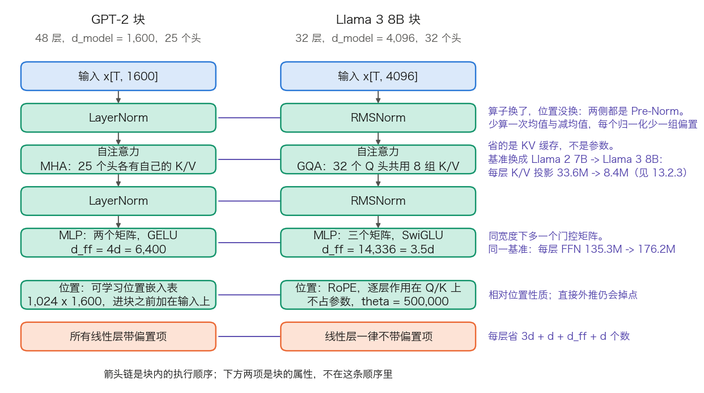
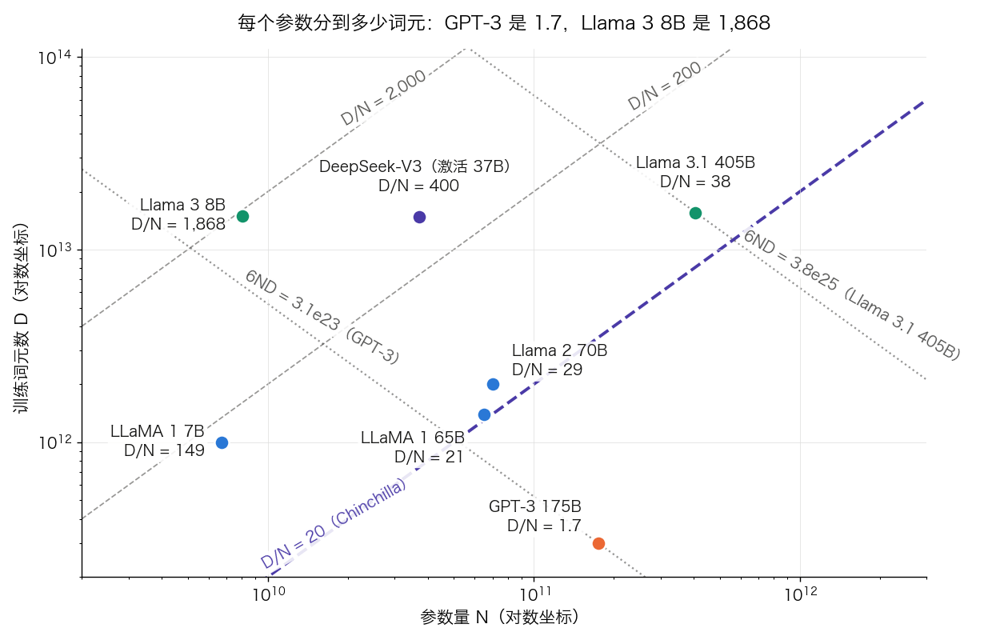

## 13.2 Llama 家族：开放权重如何改变 LLM 格局

Llama 没有发明新结构，它把已被验证的改进固定成一套配方：前置 RMSNorm、SwiGLU、RoPE、GQA，线性层不带偏置。前三项由 Llama 1（2023 年）定下，GQA 在 Llama 2 的 70B 引入、Llama 3 起全系采用。这套配方成了开放模型的共同起点。配置公开之后三笔账都能算：参数量里 FFN 占八成；每词元 KV 缓存由层数与 K/V 头数决定，与宽度无关；训练算力按 $$6ND$$。Llama 最重要的决策是把小模型训到远超算力最优：模型要服务海量请求时，判据是每次推理的成本，训练多付的那一笔是一次性的。

### 13.2.1 从 GPT-2 块到 Llama 块：五处改动各换来什么

图 13-1 把 GPT-2 块与 Llama 3 8B 块并排，两者相差五处。位置、归一化、激活、偏置四处在 Llama 1 就已定型（[LLaMA 论文](https://arxiv.org/abs/2302.13971)列出的改进是前置 RMSNorm、SwiGLU、RoPE 三项，不带偏置是同时采用的实现设定），注意力一处到 Llama 2 的 70B 才改成 GQA。

图 13-1：GPT-2 块与 Llama 3 8B 块的逐项对照（[生成脚本](https://github.com/yeasy/llm_internals/blob/main/tools/figures/ch13_block_diff.py)）。青绿标出改动的部件，橙色标出偏置项这一处删减。竖直箭头是块内的执行顺序，两侧相同：归一化在前，再读上下文，再逐位置加工。下方两项是块的属性而非流程步骤：位置嵌入表在进入第一个块之前就加到输入上，偏置项是所有线性层的共同设定。

五处改动的收益与代价列在表 13-3。

| 部件 | GPT-2 的做法 | Llama 的做法 | 换来什么 | 代价与备选 |
| --- | --- | --- | --- | --- |
| 位置 | 可学习位置嵌入表，加在输入上 | RoPE，每层作用在 Q、K 上 | 相对位置性质；不占参数；换上下文长度不必换表 | 直接外推到训练长度数倍会掉点，需位置内插、NTK 或 YaRN（见 [4.3 节](../04_position_encoding/4.3_rope.md)）；备选是 ALiBi |
| 归一化 | LayerNorm，放在子层之前 | RMSNorm，放在子层之前 | 少算一次均值与减均值，每个归一化少一组偏置 | 去掉中心化在部分任务上略有损失 |
| 激活 | 两个矩阵，GELU | 三个矩阵，SwiGLU | 同宽度下门控带来更强的表达 | FFN 从 $$2d \cdot d_{ff}$$ 变成 $$3d \cdot d_{ff}$$，须调小 $$d_{ff}$$ 才能持平（见 [3.4 节](../03_components/3.4_feedforward.md)） |
| 注意力 | MHA，每个头各有 K/V | GQA，若干 Q 头共用一组 K/V | KV 缓存按 $$n_h / n_{kv}$$ 成比例缩小 | K/V 表示变少，容量下降；参数几乎没省，省的是缓存 |
| 偏置项 | 各线性层都带 | 一律不带 | 每层少 $$3d + d + d_{ff} + d$$ 个数，实现更简洁 | 对表达能力的影响在这个规模下可忽略 |

表 13-3：Llama 块相对 GPT-2 块的五处改动。GPT-2 的做法取自 [GPT-2 论文](https://cdn.openai.com/better-language-models/language_models_are_unsupervised_multitask_learners.pdf)，Llama 的做法取自 LLaMA 论文与 [Llama 3 论文](https://arxiv.org/abs/2407.21783)表 3。

**归一化只换了算子，没换位置。** Pre-Norm 从 GPT-2 起就是 GPT 系的做法（见 [13.1.1 节](13.1_gpt_series.md)），Llama 改的是 LayerNorm 到 RMSNorm。把 Pre-Norm 记成 Llama 的贡献是一处常见误读。去掉减均值影响不大的原因见 [3.6.6 节](../03_components/3.6_layer_norm.md)。

**SwiGLU 的宽度要重新取。** 三个矩阵而非两个，若仍取 $$d_{ff} = 4d$$，FFN 参数会多出一半。LLaMA 论文取 $$\frac{2}{3} \times 4d$$：$$\frac{8}{3} \times 4{,}096 \approx 10{,}923$$，向上取到 256 的倍数得 11,008，即 Llama 1 与 Llama 2 的 7B 的中间宽度。Llama 3 8B 偏离了这条规则，取 14,336，即 $$3.5d$$，是 $$8/3$$ 规则的 1.31 倍。

### 13.2.2 读懂 config.json：以 Llama 3 8B 为例

一份配置里决定形状的只有七八个字段，其余两笔账（参数量与 KV 缓存）都由它们算出。表 13-4 列出 Llama 3 8B 的取值。

| 字段 | 取值 | 决定什么 |
| --- | ---: | --- |
| `num_hidden_layers` | 32 | 块重复几次，即层数 $$L$$ |
| `hidden_size` | 4,096 | 残差流宽度 $$d$$ |
| `num_attention_heads` | 32 | Q 头数 $$n_h$$，每头宽度 $$d_h = 4{,}096/32 = 128$$ |
| `num_key_value_heads` | 8 | K/V 头数 $$n_{kv}$$，决定 KV 缓存 |
| `intermediate_size` | 14,336 | FFN 中间宽度 $$d_{ff}$$ |
| `vocab_size` | 128,256 | 词表行数 |
| `tie_word_embeddings` | `false` | 输出投影不复用嵌入表，另有一份 LM head |
| `rope_theta` | 500,000 | RoPE 的基频，不占参数 |
| `max_position_embeddings` | 8,192 | 训练时的上下文上限，Llama 3.1 起为 131,072 |

表 13-4：Llama 3 8B 的关键配置字段，取值与 [Llama 3 论文](https://arxiv.org/abs/2407.21783)表 3 的 8B 一列相符（论文的词表写作 128,000，发布权重的嵌入表另含特殊词元，共 128,256 行）。各字段对应的模块名与权重形状见[附录 A.7](../appendix/a7_framework_recipes.md)。

Q 头数与 K/V 头数是两个字段。把它们混为一谈，KV 缓存会算大 4 倍。

**取值规律。** 把 Llama 各档的配置并排（[3.8.7 节](../03_components/3.8_gpt_inference_flow.md)的表 3-25、本节表 13-5、表 13-6 与[附录 A.3](../appendix/a3_model_reference.md)），可以读出一组稳定的取值，新建一个稠密解码器时它们就是默认起点：

- **每头宽度恒为 128。** 7B/8B、70B、405B 的宽度是 4,096、8,192、16,384，Q 头数是 32、64、128，模型变宽靠加头，头本身不变宽。
- **K/V 头数恒为 8。** 用 GQA 的各档都是 8 组，K/V 投影的总宽固定在 $$8 \times 128 = 1{,}024$$，不随模型变大。
- **加宽与加深同步。** 宽度与层数之比是 $$4{,}096/32 = 128$$、$$8{,}192/80 \approx 102$$、$$16{,}384/126 = 130$$，都在 100 到 130 之间。
- **FFN 取宽度的 8/3 到 3.5 倍。** Llama 2 7B 是 2.69 倍，Llama 3 的 8B 与 70B 是 3.5 倍，405B 是 3.25 倍。

### 13.2.3 参数量逐项对账：8.03B 是怎样加出来的

一层里有两块权重。注意力是四个投影，Q 与输出是方阵，K 与 V 因为只有 8 个头而变窄：$$2 \times 4{,}096^2 + 2 \times 4{,}096 \times 1{,}024 \approx 41.94\text{M}$$。FFN 是 SwiGLU 的三个同宽矩阵：$$3 \times 4{,}096 \times 14{,}336 \approx 176.16\text{M}$$。两个 RMSNorm 各 4,096 个数，可以忽略。每层合计 218.11M，32 层是 6.98B。嵌入与 LM head 不绑定，各 $$128{,}256 \times 4{,}096$$，合计 1.05B。两项相加即标称的 8.03B，与发布权重一致。同法可得另外两档，列在表 13-5；精确到个位的展开式见[附录 A.3](../appendix/a3_model_reference.md)。

| 模型 | 注意力/层 | FFN/层 | 每层合计 | FFN 占比 | 嵌入 + LM head | 总参数 |
| --- | ---: | ---: | ---: | ---: | ---: | ---: |
| Llama 2 7B（MHA，$$d_{ff}=11{,}008$$，$$V=32{,}000$$） | 67.11M | 135.27M | 202.38M | 66.8% | 262.14M | 6.74B |
| Llama 3 8B（GQA，$$d_{ff}=14{,}336$$，$$V=128{,}256$$） | 41.94M | 176.16M | 218.11M | 80.8% | 1,050.67M | 8.03B |
| Llama 3.1 405B（126 层，$$d=16{,}384$$，$$d_{ff}=53{,}248$$） | 570.43M | 2,617.25M | 3,187.70M | 82.1% | 4,202.69M | 405.85B |

表 13-5：三档 Llama 的参数量分解。配置取自 Llama 3 论文表 3 与各模型的公开配置。

三条结论从这张表直接读出。

**GQA 省下的参数很少。** 7B 到 8B，K/V 投影从每层 33.55M 降到 8.39M，每层省 25.17M；同期 FFN 加宽多出 40.89M，净增 15.73M。GQA 省下的参数只抵掉 FFN 加宽的约六成，它的意义不在参数。两处改动是否有意配平，论文没有说明。

**FFN 是每层的大头，且占比还在升。** 从 66.8% 升到 82.1%。原因有两个：$$d_{ff}/d$$ 从 2.69 提到 3.25 以上；GQA 下 K/V 投影的总宽固定为 1,024，不随 $$d$$ 增长，注意力那一项相对缩水。

**大词表对小模型是真开销。** 8B 的嵌入与 LM head 占总量 13.1%，405B 只占 1.0%。词表从 32K 扩到 128K 换来更好的压缩率：Llama 3 论文报告英文样本从每词元 3.17 个字符提高到 3.94，相当于同样算力下多读约 24% 的文本。这笔收益全系共享，代价由小模型承担得更重。

### 13.2.4 GQA 省的是缓存不是参数：每词元多少字节

每词元 KV 缓存等于“K 与 V 两份 × 层数 × K/V 头数 × 每头宽度 × 每个数的字节”（公式与推导见 [10.2.3 节](../10_inference_optimization/10.2_kv_cache.md)）。Llama 3 8B 按 BF16 是 $$2 \times 32 \times 8 \times 128 \times 2$$ 字节，即 128 KiB。表 13-6 给出四档模型与一个反事实对照。

| 模型 | $$L$$ | $$n_{kv}$$ | 每词元 KV | 128K 上下文单序列 |
| --- | ---: | ---: | ---: | ---: |
| Llama 2 7B（MHA） | 32 | 32 | 512 KiB | 64.0 GiB |
| Llama 3 8B（GQA） | 32 | 8 | 128 KiB | 16.0 GiB |
| Llama 2 70B（GQA） | 80 | 8 | 320 KiB | 40.0 GiB |
| Llama 3.1 405B（GQA） | 126 | 8 | 504 KiB | 63.0 GiB |
| Llama 3.1 405B 若用 MHA | 126 | 128 | 8,064 KiB | 1,008.0 GiB |

表 13-6：每词元 KV 缓存与 128K 上下文下单条序列的占用，BF16，$$d_h = 128$$。最后一行是反事实：把 405B 的 K/V 头数改回 128。

**GQA 必须在训练时定下。** 405B 若用 MHA，一条 128K 的序列要 1,008 GiB 缓存，单机装不下；改成 8 个 K/V 头后降到 63 GiB，进入分页管理与多卡切分能处理的范围（见 [11.4 节](../11_serving/11.4_kv_memory_management.md)）。已发布的 MHA 模型无法事后改成 GQA，只能靠续训转换或 KV 量化。

**参数比不能用来推缓存比。** 70B 与 405B 的参数比 $$70/405 = 17\%$$ 适用于权重显存与每词元 FLOPs；KV 缓存之比是 $$320/504 = 63\%$$。两者的 $$n_{kv} \times d_h$$ 都是 $$8 \times 128$$，缓存之比只剩层数之比 $$80/126$$，与残差流宽度无关。

### 13.2.5 为什么把小模型训到远超 Chinchilla 最优

Chinchilla 回答的是：给定训练算力，$$N$$ 与 $$D$$ 怎样分配损失最低。LLaMA 论文换了一个问题：大规模服务时，首选的是推理最快的模型，把小模型训得更久，推理时终归更便宜。该文举的例子是，Chinchilla 建议 10B 模型配 200B 词元，而 7B 模型训到 1T 词元后仍在继续变好。这条论点的量化形式是 $$D/N$$，图 13-2 把历代模型画在同一张对数图上。

图 13-2：参数量 $$N$$ 与训练词元数 $$D$$ 的对数图，斜虚线是 $$D/N$$ 等值线，点线是等算力线 $$6ND = C$$（[生成脚本](https://github.com/yeasy/llm_internals/blob/main/tools/figures/ch13_tokens_per_param.py)）。落在同一条斜虚线上的模型，每个参数分到的词元数相同。

| 模型 | 参数量 $$N$$ | 训练词元 $$D$$ | $$D/N$$ | $$6ND$$ |
| --- | ---: | ---: | ---: | ---: |
| GPT-3 175B | 174.6B | 300B | 1.7 | $$3.14 \times 10^{23}$$ |
| LLaMA 1 7B | 6.7B | 1.0T | 149 | $$4.0 \times 10^{22}$$ |
| LLaMA 1 65B | 65.2B | 1.4T | 21 | $$5.5 \times 10^{23}$$ |
| Llama 2 70B | 70B | 2.0T | 29 | $$8.4 \times 10^{23}$$ |
| Llama 3 8B | 8.03B | 约 15T | 约 1,900 | $$7.2 \times 10^{23}$$ |
| Llama 3.1 405B | 405.9B | 15.6T | 38 | $$3.8 \times 10^{25}$$ |

表 13-7：各代模型的词元/参数比与训练算力。LLaMA 1 取自 LLaMA 论文表 2，Llama 2 取自 [Llama 2 论文](https://arxiv.org/abs/2307.09288)，405B 取自 Llama 3 论文；8B 没有单独给出训练词元数，按该文“约 15T 词元”的语料规模记为约数。

**代价写在明面上。** Llama 3 8B 的 $$D/N$$ 约 1,900，比 Chinchilla 的约 20 高出近两个数量级；$$6ND$$ 达到 $$7.2 \times 10^{23}$$，与 65B 级别的模型相当。这笔训练算力花在了一个远非算力最优的模型上。Llama 3 论文的理由是：在同样的推理预算下，训得更久的小模型好于算力最优的模型。系列里刻意过度训练的是 8B 与 70B，405B 接近论文自己拟合出的算力最优点（见 [5.4.6 节](../05_pretraining/5.4_data_scaling.md)）。

**这条选择对谁成立。** 训练约花 $$6ND$$，推理每词元约花 $$2N$$，所以累计服务的词元数超过训练词元数的 3 倍时，推理的累计算力就超过训练；Llama 3 8B 的这个门槛约是 45T 词元。服务量远高于此的模型，把训练多付的算力换成每次推理更便宜是划算的；只跑几次实验的研究场景相反，算力最优才是对的目标。与更大模型比较总成本的算法见 [5.4.5 节](../05_pretraining/5.4_data_scaling.md)。

### 13.2.6 版本演进：每一代改的是哪一处

每一代动的是不同的部件，表 13-8 按这条线索列出七代。

| 版本 | 参数规格 | 训练词元 | 上下文 | 改动的部件 |
| --- | --- | --- | --- | --- |
| Llama 1（2023） | 7B/13B/33B/65B | 7B、13B 为 1.0T；33B、65B 为 1.4T | 2K | 确立 RoPE + Pre-Norm/RMSNorm + SwiGLU 的组合；按推理预算选规模 |
| Llama 2（2023） | 7B/13B/70B | 2T | 4K | RLHF 后训练；70B 引入 GQA |
| Llama 3（2024） | 8B/70B | 约 15T | 8K | 词表 32K → 128K；全系 GQA；`rope_theta` 提到 500,000 |
| Llama 3.1（2024） | 8B/70B/405B | 405B 为 15.6T | 128K | 405B 为稠密 126 层；上下文靠继续预训练分六阶段扩到 128K |
| Llama 3.2（2024） | 1B/3B/11B/90B | — | 128K | 1B、3B 由 8B 一次性结构化剪枝得到，再用 8B/70B 的 logits 蒸馏；11B/90B 加视觉 |
| Llama 3.3（2024） | 70B | — | 128K | 后训练改进，使 70B 在若干基准上接近 3.1 405B |
| Llama 4（2025） | MoE 多档 | — | 因变体而异 | 从稠密转向 MoE |

表 13-8：Llama 系列版本演进，按“这一代改了哪个部件”组织。训练词元与上下文取自对应论文与模型卡，3.2、3.3、4 的词元数官方未给出，留空。各代的可用状态与型号列表见[附录 A.5](../appendix/a5_volatile_facts.md)。

四处值得展开。

**405B 的规模由规模定律外推得到。** Llama 3 论文用 IsoFLOP 曲线拟合算力最优的配比，外推到 $$3.8 \times 10^{25}$$ FLOPs 的预算，建议 402B 参数配 16.55T 词元，实际取 405B 与 15.6T。算力预算越大，曲线在最低点附近越平坦，规模选得略有偏差影响不大（见 [5.4.6 节](../05_pretraining/5.4_data_scaling.md)）。

**128K 上下文靠继续预训练得到。** 8K 的标准预训练之后，再用约 800B 词元分六个阶段逐级加长；每一级的通过判据有两条：短上下文评测完全恢复，且该长度下的“大海捞针”任务全对。这是上下文扩展的通行做法，见 [14.7 节](../14_future_trends/14.7_long_context.md)。

**选稠密而不是 MoE 是一个显式决策。** Llama 3 论文写明，选择标准稠密架构是为了最大化训练稳定性；后训练也相应地只用 SFT、拒绝采样与 DPO。Llama 4 转向 MoE，是同一条取舍在新的约束下重做了一遍（MoE 的机制与各家配置见 [14.2 节](../14_future_trends/14.2_moe.md)）。

**端侧模型靠剪枝加蒸馏。** 1B、3B 由 8B 结构化剪枝得到，再用 8B 与 70B 的 logits 做词元级蒸馏来恢复性能，是这两种方法组合使用的一个完整公开案例（见 [10.5 节](../10_inference_optimization/10.5_pruning_distillation.md)）。

### 13.2.7 开放生态及其边界

Llama 的生态地位来自两个条件同时成立：基础能力强，许可宽松。此前已有研究申请制的 OPT-175B 与完全开放的 BLOOM，同时具备两者的开放权重系列，Llama 是第一个。Llama 1 以研究许可发放，Llama 2 改为宽松商用许可，数月之内出现了大批微调衍生模型，例如用闭源模型生成的指令数据或用户分享的对话微调出的 Alpaca 与 Vicuna。这类工作有三条边界。

**模仿学到的可能只是风格。** [一项针对模仿闭源模型的研究](https://arxiv.org/abs/2305.15717)的结论是，用闭源模型的输出做模仿微调，能让输出风格迅速接近目标模型，却补不上基础能力的差距。人工评分提升而知识密集型基准不动，是这种情形的信号。

**“接近某闭源模型”的成绩要看裁判是谁。** Vicuna“达到 ChatGPT 九成质量”的说法来自以 GPT-4 为裁判、80 道题的初步评测。模型充当裁判有位置偏好、长度偏好等已知问题，评测方法见 [8.6 节](../08_alignment/8.6_evaluation.md)。

**许可约束随版本变化。** 能否用某个模型的输出训练别的模型，由该版本的许可条款决定，选型时应直接读许可原文。
