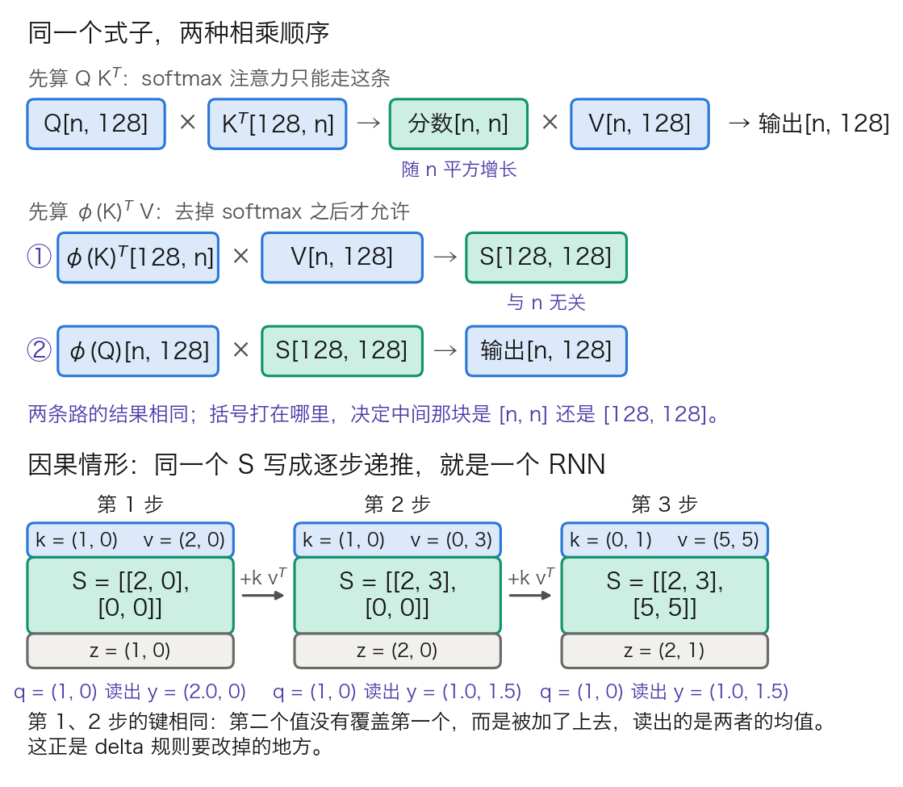

## 14.1 高效注意力：突破平方复杂度的瓶颈

降低注意力成本只有三种手法：不改数学、只改 IO 与缓存布局（[10.3 节](../10_inference_optimization/10.3_flash_attention.md)、[11.4 节](../11_serving/11.4_kv_memory_management.md)），让每个查询少看几个位置（稀疏），把历史压成一块固定大小的状态（线性注意力与递推）。线性注意力把 $$(QK^T)V$$ 的括号改打成 $$Q(K^TV)$$，历史变成每个头一块 $$[d_h, d_v]$$ 的联想记忆：省掉的是随长度增长的读取，代价是状态的秩封顶，逐字复制与精确定位最先失效。稀疏注意力省的是读取量，存储量不变，而且“选谁”这一步仍保留一项随长度平方增长的打分，只是搬到了便宜的支路上。今天落地的配方是混合：多数层用固定状态，少数层保留全注意力守住检索；这类改造要到批大小与上下文长度的乘积超过约十万词元之后才有收益（14.1.6）。

本节承接 [3.8 节](../03_components/3.8_gpt_inference_flow.md)的瓶颈三：KV 缓存随序列线性增长，先占显存容量，再占显存带宽。同一个递推形式从状态空间模型一侧怎样推出，见 [14.3 节](14.3_ssm_hybrid.md)。

### 14.1.1 两类“高效”的分界

分界线是改不改注意力的数学定义。FlashAttention 与 PagedAttention 不改，下文称精确优化栈：中间的 `[n, n]` 分数矩阵留在片上，稠密注意力的定义不变，已训练的模型通常不必重训，只需验证浮点误差与任务质量。稀疏、线性与状态空间模型改变参与计算的位置或算子本身，输出随之改变，一般要从预训练或续训阶段就采用。本节讨论后一类；[2.5.6 节](../02_attention/2.5_complexity_limits.md)的表 2-7 给出了更细的四分法。

> [!NOTE]
> **进阶：MQA、GQA、MLA 归哪一类。** MQA/GQA 改变头之间的参数共享，MLA 改变投影的参数化，属于模型结构设计（[10.2 节](../10_inference_optimization/10.2_kv_cache.md)）。已有的 MHA 检查点不能直接换成它们并保持原结果，转换需要重新训练或续训；[GQA 论文](https://arxiv.org/abs/2305.13245)给出的正是从 MHA 检查点续训的方案。

### 14.1.2 线性注意力：从核化到递推状态

线性注意力的全部内容是一次结合律：相似度能拆成两个特征向量的内积时，历史可以先求和、后与查询相乘，于是只需保存一块与长度无关的状态。下面分七步推出这块状态、它的大小和它的代价。记号沿用第 3 章（[3.8.7 节](../03_components/3.8_gpt_inference_flow.md)表 3-28）：每头宽度记作 $$d_h$$；$$d_v$$ 是 Value 每头的宽度，真实配置里两者相等，分开写只为让状态矩阵的形状可读。

**第一步：把 softmax 写成通式。** 位置 $$i$$ 的输出是各位置 Value 的加权平均，权重由某个相似度函数给出（[Katharopoulos 等的线性 Transformer](https://arxiv.org/abs/2006.16236)，下式按因果情形求和到 $$j \le i$$）：

$$
y_i = \frac{\sum_{j=1}^{i}\operatorname{sim}(q_i, k_j)\, v_j}{\sum_{j=1}^{i}\operatorname{sim}(q_i, k_j)}
$$

取 $$\operatorname{sim}(q,k) = \exp(q^Tk/\sqrt{d_h})$$ 就是第 2 章的缩放点积注意力，分母是 softmax 的行和。

**第二步：选择可分解的核。** 把相似度写成两个特征向量的内积 $$\operatorname{sim}(q,k) = \phi(q)^T\phi(k)$$，$$\phi(q_i)^T$$ 就与求和下标 $$j$$ 无关，可以提到求和号外面。这种拆法有条件：相似度非负并不足以保证它能写成共享特征映射的内积，所以要选具有可计算的有限维特征表示的核，并要求相似度非负、分母非零。记特征维度为 $$r$$，它不必等于 $$d_h$$。代入后：

$$
y_i = \frac{\phi(q_i)^T \sum_{j\le i}\phi(k_j)v_j^T}{\phi(q_i)^T \sum_{j\le i}\phi(k_j)}
$$

分子的和是一个 $$[r, d_v]$$ 的矩阵，分母的和是一个 $$[r]$$ 的向量。这两块概括了当前前缀，不再需要为每个历史位置单独打分。$$\phi$$ 的常见取法是 $$\phi(x) = \operatorname{elu}(x) + 1$$，选 elu 是为了避免负半轴梯度为 0。

> [!NOTE]
> **进阶：softmax 的指数核为什么不能照此处理。** 指数点积核也有特征内积表示，但需要无限维特征，压不成小型的有限维状态。Performer 用有限个随机特征近似指数核，因而引入近似误差；这与改选 ELU+1 特征定义另一种核是两条路线。

**第三步：形状对照。** 图 14-1 的上半幅把同一个核的两种相乘顺序并排画出，先不加因果掩码。按 Llama 3 8B 的单头宽度取 `d_h = d_v = 128`，并取 `r = 128`：

- 先算打分矩阵：`φ(Q)[n, 128] × φ(K)ᵀ[128, n] → 分数[n, n]`，再 `分数[n, n] × V[n, 128] → 分子[n, 128]`。
- 先算状态矩阵：`φ(K)ᵀ[128, n] × V[n, 128] → S[128, 128]`，再 `φ(Q)[n, 128] × S[128, 128] → 分子[n, 128]`。

两条路给出相同的分子；括号打在哪里，决定中间那块是 `[n, n]` 还是 `[128, 128]`。

图 14-1：同一个式子的两种相乘顺序，以及因果情形下的递推状态（[生成脚本](https://github.com/yeasy/llm_internals/blob/main/tools/figures/ch14a_linear_state.py)）。上半幅的 Q/K 按核特征理解，展示分子计算，取 `r = 128`。蓝色是随输入变化的数据，青绿色是本轮新算出的中间量。上半幅第二条路上的 ① ② 标出相乘的先后；下半幅的数值即 14.1.2 第五步的三步手算。

**第四步：因果掩码把求和变成前缀和。** 第 $$i$$ 步只加到 $$j \le i$$，两个和都可以增量维护：

$$
\begin{aligned}
S_t &= S_{t-1} + \phi(k_t)v_t^T && [r, d_v] \\
z_t &= z_{t-1} + \phi(k_t) && [r] \\
y_t &= \frac{\phi(q_t)^T S_t}{\phi(q_t)^T z_t} && [d_v]
\end{aligned}
$$

这三行就是一个 RNN：$$(S, z)$$ 是隐状态，每步读一次、写一次，形状不随 $$t$$ 变化。论文标题“Transformers are RNNs”说的就是这件事。逐步递推只是解码时的算法；训练时整条序列已知，前缀和一次累加就得到所有位置的值，前向与反向都是线性时间。

**第五步：三步手算。** 取 $$r = d_h = d_v = 2$$、$$\phi$$ 为恒等映射，初始 $$S_0 = 0$$、$$z_0 = 0$$，输入见图 14-1 下半幅：

- 第 1 步，$$k_1 = (1,0)$$、$$v_1 = (2,0)$$。$$S_1 = [[2,0],[0,0]]$$，$$z_1 = (1,0)$$。用 $$q = (1,0)$$ 读出：分子 $$(2,0)$$，分母 $$1$$，$$y = (2,0)$$，正是刚写进去的值。
- 第 2 步，$$k_2 = (1,0)$$、$$v_2 = (0,3)$$，键与上一步相同。$$S_2 = [[2,3],[0,0]]$$，$$z_2 = (2,0)$$。同一个 $$q$$ 读出分子 $$(2,3)$$、分母 $$2$$，$$y = (1, 1.5)$$。
- 第 3 步，$$k_3 = (0,1)$$、$$v_3 = (5,5)$$。新键写进第二行，$$S_3 = [[2,3],[5,5]]$$。$$q = (1,0)$$ 只读第一行，$$y$$ 仍是 $$(1, 1.5)$$。

第 2 步是关键：两个值写在同一个键上，后来的没有覆盖先前的，读出的是两者的均值。分母 $$z$$ 只做归一化，改不了这一点；14.1.3 的 delta 规则针对的就是它。

**第六步：账。** 沿用 Llama 3 8B 的配置（32 个 Query 头、8 个 KV 头、`d_h = 128`、32 层），线性注意力取 `r = d_h = d_v = 128`：

- GQA 每层每词元的 KV 是 `2 × 8 × 128 = 2048` 个数，全模型 `2048 × 32 = 65,536` 个数，BF16 下 128 KiB/词元。
- 同宽的线性注意力每层存 32 个头各一块 `[128, 128]` 的状态，即 `32 × 128 × 128 = 524,288` 个数，外加 4096 个数的分母，与长度无关。
- 两者在 `524,288 ÷ 2048 = 256` 个词元处持平。这类交叉点都远短于实际上下文，不构成选型判据（[14.3.4 节](14.3_ssm_hybrid.md)），起作用的门槛见 14.1.6。

计算量上，单头解码一步，softmax 要对 $$n$$ 行各做一次打分和一次读取，约 $$2nd_h$$ 次乘加；线性注意力读一次状态、写一次状态，约 $$2d_h^2$$ 次，与 $$n$$ 无关。表 14-1 代入数字。

| 已有长度 n | softmax 每头乘加次数 | 线性注意力每头乘加次数 | 比值 |
| ---: | ---: | ---: | ---: |
| 256 | 65,536 | 32,768 | 2.0 |
| 4,096 | 1,048,576 | 32,768 | 32 |
| 131,072 | 33,554,432 | 32,768 | 1,024 |
| 1,048,576 | 268,435,456 | 32,768 | 8,192 |

表 14-1：单个注意力头解码一步的乘加次数，`d_h = 128`。两列只数注意力本身；每层 FFN 与投影的开销两者相同，在总账里往往仍占大头（[3.8.8 节](../03_components/3.8_gpt_inference_flow.md)）。

**第七步：代价在哪。** $$S$$ 是一个 `[128, 128]` 的矩阵，秩至多 128。写入的键值对超过 128 个时，这些特征键不可能线性无关，不能保证每个关联都独立保存、精确读回。softmax 注意力保留全部 $$n$$ 个位置的 KV，没有这一容量瓶颈；它同样不保证任意检索：两个相同的 Key 得分与权重相同，对应的 Value 被混合，近似的 Key 与有限精度也会让区分变难。

这一代价由维度决定，工程手段绕不过去。无门控的累加式状态是一个可交换的求和，读出结果与写入先后无关：干扰只取决于键是否重叠或近似，没有“久远的内容先丢”这回事。按时间遗忘是 14.1.3 加上衰减门控之后才有的性质。逐字复制长串、在长文里回头找一个具体编号，是最容易暴露容量上限的两类任务；同一结论在状态空间模型上的表述见 [14.3.6 节](14.3_ssm_hybrid.md)。

### 14.1.3 delta 规则与门控：把“累加”改成“改写”

累加式状态有两个毛病：同一个键上的新值只会叠加，旧内容永不退场。delta 规则治前一个，门控治后一个；代价是递推不再是简单的前缀和，训练要靠分块并行形式，并处理累积衰减带来的数值稳定性问题。

**delta 规则**（delta rule）先把该键上的旧值读出来减掉，再写新值。Key 先做 L2 归一化，满足 $$\lVert k_t\rVert_2 = 1$$：

$$
S_t = \left(I - \beta_t k_t k_t^T\right)S_{t-1} + \beta_t\, k_t v_t^T
$$

此处取 $$r = d_h$$，状态为 $$S \in \mathbb{R}^{d_h \times d_v}$$、读出为 $$q_t^T S_t$$，$$\beta_t \in [0,1]$$ 是写入强度。把括号展开，“读出旧值、减掉、写入新值”各有对应：

$$
S_t = S_{t-1} + \beta_t\, k_t\left(v_t - S_{t-1}^T k_t\right)^T
$$

$$S_{t-1}^T k_t$$ 是用 $$k_t$$ 从旧状态读出的结果，即该键上的旧值；写进状态的只是新值与旧值之差，delta 规则因这个差得名。$$\beta_t = 0$$ 表示这一步什么也不写；$$\beta_t = 1$$ 时，当前单位键方向满足 $$k_t^T S_t = v_t^T$$，读到的就是新值本身，但与它不正交的其他键的读出也可能改变。Key 未归一化时这条读回保证不成立：标量 `k = 2`、`v = 3`、旧状态为 0，写入后状态为 6，按同一键读出是 12。

这一步也是一次在线回归：把状态看作由键预测值的线性模型，上式正是对损失 $$\tfrac{1}{2}\lVert S^T k_t - v_t \rVert^2$$ 做一步学习率为 $$\beta_t$$ 的梯度下降（[DeltaNet 的并行化论文](https://arxiv.org/abs/2406.06484)）。累加式只管往里写，delta 规则每写一次都按当前误差修正一次。

把 14.1.2 的同一组单位键代进去（$$\beta = 1$$）：

- 第 1 步，旧值 $$(0,0)$$，$$S_1 = [[2,0],[0,0]]$$，读出 $$(2,0)$$。
- 第 2 步，先读出该键上的旧值 $$(2,0)$$ 并减掉，再写入 $$(0,3)$$，得 $$S_2 = [[0,3],[0,0]]$$。同一个 $$q = (1,0)$$ 读出 $$(0,3)$$，是新值本身。
- 第 3 步换了键，$$S_3 = [[0,3],[5,5]]$$，读第一行仍得 $$(0,3)$$。

累加读出的 $$(1, 1.5)$$ 是历史平均，delta 规则读出的 $$(0,3)$$ 是最近一次写入。本例的键相互正交，第 3 步不影响第一个键；一般输入仍有键间干扰。

**门控**（gating）在递推里乘一个由当前输入算出的衰减因子 $$\alpha_t \in (0,1)$$，让“忘多少”也随内容变化：

$$
S_t = \alpha_t \odot \left[\left(I - \beta_t k_t k_t^T\right)S_{t-1}\right] + \beta_t\, k_t v_t^T
$$

这一项与 [14.3 节](14.3_ssm_hybrid.md) Mamba 的 $$\bar{A}_t = \exp(\Delta_t A)$$ 是同一个东西，那边从连续系统离散化推出，这边直接参数化。门控的粒度是设计旋钮：[Gated DeltaNet](https://github.com/fla-org/flash-linear-attention/blob/main/fla/layers/gated_deltanet.py) 的 $$\alpha_t$$ 是每个头一个标量，整块状态同乘；Moonshot 的 **Kimi Delta Attention**（KDA，见 [Kimi Linear](https://arxiv.org/abs/2510.26692)）把它换成长度为 $$d_h$$ 的向量，状态的每一行各有自己的衰减率，并取先衰减、后改写的次序：

$$
S_t = \left(I - \beta_t k_t k_t^T\right)\operatorname{Diag}(\alpha_t)\,S_{t-1} + \beta_t\, k_t v_t^T
$$

标量门控下两种次序结果相同；换成向量后 $$\operatorname{Diag}(\alpha_t)$$ 与 $$I - \beta_t k_t k_t^T$$ 不可交换，次序成了设计的一部分。

**数值稳定性是真实代价。** 带门控与 delta 规则的递推训练时改用**分块并行形式**（chunkwise parallel form）：把序列切成定长的块，块内像注意力那样用矩阵乘一次算完，块与块之间只传状态（[GLA 论文](https://arxiv.org/abs/2312.06635)）。块内要用累积衰减的倒数缩放键，而累积衰减是一串 $$(0,1)$$ 内因子的乘积，倒数可以无界增长，有限精度下会溢出。Kimi Linear 改在对数空间计算相对衰减，[Kimi K3](https://arxiv.org/abs/2607.24653) 再给衰减加下界。线性注意力理论上省下的计算，有一部分要用这类数值工程换回来。

### 14.1.4 稀疏注意力：从预设形状到学出来的选择

稀疏注意力不换数学结构，只让每个查询少读几个位置。早期方案的稀疏模式由人手预设，与内容无关；2025 年起的做法是让模型自己学“看哪里”。公开的三个方案（MSA、DSA、NSA）可以用四个维度并排，共同规律有两条：随长度平方增长的那一项没有消失，只是搬到了比主注意力便宜的支路上；选择只省读取，被跳过的条目照样占显存。

**预设形状**有三种。

**局部窗口注意力。** 每个词元只看固定窗口内的邻居，复杂度 $$O(n\cdot w)$$，代表是 Longformer（[12.3 节](../12_encoder_models/12.3_longformer_bigbird.md)）。

**分块注意力。** 序列切成固定大小的块，块内全注意力，块间选择性交互。它与 FlashAttention 的分块无关：后者把稠密注意力拆成片上放得下的块，数学定义不变。

**哈希注意力。** [Reformer](https://arxiv.org/abs/2001.04451) 用局部敏感哈希筛出相近的 Q 与 K，只在候选位置上算注意力，复杂度 $$O(n\log n)$$。它的自注意力共享 Q/K 投影，这不妨碍自回归：原论文按排序前的位置构造因果掩码，并验证了下一词元预测。交叉注意力是例外，Query 与 Key 来自两条不同的序列，不能套用共享 Q/K 的假设。哈希、排序与多轮候选的开销要计入实际收益。

**可训练稀疏注意力**给每个查询挑出最相关的少数块或词元，只在选中的部分上做精确注意力。三个方案的差别落在下表的四列上。

| 方案 | 选择粒度 | 分数来源 | 训练信号 | 平方项落在哪一支 |
| --- | --- | --- | --- | --- |
| MSA（[MiniMax Sparse Attention](https://arxiv.org/abs/2606.13392)，用于 MiniMax-M3） | 128 词元的块；每个查询、每个 GQA 组保留 16 块，其中 1 块固定为查询所在的局部块 | 独立的轻量索引分支 | KL 损失对齐主分支的注意力分布，梯度截断，稠密预热 | 索引分支：为每个查询给全部块打分 |
| DSA（DeepSeek Sparse Attention，[DeepSeek-V3.2](https://arxiv.org/abs/2512.02556)） | 单个词元；保留 2048 个，全部 Query 头共用一份选择 | 独立的闪电索引器（lightning indexer） | 同上：先稠密预热索引器，再稀疏训练 | 索引器：为每个查询给此前全部词元打分 |
| NSA（Native Sparse Attention，[DeepSeek 与北京大学等](https://arxiv.org/abs/2502.11089)） | 64 词元的块，保留 16 块；另有压缩支与最近 512 词元的滑窗支，三支门控加权 | 复用压缩支已算出的注意力分数 | 只有语言建模损失 | 压缩支：与约 $$s/16$$ 个压缩条目打分 |

三个方案之外，[10.2.8 节](../10_inference_optimization/10.2_kv_cache.md)的压缩稀疏注意力（CSA）先沿时间轴把相邻词元的 KV 合并成压缩条目，再对压缩条目做同样的索引与 Top-k。

**规律一：平方项搬到了便宜的支路上。** MSA 的两支计算量是

$$
F_{\text{GQA}}(N) = 2n_h d_h N^2, \qquad F_{\text{MSA}}(N) = \underbrace{n_{kv} d_{\text{idx}} N^2}_{\text{索引分支}} + \underbrace{4n_h d_h N k B_k}_{\text{主分支}}
$$

$$n_h$$ 与 $$n_{kv}$$ 是 Query 头数与 KV 头数，$$d_{\text{idx}}$$ 是索引头的宽度，$$B_k = 128$$ 是块大小，$$k = 16$$ 是每个查询保留的块数。100 万词元的上下文切成 7813 块，每个查询只读 `16 × 128 = 2048` 个 KV，主分支一项的缩减是 $$N / (2kB_k) = 1{,}000{,}000 \div 4096 \approx 244$$ 倍，与头数、头宽无关。论文报告的每词元注意力计算量只降 28.4 倍，差额几乎全在索引分支：只有它带 $$N^2$$。用这两个数反推，主分支只占 MSA 注意力计算量的 `28.4 ÷ 244 ≈ 12%`。落到墙钟时间还要再打一次折，该文在 H800 上的实测是预填充 14.2 倍、解码 7.6 倍，分母里多了投影、FFN 与内核本身的开销。“理论压缩比”“每词元注意力 FLOPs 比”“端到端墙钟加速比”是三个不同的口径，读任何稀疏注意力论文都要先分清。

DSA 与 NSA 是同一条规律的另两个样本。DSA 的索引器为查询词元 $$t$$ 与此前每个词元 $$s$$ 算一个分数：

$$
I_{t,s} = \sum_{j=1}^{H^I} w^I_{t,j}\cdot\operatorname{ReLU}\left(q^I_{t,j}\cdot k^I_s\right)
$$

$$H^I$$ 是索引器的头数；取 ReLU、头数少、可用 FP8 实现，都是为了让这项 $$O(L^2)$$ 的打分足够便宜。128K 上下文下主注意力只读 2048 个条目，读取量降为 1/64。NSA 没有独立索引器，平方项落在压缩支：缓存长度 $$s = 65{,}536$$ 时一步读 `4096 + 1024 + 512 = 5632` 个条目，全注意力是它的 11.6 倍，其中压缩支占 73%，且随长度线性增长。

**规律二：选择器需要一路训练信号，除非它复用主干的分数。** Top-k 不可导，语言建模损失训不到独立索引器的参数。MSA 与 DSA 用的是同一套解法：以主注意力的分布为目标，用 KL 散度训练索引器；把索引器的输入从计算图上截断，使它只受 KL 损失、主模型只受语言建模损失；先在稠密注意力下预热索引器，再切到稀疏。DSA 的两个阶段正是如此：稠密预热阶段冻结索引器之外的全部参数，稀疏训练阶段放开全部参数、KL 损失只在被选中的词元上计算。NSA 的块分数直接取自压缩支的注意力分数，压缩支的输出本身进入结果、受语言建模损失训练，所以不需要对齐损失，可以从预训练第一步就用稀疏注意力；该文试过用辅助损失监督块分数，在 3B 模型上训练损失反而更高。

**规律三：粒度是内核效率与选择精度之间的取舍。** 块级选择（MSA、NSA）读取连续，矩阵乘能用上 Tensor Core，可沿用 FlashAttention 式的内核。词元级选择（DSA）更细，选中的条目一般不相邻；DSA 建在 MLA（[10.2.7 节](../10_inference_optimization/10.2_kv_cache.md)）之上，让一个被选中的条目由全部 Query 头共用，靠这种共享保住内核效率。

### 14.1.5 混合比例：三笔账怎么合

纯线性注意力至今没有独占旗舰模型，落地的配方是混合：绝大多数层用线性注意力换效率，按固定间隔插入少量全注意力层守住精确检索。Kimi Linear 用 KDA 与全注意力 MLA 按 3:1 逐层交替；Kimi K3（2.8T 总参 / 104B 激活）把同一配方推到旗舰规模，并在骨干末尾额外放一层 Gated MLA，保证最后一层是全局注意力。更多模型的层布局与比例怎么定，见 [14.3.7 节](14.3_ssm_hybrid.md)。

混合之后有三笔账。第一笔是 KV：降幅等于不留 KV 的层占比，与序列长度无关。仍按 Llama 3 8B 的口径，3:1 混合后只有 8 层留 KV，每词元从 65,536 个数降到 `2048 × 8 = 16,384` 个，降 `1 − 8/32 = 75%`。第二笔是线性层的固定状态：24 层共 `24 × 524,288 = 12,582,912` 个数，BF16 下每个请求约 25 MB，不随长度增长。第三笔是吞吐：Kimi Linear 在 100 万词元上下文下报告 KV 缓存最多降 75%、解码吞吐最多提升约 6 倍，前一个数就是第一笔的算式，后一个数还包含内核与批大小的收益。

### 14.1.6 选型：四条路线的对照与失效情形

默认仍是精确优化栈加 GQA 或 MLA；混合与可训练稀疏用在长上下文、高并发的新模型上，必须从训练阶段就定下来。表 14-2 把四条路线按同一组维度并排。

| 维度 | 精确优化栈 | 稀疏（块 / 词元） | 线性 / 递推 | 混合（3:1） |
| --- | --- | --- | --- | --- |
| 结果是否精确 | 是 | 否 | 否 | 全注意力层是，其余否 |
| 解码每步与 n 的关系 | 线性 | 主注意力读取量固定，但索引或压缩支仍随 n 增长 | 常数 | 由全注意力层决定，线性但系数小 |
| 每词元缓存 | 随 n 线性增长 | 随 n 线性增长（未选中的条目照存不误） | 固定 | 按留 KV 的层占比缩小 |
| 检索约束 | 保留全部 KV，但不保证精确检索 | 还取决于选择的召回率 | 受固定状态容量约束 | 全注意力层缓解压缩损失，但不保证精确检索 |
| 是否需要专用内核 | 需要（FlashAttention） | 需要 | 需要 | 两套都要 |
| 训练是否需额外损失 | 否 | MSA、DSA 是（索引器对齐），NSA 否 | 否 | 否 |

表 14-2：四条路线的对照。“稀疏”一列的缓存不减，是最容易被忽略的一条：选择只减少读取量，被跳过的条目仍然占着显存。

**生效门槛看批大小与上下文长度的乘积。** 解码一步，引擎读一遍权重，再为批内每个请求读一遍它的 KV。Llama 3 8B 的权重是 16.06 GB，KV 每词元 128 KiB，两者相等于 `16.06 GB ÷ 128 KiB ≈ 12.3 万`个词元。这个数是批内各请求上下文长度之和：权重每步只读一遍，由全批分摊，KV 按请求累加。单请求要到 12 万词元，KV 的读取量才追平权重；批大小 32 时每个请求约 3,800 词元就到了。容量是第二道线：80 GB 的卡去掉权重剩 63.94 GB，放得下约 48.8 万词元的 KV，只是前一个数的 4 倍。乘积远小于十万时，注意力的读取淹没在权重读取里，换结构基本无收益；超过之后，KV 先成为带宽的主项，很快又成为显存的上限。预填充一侧的门槛是平方项开始主导的长度，约 $$12.75d$$（[14.7.1 节](14.7_long_context.md)）。

其余三条判断：

- **需要逐字复制或精确定位**时，纯线性方案不可靠。状态秩的上界是硬约束，加多少门控也绕不过去，所有落地方案因此都保留全注意力层。
- **稀疏选择解决不了显存问题**。它减的是计算量与读取量，容量不变。显存紧张时仍得靠 GQA、MLA、KV 量化与分页（[10.2 节](../10_inference_optimization/10.2_kv_cache.md)、[11.4 节](../11_serving/11.4_kv_memory_management.md)）。
- **任何“降低 N 倍复杂度”的说法都要问口径**：理论计算量、每词元注意力计算量，还是端到端墙钟时间。14.1.4 的 244、28.4、14.2 三个数来自同一个方法。

本节改的都是注意力层，每一层的 FFN 原样保留；[14.2 节](14.2_moe.md)改造的是这一层。
