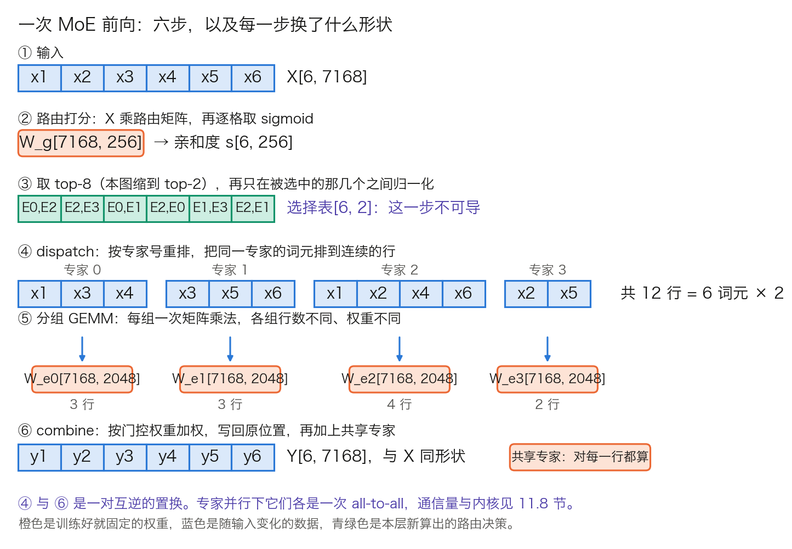
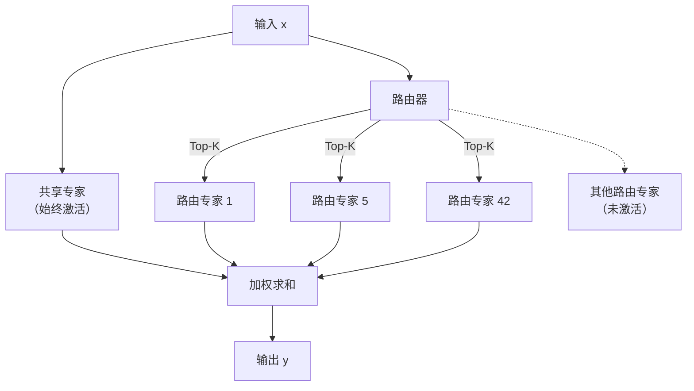

## 14.2 混合专家模型：为什么不必激活所有参数

**混合专家模型**（Mixture of Experts，MoE）把一层 FFN 换成一组并行的 FFN（称为专家），每个词元只走其中几个。它能成立的前提是 FFN 的作用接近按内容寻址的存储（[3.4.3 节](../03_components/3.4_feedforward.md)的键值记忆视角）：单个词元用得上的只是其中一小部分，其余可以不算；注意力是词元之间搬运信息的通道，稀疏不到它头上。直接证据是经验性的：相同激活参数量下 MoE 可以明显强于稠密模型，条件是总参数量大得多、训练词元足够多（14.2.6）。它换来的是容量与每词元计算量的解耦，代价记在另外两栏：显存按总参数算，多卡部署每层多出两次 all-to-all 通信。DeepSeek-V3、Qwen3.5 等公开旗舰的常见配置是词元选专家、大量窄专家加共享专家、用偏置或极小系数的辅助损失做均衡，部署用专家并行加大批量。

[14.1 节](14.1_efficient_attention.md)改的是注意力层，本节改的是 FFN。推理侧专家并行的通信账在 [11.8.7 节](../11_serving/11.8_multi_gpu_inference.md)，本节只引结论。

### 14.2.1 一次 MoE 前向：六步与形状

标准 FFN 是 $y = \text{FFN}(x)$，一个网络处理所有输入。MoE 层改成：

$$
y = \sum_{i \in \text{TopK}} g_i \cdot \text{Expert}_i(x)
$$

$g_i$ 是路由器给第 $i$ 个专家的门控权重，TopK 是被选中的那几个专家。式子省略了实现上最关键的一步：同一批词元选了不同的专家，怎样仍然用矩阵乘法算完。图 14-2 把六步逐一画出，形状按 DeepSeek-V3 的公开配置写：模型宽度 7168，专家中间层宽度 2048，每层 256 个路由专家，每个词元路由 8 个。

图 14-2：一次 MoE 前向的六步，以及每一步换了什么形状（[生成脚本](https://github.com/yeasy/llm_internals/blob/main/tools/figures/ch14a_moe_forward.py)）。示意设定为 6 个词元、4 个路由专家、top-2；每个词元的选择是手工设定的，用来说明置换。橙色是权重，蓝色是数据，青绿色是本层新算出的路由决策。

1. **输入**：`X[T, 7168]`，与稠密层完全相同。
2. **路由打分**：`X[T, 7168] × W_g[7168, 256] → s[T, 256]`。DeepSeek-V3 对每一格取 sigmoid 得到亲和度，各专家的亲和度互不归一。
3. **取 top-k 并归一化**：每行留下最大的 8 个，其余置 0，再在这 8 个之间归一化得到门控权重。“选哪 8 个”不可导，路由器仍然训得动：门控权重在第 6 步乘在专家输出上，梯度经这 8 个权重回到 $W_g$。不可导的后果在别处：每个专家收到多少词元只是一个计数，无法直接写进损失，14.2.3 的均衡手段都要绕开这一点。
4. **dispatch 置换**：按专家号重排，把同一专家的词元排到连续的行。`T` 个词元、top-8，重排后共 `8T` 行。
5. **分组 GEMM**：每个专家对自己那一组做一次矩阵乘法，`[m_i, 7168] × W_i[7168, 2048] → [m_i, 2048]`，再投回 7168 维。各组行数 $m_i$ 不同、权重不同，这是与稠密 FFN 唯一的实质差别。
6. **combine**：按门控权重加权，按第 4 步的逆置换写回原位置，再加上共享专家的输出，得 `Y[T, 7168]`。

第 4、6 两步是一对互逆的置换，存在的理由是 GPU 上最快的路径仍是大矩阵乘法。单卡上它们是一次 gather 加一次 scatter；多卡专家并行下各是一次 all-to-all（[11.8.7 节](../11_serving/11.8_multi_gpu_inference.md)）。这六步在框架里的对应见[附录 A.7](../appendix/a7_framework_recipes.md)。

### 14.2.2 激活参数怎么算：以 DeepSeek-V3 为例

MoE 解开了两件事：总参数量决定模型能存多少知识，每词元激活参数量决定推理要算多少。“671B 总参、37B 激活”可以从公开配置算出来（[技术报告](https://arxiv.org/abs/2412.19437)）：61 层，前 3 层是稠密 FFN（中间层宽度 18,432），其余 58 层是 MoE 层，每层 256 个路由专家加 1 个共享专家。

**单个专家。** 采用 SwiGLU，一个专家是三个 `[7168, 2048]` 的矩阵：

$$
3 \times 7168 \times 2048 = 44{,}040{,}192 \approx 44.0\ \text{M}
$$

**一个 MoE 层**有 257 个专家，`257 × 44.0M = 11.32B`；58 层合计 656.5B。**每个词元**走 8 个路由专家加 1 个共享专家，`9 × 44.0M = 396.4M`，58 层合计 22.99B，只用了 `9/257 = 3.5%` 的专家参数。9 个专家的中间层合计 `9 × 2048 = 18,432`，正好等于稠密 FFN 的宽度：每个词元在 MoE 层里用到的参数量与一层稠密 FFN 相同，多出来的 248 个专家全是容量。

**其余部分全部激活。** 前 3 层稠密 FFN 共 1.19B，61 层 MLA 共 11.41B，嵌入表与输出头各 `129,280 × 7168 = 926.7M`。四部分并排在表 14-3。

| 部分 | 总参数 | 每词元激活 |
| --- | ---: | ---: |
| 58 个 MoE 层的专家 | 656.5B | 22.99B |
| 前 3 层稠密 FFN | 1.19B | 1.19B |
| 61 层 MLA | 11.41B | 11.41B |
| 嵌入表 + 输出头 | 1.85B | 1.85B |
| 合计 | 671B | 37.4B |

表 14-3：DeepSeek-V3 的参数分布，未计入多词元预测模块。总参与激活分别对上官方的 671B 与 37B，激活约占总参的 5.6%。

这张表有两条可以推广的读法。第一，**稀疏只发生在专家上**：注意力、嵌入、输出头和稠密层参与每一次前向，在激活侧占 14.4B，接近四成，所以“总参 / 激活参数”之比永远小于“专家总数 / 每词元专家数”之比。第二，**显存按总参算，算力按激活参数算**：671B 即使用 FP8 也需约 670 GB 权重显存，远超单卡容量，这是 MoE 部署的第一道门槛。

### 14.2.3 路由与负载均衡

路由的默认做法是词元选专家；训练的核心风险是路由坍塌；均衡手段上，DeepSeek-V3 把主力从辅助损失换成了偏置调整，辅助损失只留极小系数。

**两种选择范式。** 词元选择专家（Token-Choice）让每个词元独立选 Top-K 个专家，Switch Transformer、Mixtral、DeepSeek 都采用。专家选择词元（Expert-Choice）让每个专家从批次中选固定数量的词元，负载天然均衡，但有的词元可能不被任何专家选中，而且一个词元的输出会依赖同批的其他词元。前者是主流，因为推理时计算图确定；代价是词元可能扎堆，需要另做均衡。

**负载坍塌**（routing collapse）是指路由器把大部分词元送给少数几个专家，未被选中的专家梯度接近零、无法训练，形成强者愈强。对策有两类。

**辅助负载均衡损失**出自[稀疏门控 MoE](https://arxiv.org/abs/1701.06538) 与 GShard，[Switch Transformer](https://arxiv.org/abs/2101.03961) 给出了广为使用的简化形式：

$$
\mathcal{L}_{\text{balance}} = \alpha \cdot N \sum_{i=1}^{N} f_i \cdot p_i
$$

$f_i$ 是实际路由到专家 $i$ 的词元比例，$p_i$ 是路由器给专家 $i$ 的平均概率，$N$ 是专家数。取 $N = 4$，某批的 $f = [0.7, 0.1, 0.1, 0.1]$、$p = [0.4, 0.2, 0.2, 0.2]$：

$$
N\textstyle\sum_i f_i p_i = 4 \times (0.28 + 0.02 + 0.02 + 0.02) = 1.36
$$

完全均衡时 $f = p = [0.25, 0.25, 0.25, 0.25]$，该值为 1；全部词元塞给同一个专家、路由概率也集中在它身上时为 $N = 4$。$f$ 与 $p$ 同序时（top-k 路由下大体如此）该值不小于 1，所以 1.36 表示有点偏，但远未坍塌。$f_i$ 由 top-k 的计数得到，不可导；$p_i$ 可导。梯度只经 $p_i$ 回传，$f_i$ 充当“当前有多偏”的系数：某个专家越超载，压它概率的力度越大。系数 $\alpha$ 很敏感：过大会压制路由器的学习信号、迫使专家同质，过小不足以阻止坍塌。

**偏置调整**是 DeepSeek-V3 的方案，它不通过损失。每个专家维护一个偏置 $b_i$，只在 top-k 比较时加上：

$$
g'_{i,t} = \begin{cases} s_{i,t}, & s_{i,t} + b_i \in \operatorname{Topk}(\{s_{j,t} + b_j\},\ K_r) \\ 0, & \text{其他} \end{cases}
$$

$s_{i,t}$ 是词元 $t$ 对专家 $i$ 的亲和度，$K_r$ 是每个词元路由的专家数。偏置只影响选谁，与专家输出相乘的门控值仍来自原始亲和度。$b_i$ 不由反向传播学出，按负载规则更新：每一步结束时统计全批的专家负载，超载的减去 $\gamma$，欠载的加上 $\gamma$（V3 取 0.001）。V3 并没有完全移除辅助损失：为防止单条序列内部极端不均，它保留一项系数为 0.0001 的序列级均衡损失。偏置法更好的理由是它在全批范围内配平，序列级损失强制每条序列内部均衡，会妨碍专家按领域分化。路由还可以与网络拓扑协同设计：V3 限制每个词元最多发往 4 个节点，以压低跨节点流量。

**容量因子与词元丢弃。** 分布式实现中每个专家的批大小必须静态确定，于是有容量上限：

$$
\text{capacity} = \frac{\text{总词元数} \times K}{\text{专家数}} \times \text{capacity factor}
$$

批内 8192 个词元、64 个专家、top-2，平均每专家 `8192 × 2 ÷ 64 = 256` 个；容量因子取 1.25，每专家槽位 320。某专家实际收到 500 个词元，就丢弃 180 个，这些词元不经过这一层，由残差连接直接跳过。反过来，路由完全均匀时 `64 × 320 = 20,480` 个槽位里有 4096 个空转，20% 的计算与通信白做。调小丢词元，调大烧算力，两头都是真实损失。dropless 实现改用变长分组 GEMM 避开静态上限，代价是内核复杂度；DeepSeek-V3 报告称训练与推理全程不丢弃词元。

**该盯的三个指标**是路由熵（是否坍塌成少数几个专家）、每专家的词元分布（是否长尾）、词元丢弃率（容量因子是否合适）。只看最终损失不够：路由坍塌可以在损失曲线上潜伏很久，直到某几个专家已经死掉才显现。

### 14.2.4 细粒度 MoE 与共享专家

MoE 层有三个旋钮：专家数 $N$、每词元路由的专家数 $K$、专家中间层宽度 $m$；模型宽度记作 $d$。三笔开销各自正比于一个乘积：每词元的非线性容量与计算量正比于 $K \cdot m$，发往专家的通信量正比于 $K \cdot d$，单个专家的权重正比于 $d \cdot m$。趋势是 $N$、$K$ 变大而 $m$ 变小，尽头是单个专家的矩阵乘窄到喂不饱硬件（14.2.5）；LatentMoE 在这条约束下改压 $d$。

**细粒度 MoE** 由 DeepSeek 系列推广：把同样的参数量拆成大量小专家。Mixtral 8x7B 是 8 选 2，只有 $\binom{8}{2} = 28$ 种组合；V3 是 256 选 8，$\binom{256}{8} \approx 4.1\times10^{14}$ 种。组合数不等于有效表达能力，但它说明路由器可以做出精细得多的区分，专家数多时统计上也更容易均衡。Top-1（Switch Transformer）计算最省，每个词元的表达受限于单个专家；专家很小时多选几个仍然便宜，V3 取 8，Qwen3.5 取 10。

**共享专家**（Shared Expert）对所有词元始终激活，不参与路由。动机是基本语法、常见语义这类通用能力应被所有输入共享，否则每个路由专家都要冗余地学一遍。V3 每层 1 个共享专家，与路由专家同宽，开销占激活量的 1/9。图 14-3 画出两类专家的分工。

图 14-3：共享专家与路由专家的分工。共享专家不经过路由，对每个词元都算；路由专家只在被选中时参与。

**LatentMoE：先降维再进专家。** 细粒度切窄的是 $m$，专家的输入与输出仍是完整的 $d$ 维；$N$ 与 $K$ 继续增大时，通信量 $K \cdot d$ 与专家权重 $d \cdot m$ 跟着涨。[LatentMoE](https://arxiv.org/abs/2601.18089) 只压 $d$：被路由的词元先乘一个各专家共用的下投影，从 $d$ 维降到 $\ell$ 维，专家在 $\ell$ 维上计算，加权求和后再乘上投影回到 $d$ 维（按本书的行向量写法）：

$$
y = \Big(\sum_{i \in \text{TopK}} g_i \cdot \text{Expert}_i(x W_\downarrow)\Big) W_\uparrow + \sum_{j} \text{SharedExpert}_j(x), \qquad W_\downarrow: [d, \ell],\quad W_\uparrow: [\ell, d]
$$

路由器与共享专家留在全宽，它们对访存与通信瓶颈的贡献不大。$K$ 与 $m$ 不动，因为减小任何一个都损害质量；$d$ 可以压，16B 模型上的消融显示压缩比 $\alpha = d/\ell$ 不超过 4 时验证损失基本不变。省下的预算，论文推荐的花法是把专家数与 $K$ 都乘 $\alpha$：通信量与访存回到原水平，换来更多的专家组合与 $\alpha$ 倍的 $K \cdot m$。在 95B 模型上（$d = 4096$、$\ell = 1024$），这样配置的总参数与激活参数同基线持平，下游指标都高于基线。

[Kimi K3](https://arxiv.org/abs/2607.24653) 是旗舰规模的样本：模型宽度 7168，路由专家工作在 3584 维（压缩比 2），中间层宽度 3072；每层 896 个路由专家，每词元激活 16 个，另有 2 个全宽的共享专家。一个路由专家是 `3 × 3584 × 3072 ≈ 33.0M` 个参数，是全宽时的一半。每个词元向 16 个专家各发一份 3584 维向量，共 `16 × 3584 = 57,344` 个数，与 DeepSeek-V3 的 `8 × 7168` 相等：$K$ 翻了一倍，每层 all-to-all 的数据量没有增加。

代价有两处。两个投影对每个词元都要计算，等参数量对比下并发度为 1 时每卡吞吐低 12%，并发度更高时差距至多约 6%。训练稳定性也更难：下投影、专家、上投影连成近四次连续的矩阵乘，K3 在其规模上遇到了内部激活爆炸，近千个专家的均衡也超出了固定步长偏置更新的适用范围，对策是在上投影之前加 RMSNorm、给激活函数加软上限、按分位数设定偏置。

### 14.2.5 推理侧：显存、通信与小批量

MoE 推理有三道约束。前两道已经算清：显存按总参数算（14.2.2）；多卡下每层两次 all-to-all，专家要用专家并行而不是张量并行来切，单个专家用 8 路张量并行切开后中间层只剩 256 维，矩阵太窄（通信量、实测耗时与四种并行方式的对照见 [11.8.7 节](../11_serving/11.8_multi_gpu_inference.md)）。第三道是小批量下专家的矩阵乘喂不饱硬件，它决定了部署形态。

**解码小批量是 MoE 效率最低的场景。** 平均每个专家分到的词元数是“全组词元总数 × K ÷ 专家数”，V3 即总数的 1/32。一个专家的三个矩阵在 FP8 下是 44 MB，为 $b$ 个词元做的运算约 `2 × 44.04M × b` 次，算术强度是

$$
I = \frac{2 \times 44{,}040{,}192 \times b}{44{,}040{,}192\ \text{字节}} = 2b\ \text{FLOPs/Byte}
$$

H100 的拐点约 300 FLOPs/Byte（[10.1.2 节](../10_inference_optimization/10.1_bottleneck.md)），要让这个 GEMM 算力受限，需要每专家 $b \ge 150$，换算回全组是每步 `150 × 32 = 4800` 个词元。全组一步只有 64 个词元时每个专家平均 2 个，算术强度只有 4，比拐点低近两个数量级：读 44 MB 权重只为算 2 行。

“专家并行加大批量”因此是主流部署形态：不这样做，专家的 GEMM 喂不饱。同一道理，小批次时 MoE 的效率不如同激活量的稠密模型，大批次时优势才显现。权重用 BF16 时字节数翻倍，$I = b$，门槛升到每专家约 300 个词元，MoE 因此比稠密模型更依赖低精度权重。显存放不下全部专家时，可以用量化与专家卸载换取可运行性，代价是延迟。

**执行侧的均衡不改路由，只改在哪儿算。** 路由分布均匀之后，执行仍可能不均：专家分布在不同的卡上，某一批的实际词元分布会让个别卡拖慢整层。运行时的对策必须保持语义不变，例如把共享专家的工作按各卡空闲程度分派，或在高负载专家的多个冗余副本之间切分词元（SGLang 的 [Waterfill 与 LPLB](https://lmsys.org/blog/2026-06-26-waterfill-lplb)）。两者都不改变路由器选中的专家集合，输出不变；公布的实测收益是个位数百分比的吞吐，属于压榨最后几个百分点的手段。机制细节见[附录 A.7](../appendix/a7_framework_recipes.md)。

### 14.2.6 公开模型的架构参数

公开模型分成两条路线：少量大专家加 Top-2（Mixtral），大量小专家加共享专家（DeepSeek、Qwen）。表 14-4 列出各模型的专家数、每词元路由几个、有没有共享专家、专家做到多窄。

| 模型 | 总参数 | 激活参数 | 路由专家数 | 每词元路由 | 共享专家 | 专家中间层宽度 |
| --- | ---: | ---: | ---: | ---: | ---: | ---: |
| Switch Transformer | 多种 | 多种 | 2 到 2048 | 1 | 无 | 与稠密 FFN 同宽 |
| Mixtral 8x7B | 46.7B | 13B | 8 | 2 | 无 | 14,336 |
| Mixtral 8x22B | 141B | 39B | 8 | 2 | 无 | — |
| DeepSeek-V2 | 236B | 21B | 160 | 6 | 2 | — |
| DeepSeek-V3 | 671B | 37B | 256 | 8 | 1 | 2,048 |
| Llama 4 Scout | 109B | 17B | 16 | 1 | 1 | 8,192 |
| Llama 4 Maverick | 400B | 17B | 128 | 1 | 1 | — |
| Qwen3.5-397B-A17B | 397B | 17B | 512 | 10 | 有 | 1,024 |

表 14-4：主流 MoE 模型的架构参数，取自各模型公开的配置文件与论文；逐项出处见[附录 A.3](../appendix/a3_model_reference.md)。

“专家中间层宽度”一列比“粒度粗细”的标签更有信息量。DeepSeek-V3 的 2048 只有它稠密 FFN 的 1/9，Qwen3.5 的 1024 只有模型宽度的 1/4，这才是典型的细粒度；Llama 4 Scout 的 8192 是其稠密 FFN 的一半，稀疏性来自“16 选 1”的极低 top-k，没有把专家切小。

**比较口径决定结论。** Mixtral 8x7B 以 13B 激活参数超过了 Llama 2 70B，说明按激活参数比，MoE 可以明显强于稠密模型。这条结论有两个前提：总参数量大得多，训练词元足够多。按总参数比，MoE 的每个词元只用上其中一小部分，每个路由专家平均只见到 $K/N$ 的词元，要更多训练数据才学得满。选 MoE 的理由是每词元计算量受限而显存与训练数据充裕；反过来，显存受限或批量很小时，同激活量的稠密模型更合适。

### 14.2.7 趋势

三个方向都在改“每个词元激活哪些参数”这件事的粒度：激活的专家数随词元变化，MoE 与混合序列层叠加，以及在条件计算之外增加一条条件记忆的轴。

**每词元专家数可变。** 零计算专家（zero-computation expert）原样返回输入，不做任何运算。[LongCat-Flash](https://arxiv.org/abs/2509.01322) 在每层 512 个 FFN 专家之外加入 256 个零计算专家，路由器照常从 768 个里为每个词元选 12 个：选中几个零计算专家，这个词元就少算几个 FFN。它用专家偏置把平均激活的 FFN 专家数控制在 8 个左右，每词元激活 18.6B 到 31.3B，平均约 27B，总参数 560B。

**与混合架构叠加。** MoE 改的是 FFN，[14.3 节](14.3_ssm_hybrid.md)的混合架构改的是序列层，两者互不冲突：Jamba 在 Mamba 与注意力混合的骨干上叠加 MoE，Qwen3.5 把线性注意力与 512 专家的 MoE 放在同一个模型里。

**条件记忆。** MoE 是条件计算，[Engram](https://arxiv.org/abs/2601.07372) 加了一条条件记忆的轴：用以当前位置结尾的 N-gram 的哈希值作下标，从一张大嵌入表里取出几行，经门控后加到残差流上，不经过矩阵乘。下标只依赖输入的词元 ID，前向开始之前就能算出，表因此可以放在主机内存里异步预取，这是 MoE 的路由做不到的：100B 参数的表放在主机内存，8B 稠密模型的吞吐只降 2.8%。在固定总参数与激活参数（两者之比约 10）的受控实验里，验证损失随分配比例呈 U 形，把未激活预算的 20% 到 25% 给查表时最低。
