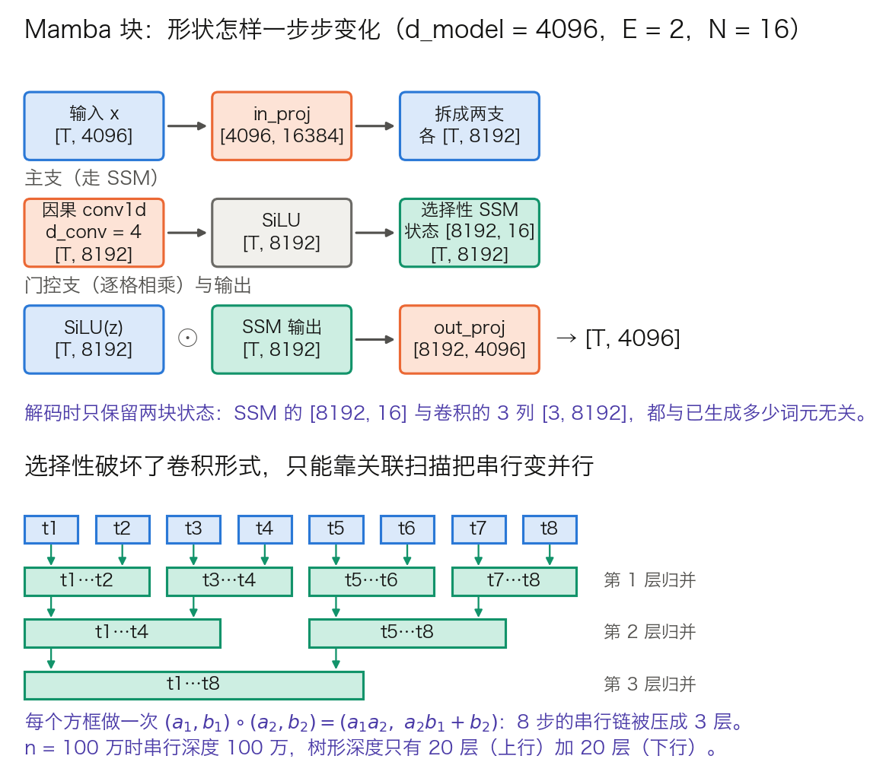

## 14.3 状态空间模型与混合架构：注意力的挑战者

**状态空间模型**（State Space Model，SSM）与线性注意力是同一类东西：用一块固定大小的状态做线性递推来概括历史，差别只在状态转移的结构与写入规则。让参数随输入变化（选择性）换来按内容记忆，代价是失去卷积形式，训练要靠并行扫描；Mamba-2 把转移限制成标量，就是为了回到矩阵乘。固定状态的代价是精确检索与逐字复制，转移只有正实特征值时还做不了状态追踪，所以没有纯 SSM 的旗舰模型，落地形态是混合。混合比例在公开模型里并不一致，线性层与全注意力层之比有 3:1、5:1、7:1。KV 的降幅等于不留 KV 的层占比；质量一侧的两份公开消融显示，全注意力占四分之一到一半时质量平稳，再往下压结论不一：Jamba 在 1:3 与 1:7 之间看不出差别，Kimi Linear 在 3:1 时验证困惑度最低、7:1 起变差。比例因此由缓存预算定，3:1 是有消融支持、最常见的取值，更激进的比例要用自己任务上的检索评测来验证。

[14.2 节](14.2_moe.md)的 MoE 拆开了“模型有多大”与“每个词元算多少”，拆不开 KV 缓存随序列增长这笔账。[14.1.2 节](14.1_efficient_attention.md)从核化注意力推出过固定状态的递推，本节从连续系统的离散化走到同一个地方。

### 14.3.1 从连续系统到递推：离散化那一格

SSM 源于控制理论中的线性时不变系统。连续形式把输入信号 $x(t)$ 经一个隐状态 $h(t)$ 映到输出 $y(t)$：

$$
h'(t) = A h(t) + B x(t), \qquad y(t) = C h(t)
$$

语言模型面对的是离散词元，要先把这个系统按步长 $\Delta$ **离散化**（discretization）。常用的零阶保持（Zero-Order Hold，ZOH）给出：

$$
\bar{A} = \exp(\Delta A), \qquad \bar{B} = (\Delta A)^{-1}\left(\exp(\Delta A) - I\right)\Delta B
$$

$\Delta$ 很小时 $\bar{B}$ 近似 $\Delta B$，本节的算例只用到 $\bar{A} = \exp(\Delta A)$。于是得到递推式（$N$ 是状态维）：

$$
\begin{aligned}
h_t &= \bar{A} h_{t-1} + \bar{B} x_t && [N] \\
y_t &= C h_t && [1]
\end{aligned}
$$

这是单个通道上的系统：$x_t$ 与 $y_t$ 是标量，状态 $h_t$ 是 $N$ 维向量。输入是多通道的向量序列时，每个通道各跑一个这样的 SSM，互不相干（[Mamba 论文](https://arxiv.org/abs/2312.00752)）。通道数为 `d_inner` 时，总状态是 `[d_inner, N]`，后面的状态形状都由这一条推出。

$\Delta$ 管的是遗忘速度。取标量 $A = -1$，$\bar{A} = \exp(-\Delta)$，代入几个取值见表 14-5：

| $\Delta$ | $\bar{A} = e^{-\Delta}$ | 旧状态衰减到一半需要几步 |
| ---: | ---: | ---: |
| 0.01 | 0.9900 | 69.3 |
| 0.1 | 0.9048 | 6.9 |
| 1.0 | 0.3679 | 0.7 |
| 2.0 | 0.1353 | 0.3 |

表 14-5：离散化步长怎样决定遗忘速度。最后一列是 $\ln 2 / \Delta$。$\Delta$ 小则 $\bar{A}$ 接近 1，旧状态几乎原样留着；$\Delta$ 大则一两步就把历史冲掉，同时 $\bar{B}$ 把当前输入放大写入。$\Delta$ 是“保持”与“快进”之间的旋钮。

**S4**（Structured State Space for Sequence Modeling）通过对 $A$ 的结构化参数化（HiPPO 初始化）解决了长距离建模的困难，首次在长序列基准上达到 Transformer 的水平。它的 $A$、$B$、$C$、$\Delta$ 都与输入无关，这是下一步要改的地方。

### 14.3.2 选择性：为什么它逼出了并行扫描

参数与输入无关时，整条序列是一次卷积，训练很快，但模型无法按内容决定记什么。Mamba 让参数随输入变化，卷积形式随之失效，替代的并行算法是关联扫描。

**线性时不变的代价。** $A$、$B$、$C$ 固定时，把递推展开，整条序列可以写成一次卷积：

$$
K = (CB,\ C\bar{A}B,\ C\bar{A}^2B,\ \dots), \qquad y = x * K
$$

卷积核 $K$ 与输入无关，可以先算好，再用 FFT 一次算完整条序列。代价是同一个卷积核作用在每一个位置上。

**Mamba 的选择性机制**（selective mechanism）让 $B$、$C$、$\Delta$ 依赖于输入：

$$
B_t = f_B(x_t), \qquad C_t = f_C(x_t), \qquad \Delta_t = \tau_\Delta(f_\Delta(x_t))
$$

$f_B$、$f_C$ 是投到 $N$ 维的线性层，$\tau_\Delta$ 取 softplus。各通道共用同一组 $B_t$、$C_t$，$A$ 与 $\Delta_t$ 每个通道各有一份。于是每个位置有自己的一套 $(\bar{A}_t, \bar{B}_t, C_t)$，模型可以按当前词元决定“保持”还是“快进”；$K$ 不再固定，没有可以预先算好的核。

**扫描的结合律算子。** 递推 $h_t = a_t h_{t-1} + b_t$ 可以把一段区间概括成一对数 $(a, b)$，表示“进来的状态乘 $a$ 再加 $b$”。两段相邻区间的合并是：

$$
(a_1, b_1) \circ (a_2, b_2) = (a_1a_2,\ a_2 b_1 + b_2)
$$

这个算子满足结合律，合并顺序可以任意。图 14-4 的下半幅用 8 个时间步展示树形归并：两两合并得 4 段，再合并得 2 段，再合并得 1 段，串行深度 8 被压成 3 层。$n = 100$ 万时串行深度 100 万，树形深度只有上行 20 层加下行 20 层，总工作量约 $2n$。

**不物化中间状态。** 朴素实现要在显存里准备 `[B, L, d_inner, N]` 的扫描输入（$B$ 是批大小，$L$ 是序列长度），属于访存受限。Mamba 的硬件感知实现只从显存读 $(\Delta, A, B, C)$，在片上完成离散化、扫描和乘 $C$，只把 `[B, L, d_inner]` 的输出写回；反向传播需要的中间状态不保存，反向时重算。这与 [10.3 节](../10_inference_optimization/10.3_flash_attention.md) FlashAttention 的思路一致，融合后的选择性扫描层与用 FlashAttention 的 Transformer 显存需求相同。

### 14.3.3 Mamba 块：形状怎样一步步变化

一个 Mamba 块是“扩张、短卷积、选择性 SSM、门控、收回”，参数几乎全在两个投影上。图 14-4 的上半幅画出形状，取 `d_model = 4096`、扩张因子 $E = 2$，得 `d_inner = 8192`；状态维 $N = 16$，卷积核长 4。

图 14-4：Mamba 块的形状流，以及选择性为什么逼出关联扫描（[生成脚本](https://github.com/yeasy/llm_internals/blob/main/tools/figures/ch14a_mamba_block.py)）。橙色是权重，蓝色是数据，青绿色是本层新算出的状态。

- **输入投影**（一次矩阵乘法，同时产出主支与门控支）：`x[T, 4096] × W_in[4096, 16384] → [T, 16384]`，拆成两块 `[T, 8192]`。
- **因果卷积**（逐通道，核长 4）加 SiLU 激活：`[T, 8192] → [T, 8192]`，解码时保留最近 3 列。
- **选择性 SSM**：`[T, 8192] → [T, 8192]`，内部状态 `[8192, 16]`，即 8192 个通道各带一个 $N = 16$ 的状态。
- **门控**（逐格相乘）：`SiLU(z)[T, 8192] ⊙ SSM 输出[T, 8192] → [T, 8192]`。
- **输出投影**：`[T, 8192] × W_out[8192, 4096] → [T, 4096]`，与输入同形状。

输入投影 $2ED^2$、输出投影 $ED^2$（$D$ 即 `d_model`），合计 $3ED^2$，$\Delta$、$B$、$C$、$A$ 的投影小得多。$E = 2$ 时一个块是 $6D^2$，两个块叠起来正好对上 Transformer 一层“注意力加 MLP”的 $12D^2$，所以 Mamba 模型的层数通常是同宽 Transformer 的两倍。官方实现里的构造参数与内核名见[附录 A.7](../appendix/a7_framework_recipes.md)。

### 14.3.4 状态账：固定状态对 KV 缓存，交叉点在哪

“不需要 KV 缓存”换来的是一块大小固定的显存，状态越大越能记，也越晚开始省。交叉点等于固定状态的大小除以每词元 KV 的大小，公开配置算出来都在一千词元以内，远短于实际上下文，所以它不是选型判据；起作用的门槛是批大小与上下文长度的乘积（[14.1.6 节](14.1_efficient_attention.md)）。

沿用 Llama 3 8B 的口径，GQA 层每词元每层 2048 个数。Mamba 层每层的 SSM 状态是 `8192 × 16 = 131,072` 个数，外加卷积缓存 `3 × 8192 = 24,576` 个数，两者都与已生成多少词元无关；交叉点只计 SSM 状态是 64 个词元，连同卷积缓存是 76 个。[Mamba-2](https://arxiv.org/abs/2405.21060) 把状态维放大到 64 乃至 256，状态是 524,288 与 2,097,152 个数，交叉点推到 256 与 1024。加大 $N$ 能显著改善困惑度，前提是 $B$、$C$ 也是选择性的。

吞吐上的收益要看条件。Mamba 论文报告的是比同规模 Transformer 高 4 到 5 倍的推理吞吐，原因是没有 KV 缓存，可以用大得多的批。收益来自同一块显存能同时服务更多请求，每步并没有更快；把它读成“单请求延迟降 5 倍”是误读。

### 14.3.5 Mamba-2 与 SSD：和线性注意力是同一件事

把每个头的状态转移限制成标量乘单位矩阵之后，选择性 SSM 与使用标量衰减门控、不带归一化分母的线性注意力是同一个数学对象。这层关系称为状态空间对偶（State Space Duality，SSD），它换来的是计算形式：整段序列的变换变成一次带掩码的矩阵乘。

从零初始状态出发，把选择性 SSM 的递推按 $t$ 展开，位置 $t$ 的输出是

$$
y_t = \sum_{s \le t} C_t \left(\prod_{r=s+1}^{t}\bar{A}_r\right)\bar{B}_s x_s
$$

一般情况下，括号里的连乘仍是矩阵，不能提出为一个标量。[Mamba-2 论文](https://arxiv.org/abs/2405.21060)的关键限制是 $\bar{A}_t = a_t I$。这时令 $L_{ts} = \prod_{r=s+1}^{t} a_r$（$s \le t$，对角线为空积 1；$s > t$ 时为 0），可得 $y = (L \circ C\bar{B}^T)x$，其中 $C$ 与 $\bar B$ 的每一行分别是该位置的读出向量与离散输入向量。对照线性注意力：$C$ 对应 Query，$\bar B$ 对应 Key，$x$ 对应 Value，$L$ 对应门控衰减的累积。

这个对应有边界。它不等于 [14.1.3 节](14.1_efficient_attention.md)完整的 delta 更新，后者还包含依赖 Key 方向的状态改写；一般的对角转移也不满足它，必须先核对状态转移结构、门控粒度和归一化方式，才能在模型之间转换记号。成立时，两类模型共享实现：SSD 算法把序列切块，块内直接做矩阵乘，块间只传状态，就是 14.1.3 的分块并行形式，计算落在 Tensor Core 上，累积衰减的倒数同样要防溢出。论文报告它比 Mamba 的选择性扫描快 2 到 8 倍，并能在几乎不减速的前提下把状态做到 8 倍以上。状态账的算法不变：每个通道仍带一个 $N$ 维状态，变的只是同一个头里的通道共用一个标量衰减 $a_t$。

**Mamba-3 补的是标量正实转移做不了的事。** [Mamba-3](https://arxiv.org/abs/2603.15569) 在 Mamba-2 之上改了三处，每一处都保住了矩阵乘形式。

- **复数状态，针对状态追踪。** 状态追踪（state tracking）是指状态要随输入在有限个取值之间来回切换的任务，最简单的例子是奇偶校验：读入一串 0 和 1，判断 1 的个数是奇数还是偶数。正实数的 $a_t$ 对旧状态只能缩放，不能旋转；转移矩阵的特征值限制为非负实数时，这类任务无法表达。旋转可以做到：二维状态每读到一个 1 就转 180°，从 $(1, 0)$ 出发依次读入 1、1、0、1，状态依次是 $(-1, 0)$、$(1, 0)$、$(1, 0)$、$(-1, 0)$，第一个分量的符号就是答案。Mamba-3 把转移取为复数，等价的实数形式是标量衰减乘一组 $2 \times 2$ 旋转，旋转角由当前输入算出；累积的旋转可以作用到 $B_t$ 与 $C_t$ 上，形式与 RoPE 相同，只是角度依赖数据，状态转移因此仍是标量。奇偶校验上 Mamba-3 的准确率为 100%，Mamba-2 为 0.90%。
- **梯形离散化，替掉短卷积。** 写入项改成上一步输入与当前输入的加权组合，$h_t = a_t h_{t-1} + \beta_t B_{t-1} x_{t-1} + \gamma_t B_t x_t$，相当于在状态输入上加一个两点卷积。配合 $B$、$C$ 上的可学习偏置，14.3.3 的短因果卷积可以去掉：440M 模型的困惑度是 15.72，加回卷积是 15.85。
- **多输入多输出（MIMO）更新，针对解码的硬件利用率。** Mamba 解码一步的算术强度约为 2.5 FLOPs/Byte，远低于 H100 的拐点约 300（[10.1.2 节](../10_inference_optimization/10.1_bottleneck.md)）：带宽被状态读写占满，算力闲置。MIMO 把每步写入的外积扩成秩为 $R$ 的矩阵乘，状态形状与访存量基本不变，计算量乘 $R$。取 $R = 4$ 时解码延迟与 Mamba-2 相近，训练内核约慢 2 倍。

三处改动提高的是表达能力与硬件利用率，状态仍是固定大小，14.3.6 的容量约束不变。该文的检索评测中 Transformer 基线仍明显更强，作者据此预计线性层将主要用在混合架构里。

### 14.3.6 固定状态的代价：哪些任务最先失效

固定状态有三类失效，前两类来自容量，第三类来自转移结构。[14.1.2 节](14.1_efficient_attention.md)第七步的秩上界在 SSM 上是同一条：状态 `[d_inner, N]` 的容量固定，写入量超过容量后，旧内容只能被挤掉或被干扰。

- **逐字复制**：给一段随机串要求原样输出，所需状态随串长增长，固定状态给不出。
- **关联召回**：文中先给出若干“键—值”对，末尾问其中某一个键对应什么。纯 SSM 在这两类任务上明显弱于注意力，长文检索评测（大海捞针）的失分也来自这里。
- **状态追踪**：转移矩阵的特征值限制为非负实数时，状态无法表达旋转。14.3.5 的复数状态针对的是这一类。

混合为什么有效也由此说明。注意力层把全部 Key 原样留着，任何一个位置都能被寻址；每隔几层插一层，模型就有了回头看原文的通道，大部分层仍走固定状态。代价是这几层的 KV 缓存照样随序列线性增长，长上下文下由它们决定显存上限。

### 14.3.7 混合比例：公开配置里长什么样

比例没有收敛到一个值。规律只有一条：KV 缓存的降幅等于不留 KV 的层占比，3:1 降 75%，5:1 降 83%，7:1 降 87.5%；质量一侧，全注意力占四分之一以上时对比例不敏感，再往下压各家结论不一。表 14-6 汇总公开配置。

| 模型 | 序列层类型 | 比例 | MoE | 上下文 |
| --- | --- | --- | --- | --- |
| Jamba（AI21） | Mamba 与注意力交替 | 注意力 : Mamba = 1:7 | 每 2 层一个 MoE 层，16 专家 top-2 | 256K |
| Qwen3.5-397B-A17B（397B 总参 / 17B 激活） | 45 层线性注意力 + 15 层全注意力 | 3:1（`full_attention_interval = 4`） | 512 专家 top-10，另有共享专家 | — |
| Kimi Linear（48B / 3B 激活） | KDA 与全注意力 MLA 交替 | 3:1 | — | 1M |
| Kimi K3（2.8T / 104B 激活） | 每块 3 层 KDA 接 1 层 Gated MLA | 3:1，骨干末尾额外加一层 Gated MLA | LatentMoE，896 专家 top-16，另有 2 个共享专家 | — |
| NVIDIA Nemotron 3 Ultra（550B / 55B 激活） | Mamba-2 层与 MoE 层交替，保留少量注意力层 | 周期排布，间隔不均匀 | LatentMoE | 1M |
| MiniMax-Text-01（456B / 45.9B 激活） | 每 7 层 Lightning Attention 接 1 层 softmax 注意力，共 80 层 | 7:1 | 32 专家 top-2 | 1M（推理时外推到 4M） |

表 14-6：公开混合架构的层布局，取自 [Jamba](https://arxiv.org/abs/2403.19887)、[MiniMax-01](https://arxiv.org/abs/2501.08313)、[Kimi K3](https://arxiv.org/abs/2607.24653) 与 [LatentMoE](https://arxiv.org/abs/2601.18089) 等论文及各模型公开的配置文件；逐项出处见[附录 A.3](../appendix/a3_model_reference.md)。Lightning Attention 是线性注意力的一种 I/O 感知实现，递推即 [14.1.2 节](14.1_efficient_attention.md)的累加形式。

**比例怎么定。** 公开的比例消融有两份。Jamba 在 1.3B 模型上比较注意力层与 Mamba 层 1:3 与 1:7，质量几乎无差，选 1:7 是因为更省算力。[Kimi Linear](https://arxiv.org/abs/2510.26692) 比较 KDA 与 MLA 的 0:1、1:1、3:1、7:1、15:1，验证困惑度依次是 5.77、5.66、5.65、5.70、5.82：3:1 最低，1:1 几乎相同，7:1 的训练损失相近而验证集明显变差，纯全注意力（5.77）也不如 1:1 到 7:1 的混合。Mamba-3 的作者按线性层与注意力层 5:1 训练混合模型。两份消融的共同点是全注意力占四分之一到一半时质量平稳；再往下压，结论随模型与验证集而变。比例因此由缓存预算定：全注意力层越少，KV 越小，离固定状态的检索上限也越近。3:1 是有消融支持、Kimi 与 Qwen 都采用的取值，7:1 多省的 KV 要用自己任务上的检索评测来换。

**Qwen3.5 的缓存账。** 这份配置每个全注意力层有 2 个 KV 头、头宽 256，每词元每层 `2 × 2 × 256 = 1024` 个数。15 个全注意力层合计 15,360 个数，BF16 下 30 KiB/词元；60 层全用全注意力是 120 KiB/词元，降幅恰是 `1 − 15/60 = 75%`。100 万词元上下文下是 29 GiB 对 114 GiB。45 个线性层的固定状态合计约 4,700 万个数，每个请求不到 100 MB，与长度无关（状态形状见[附录 A.7](../appendix/a7_framework_recipes.md)）。

**混合对前缀缓存的后果。** KV 缓存可以在任意前缀长度处截断和复用，[11.5 节](../11_serving/11.5_prefix_reuse.md)的前缀复用靠的就是这一点。递推状态是全部历史的摘要，只能在保存过快照的位置复用，不能回退到任意前缀；混合模型要做前缀复用，就得在可能复用的位置另存线性层的状态快照。这是固定状态的结构性后果，与具体引擎无关。

混合也不止“线性层加全注意力层”一种。Griffin（Google）用局部注意力加门控线性循环层；Zamba（Zyphra）让多个 Mamba 块共享同一个注意力层，省的是参数而非缓存。共同点是去掉了“全模型只用一种序列算子”这个隐含前提：层与层之间用哪种算子，成了一个可以按缓存预算调的超参。
