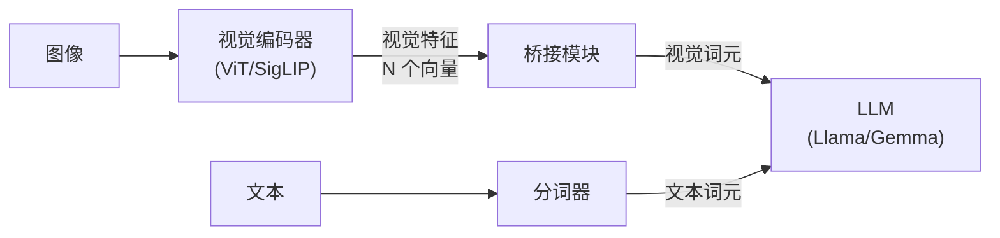
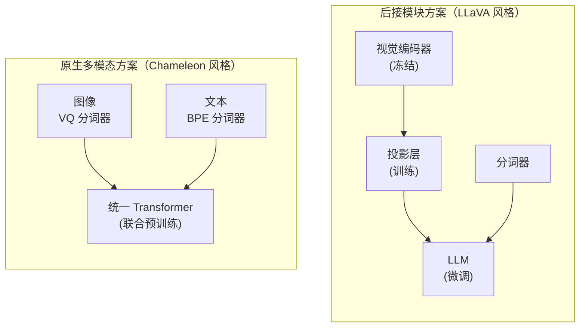

## 14.4 多模态 Transformer：统一不同模态的表示

多模态接入是把图像、音频这类连续信号变成与文本词元同宽的向量序列，排进同一条序列，此后模型不再区分每一行的来源。第一笔账因此是每张图、每秒音视频折成多少行，这个数直接乘进预填充计算量与 KV 缓存。设计空间有三个旋钮：编码器决定看得见什么；压缩决定行数，公开细节的模型里常见的做法是相邻 2×2 patch 合并加 MLP 投影，并用不切图的原生动态分辨率；训练方式决定上限，事后对齐便宜但被编码器封顶，联合预训练贵，视觉表示随语言目标一起优化。离散词元一支的价值在于能像文字一样自回归生成，代价是量化损失与训练稳定性。这条链路上的错误多半出在某一环的硬约束上，可以逐环定位。

前面三节改的是模型内部的算子，共同的前提是送进来的是一串文本词元；本节去掉这个前提。

### 14.4.1 视觉编码器：从像素到向量

视觉词元化有连续与离散两条路，编码器通常复用在大规模图文数据上预训练好的模型。

**Patch Embedding**（ViT 方案）把图像切成固定大小的块，每块经线性投影变为一个向量：

$$
\text{词元数} = \left(\frac{\text{边长}}{\text{patch 边长}}\right)^2
$$

ViT-L/14 处理 224×224 的图得 $$(224/14)^2 = 256$$ 个，处理 336×336 得 576 个。ViT 在序列前加的 `[CLS]` 词元可作整图的全局特征，多模态模型通常丢弃它，只取 patch 特征。

**离散视觉词元**（Visual Tokenizer）用 VQ-VAE 一类方法把图像块编码为码本索引，图像与文本在形式上完全统一，可以像生成文字一样逐个生成。Chameleon 的分词器把一张 512×512 的图编码成 1024 个离散词元，码本大小 8192，并入它 65,536 项的词表。

连续一支的编码器多数来自对比学习。**对比学习**在这里是指：一批 $$N$$ 个图文对，图像编码器与文本编码器各出 $$N$$ 个向量，两两算相似度得到 $$N \times N$$ 的矩阵；训练目标是让每张图在它那一行里认出配对的文本，每段文本在它那一列里认出配对的图，即按行、按列各做一次 softmax 分类（[CLIP](https://arxiv.org/abs/2103.00020)，4 亿图文对）。配对的图文被拉近，不配对的被推开，视觉特征因此天然与文本语义对齐，后续桥接容易。SigLIP 把损失换成对每个图文对独立计算的 sigmoid 二分类，去掉了批内归一化对批大小的限制。InternViT 把编码器做到 6B 参数。对比学习优化的是整图与一句话的对齐，这一点决定了 14.4.7 的几类系统性弱项；14.4.5 的 Kimi K3 改为让编码器从头随语言建模目标训练。

### 14.4.2 一张图变成多少行：三个算例

视觉词元数决定 LLM 要算多少，是整条链路上最需要先算清的量：分辨率决定词元数，词元数决定预填充计算量与 KV 缓存。

**固定分辨率。** LLaVA-1.5 用 CLIP ViT-L/14 @336，一张图 576 行。配一句 8 个词元的问句（其中一个是图像占位符），替换后序列是 `7 + 576 = 583` 行，视觉侧占 98.8%。

**动态分辨率切图。** InternVL 1.5 把图按长宽比切成若干 448×448 的块，训练时 1 到 12 块，测试可零样本扩到 40 块（约 4K 分辨率）。每块 $$(448/14)^2 = 1024$$ 个 patch，再经 pixel shuffle 压到四分之一，即每块 256 行；pixel shuffle 在这里是把相邻 2×2 个 patch 的特征拼接成一个 4 倍宽的向量。12 块加一张缩略图是 `13 × 256 = 3328` 行，40 块加缩略图是 10,496 行。

**视频。** 按 1 fps 采样、每帧 256 行，10 分钟是 `600 × 256 = 153,600` 行，超过多数模型的上下文上限。视频因此必须配词元压缩：[Qwen2-VL](https://arxiv.org/abs/2409.12191) 每秒采 2 帧，用深度为 2 的三维卷积把相邻两帧并成一组，并动态调低每帧分辨率，把单个视频的词元总数限制在 16,384。

行数是精度与成本之间的旋钮：读小字、看文档这类任务靠高分辨率换行数，行数又按 [3.8.8 节](../03_components/3.8_gpt_inference_flow.md)的账落到推理成本上。

### 14.4.3 视觉-语言桥接：三种方案

桥接模块（也称投影模块或适配器）做两件事：把视觉特征映到 LLM 的嵌入维度，并决定送多少行。今天常见的做法是相邻 patch 合并加 MLP 投影，实现简单、压缩比可控、对高分辨率友好；用可学习查询把行数钉死的 Q-Former 与 Perceiver Resampler 是上一代方案，只在必须严格限定词元数时仍有用处。图 14-5 给出桥接模块在链路里的位置。

图 14-5：后接模块式多模态 LLM 的整体链路。桥接模块是唯一必须新训练的部件。

**线性投影**用一到两个全连接层完成映射，不压缩词元：

$$
h_v = W_2 \cdot \text{GELU}(W_1 \cdot z_v)
$$

LLaVA-1.0 用单层线性投影（约 420 万参数），LLaVA-1.5 改用两层 MLP，效果显著提升。LLaVA-1.5-7B 的投影器是 `1024 → 4096 → 4096`：

$$
1024\times4096 + 4096 + 4096\times4096 + 4096 = 20{,}979{,}712 \approx 2098\ \text{万}
$$

两千万参数远小于视觉编码器（304M）和 LLM（7B）。代价是编码器输出多少行，LLM 就要处理多少行。

**相邻 patch 合并**在投影前把 2×2 个相邻 patch 并成一行，行数降到四分之一，不引入新模块。InternVL 用 pixel shuffle，Qwen2-VL 用一个 MLP，Kimi K3 用 pixel shuffle 接轻量 MLP。配套的是**原生动态分辨率**：Qwen2-VL 去掉 ViT 的绝对位置嵌入，改用二维 RoPE，任意分辨率的图直接编码成变长的 patch 序列，不必切块（做法源自 [NaViT](https://arxiv.org/abs/2307.06304)）。一张 224×224 的图按 patch 14 编码、2×2 合并后是 64 行，加上首尾两个界标共 66 个词元。

**可学习查询**把行数钉成常数：Q-Former（[BLIP-2](https://arxiv.org/abs/2301.12597)）用 32 个可学习查询，以交叉注意力读视觉编码器的输出，只把这 32 行送进 LLM；Perceiver Resampler（[Flamingo](https://arxiv.org/abs/2204.14198)）用 64 个潜变量，视频加时间位置嵌入后展平，输出行数与帧数无关。代价是这个模块本身就是要精心训练的 Transformer，Q-Former 有 188M 参数，BLIP-2 用两阶段预训练才使它有效工作。

表 14-7 按“一张图产出多少行”“桥接模块多大”“训练多难”对照四种方案。

| 方案 | 代表模型 | 一张 448×448 的图产出多少行 | 桥接模块参数量 | 训练复杂度 |
|------|---------|---------|--------|-----------|
| 线性投影 | LLaVA-1.5 | 与 patch 数相同 | 2098 万（7B 版） | 低 |
| 相邻 patch 合并 | InternVL（pixel shuffle 取 1/4）、Qwen2-VL（2×2 MLP 合并） | 1024 → 256 | 与线性投影同量级 | 低 |
| Q-Former | BLIP-2 | 固定 32 | 188M | 高（两阶段） |
| Perceiver Resampler | Flamingo | 固定 64 | 未公开（6 层、D = 1536、16 头） | 中 |

表 14-7：四种视觉-语言桥接方案对比。

### 14.4.4 视觉词元怎样进入序列

桥接模块给出的是一批向量，不是词表里的 ID；它们靠一次替换进入序列，之后的一切按位置算。图 14-6 按 LLaVA-1.5-7B 的形状走完这条路。

图 14-6：一张 336×336 的图怎样变成 576 行，再排进 LLM 的输入序列（[生成脚本](https://github.com/yeasy/llm_internals/blob/main/tools/figures/ch14a_visual_tokens.py)）。形状按 LLaVA-1.5-7B 的配置写。

**占位符替换。** 文本侧先把图片写成占位符词元（LLaVA 用 `<image>`，Qwen2-VL 用 `<|vision_start|>` 与 `<|vision_end|>` 包住一段）。嵌入层查完表之后，宿主代码把占位符所在的那一行换成桥接模块输出的 576 行，送进 LLM 的是 `[583, 4096]`。

**之后的一切按位置算。** 因果掩码、位置编码、KV 缓存都不区分一行来自图像还是文本。视觉词元与文本词元因此在同一个注意力空间里交互，不需要额外机制；它们也照样占 KV 缓存与平方项，14.4.2 的三个算例全部落到推理成本上。

**两处例外。** 一是掩码：多数模型对视觉词元也用因果掩码，PaliGemma 一类模型对前缀（含图像）用双向注意力，只对生成部分用因果掩码。二是位置：一维 RoPE 无法表达 patch 的二维排布，Qwen2-VL 的 M-RoPE（Multimodal Rotary Position Embedding）把位置拆成时间、高、宽三组分量。文本词元的三个分量取同一个位置号，退化为一维 RoPE；图像词元的时间分量不变，高、宽分量按它在图中的行、列取值；后一个模态的编号从前一个模态的最大位置号加 1 开始。例如前面有 5 个文本词元（位置 0 到 4），接一张合并后为 2×2 的图，四个视觉词元的（时间、高、宽）依次是 (5,5,5)、(5,5,6)、(5,6,5)、(5,6,6)，其后的文本从 7 接着编。四个视觉词元只用掉 2 个位置号，长图像、长视频占用的位置范围因此被压低。

### 14.4.5 原生多模态与后接模块：两种范式

两种范式的分界是训练方式，与有没有视觉编码器无关。后接模块把训练好的编码器与 LLM 事后对齐，便宜但视觉能力被编码器封顶；原生多模态从预训练第一步就联合训练，上限更高，代价是数据、算力和只有做到规模才暴露的稳定性问题。保留视觉编码器并联合训练的做法取前者的结构、后者的训练方式，Kimi K3 是细节公开的样本。

#### 后接模块

以 LLaVA 为代表：复用已有的强组件，只训练连接它们的投影层。训练分两阶段，先冻结视觉编码器和 LLM、只用图文对训投影层，再解冻 LLM 做视觉指令微调。图 14-7 把这条路线与原生多模态并排画出。

图 14-7：两种多模态范式的架构对比。右侧画的是原生多模态中离散词元的做法；保留视觉编码器的做法在结构上与左侧相同，区别在训练方式。

训练成本极低：LLaVA-1.5 的 13B 版本用 1.2M 条公开数据，单个 8 卡 A100 节点约 1 天训完，编码器与基座 LLM 都可替换。限制有两条：视觉能力被编码器封顶，CLIP 读不清细小文字，后接的 LLM 无能为力；第二阶段解冻 LLM 做全参微调会伤文本能力，LLaVA-1.5 为此在指令数据里混入纯文本样本。

#### 原生多模态

原生多模态从预训练第一步就让模型同时学习所有模态，按图像进入主干的形式分两种做法。

**离散图像词元。** Chameleon 是细节公开的样本：图像经 VQ 分词器变成离散词元，与文本共用一个词表，同一个 Transformer 自回归地处理和生成两者，没有视觉编码器，也没有桥接模块。这条路的难点在训练稳定性。softmax 有平移不变性（$$\operatorname{softmax}(z) = \operatorname{softmax}(z+c)$$），logits 整体加一个常数不改变输出，损失不会把它们的绝对大小拉回来；各模态的熵差异很大，权重又跨模态共享，每个模态都靠抬高自己的范数来竞争输出，范数只增不减，超出 bf16 的有效表示范围就发散。该文的消融显示去掉图像生成任务就不再发散。对策是 **QK-Norm**（对进入注意力 softmax 的 Query 与 Key 做归一化）加层归一化位置的调整。最后一层输出范数的失控增长与后续的损失发散强相关，可以当作早期预警，即使发散要到训练进行到 20% 到 30% 之后才出现。

**保留视觉编码器。** 结构与后接模块方案相同，差别只在训练：视觉与语言从预训练开始就联合优化，没有事后的模态对齐阶段。[Kimi K3](https://arxiv.org/abs/2607.24653) 是细节公开的样本。

- **结构。** 视觉编码器 MoonViT-V2 是一个 27 层、约 0.4B 参数的 ViT，输出先做 2×2 的 pixel shuffle，再经轻量 MLP 投影层送入主干。
- **训练。** 预训练时视觉词元与文本词元交错排在同一条序列里，训练目标只有下一词元预测。
- **编码器的初始化。** MoonViT-V2 不用对比学习预训练的权重，从头训练。首要理由是稳定性：用 SigLIP 初始化的编码器与主干联合优化时，梯度范数持续偏高并频繁出现尖峰，从头训练的编码器保持平稳。下一词元预测还让编码器的表示直接受语言建模目标塑造，对比损失则偏向全局语义、轻视细粒度的文字与结构线索。两种编码器在视觉评测上持平。

[Qwen3.5 的模型卡](https://huggingface.co/Qwen/Qwen3.5-9B)把模型标为带视觉编码器的因果语言模型，并说明其视觉语言基座对多模态词元做联合训练，属于同一类。Gemini、GPT-4o 也被描述为原生多模态，内部结构未公开到可以讨论机制的粒度。表 14-8 按六个维度对照三种做法。

| 维度 | 后接模块（LLaVA） | 原生多模态，离散词元（Chameleon） | 原生多模态，保留视觉编码器（Kimi K3） |
|------|-------------------|---------------------|---------------------|
| 训练成本 | 低（13B 版约 8 卡 A100 一天） | 高（Chameleon-34B 的训练词元是 Llama 2 的 5 倍） | 高（视觉随主干的预训练全程参与） |
| 训练数据 | 百万级图文对加指令数据 | 万亿级混合模态词元 | 文本语料加大规模视觉语料（图文交错文档、OCR、视频等） |
| 视觉上限 | 受编码器约束 | 受 VQ 分词器重构质量约束 | 编码器随语言建模目标一起训练，不是冻结的外来组件 |
| 模块化灵活性 | 高（可替换组件） | 低（端到端设计） | 低（编码器与主干联合训练） |
| 多模态生成 | 通常仅文本输出 | 支持图文交错输出 | 文本输出；界面、图形等视觉产物靠生成代码再渲染 |
| 主要工程风险 | 文本能力退化 | 跨模态范数竞争导致训练发散 | 联合优化不稳定，预训练编码器接入后梯度出现尖峰 |

表 14-8：多模态范式的对比。原生多模态按图像进入主干的形式分成两栏。

### 14.4.6 跨模态注意力的三种安排

视觉词元与文本词元怎样交互有三种安排，默认是第一种。

**同序列拼接。** 所有模态的词元放进同一条序列，用标准自注意力，LLaVA、Chameleon、Kimi K3 都是如此。实现最简单，模态间交互充分；代价是视觉词元全部计入序列长度，长视频、多图和高分辨率输入下，词元预算与压缩策略是决定性约束。

**交叉注意力。** 在 LLM 的特定层插入交叉注意力模块，文本词元查询视觉词元，视觉词元不占自注意力的序列长度。Flamingo 每隔若干层插入一个带门控的交叉注意力层：

$$
y \leftarrow y + \tanh(\alpha_{\text{xattn}})\cdot\operatorname{CrossAttn}(q{=}y,\ kv{=}x)
$$

$$\alpha$$ 初始化为 0，于是 $$\tanh(\alpha) = 0$$，插入的那一刻整个模块等价于恒等映射，冻结的 LLM 行为完全不变；训练逐步把 $$\alpha$$ 拉离 0，视觉信息才渗入。零初始化门控是往已训练好的模型里安装新模块的通用技巧。

**潜变量汇聚。** 各模态先经交叉注意力汇聚到一组固定数量的潜变量（14.4.3 的 Perceiver Resampler），计算量与输入长度解耦，适合超长视频。

### 14.4.7 这条链路上的系统性失效

多模态模型的错误有相当一部分来自链路上某一环的硬约束，可以归到具体的环节上。

**编码器决定上限的那几类任务。** CLIP 类编码器的优化目标是整图与一句话的对齐，精确读出局部内容不在目标之内，计数、空间关系、细粒度文字因此系统性偏弱。离散一支有对应的问题：Chameleon 的 VQ 分词器在重构含大量文字的图像上是弱项，直接给 OCR 类任务定了上限。

**切图破坏跨片对象。** 动态分辨率切图把图切成独立编码的块，跨越切缝的对象在任何一块里都不完整。加一张全图缩略图是标准补救，但缩略图的分辨率本身就低；14.4.3 的原生动态分辨率不切块，从结构上避开了切缝。

**指令在序列里占比极小。** 14.4.2 的算例里视觉侧占 98.8%，指令只有几个词元。模型没照着要求做，常被归因于指令被视觉词元淹没；这是一个假说，没有干净的归因证据。

**幻觉与语言先验。** 后接模块方案里 LLM 的语言先验很强，图中没有的常见物体容易被顺口说出来。这是训练数据分布的产物，与桥接模块无关。

### 14.4.8 音频：两条路线

音频进入 LLM 有两条路线，与视觉侧的连续、离散一一对应；约束也相同，每秒音频折算多少词元决定上下文能装多长的对话。

**连续特征路线**把音频过一个语音编码器（常用 Whisper 的编码器），取连续特征，经投影器接进 LLM，结构与 14.4.3 的线性投影相同。它保留韵律等连续信息，但模型无法反过来生成音频。

**离散词元路线**用神经音频编解码器（如残差向量量化的 codec）把波形编码成多层离散码，并入词表。音频因此可以自回归生成，这是实时语音对话的基础；代价是量化损失，以及多层码本带来的词元数。[EnCodec](https://arxiv.org/abs/2210.13438) 在 24 kHz 下每秒出 75 帧，每层码本 1024 项即 10 比特，6 kbps 档对应 `6000 ÷ (75 × 10) = 8` 层码本，每秒 600 个码。[Moshi](https://arxiv.org/abs/2410.00037) 的编解码器 Mimi 把帧率降到 12.5 Hz，同样 8 层，每秒仍是 100 个。

### 14.4.9 趋势

未收口的问题在生成一侧：理解偏好连续特征，生成有两条路，统一模型要让两者在一个主干里并存。

自回归地逐词元生成才需要离散词元，Chameleon 与离散音频码走的是这条路。图像生成的另一条路是在连续潜变量上做扩散或流匹配，不经过量化。两条路可以共用主干：[Transfusion](https://arxiv.org/abs/2408.11039) 用同一个 Transformer 处理混合序列，文本位置用下一词元预测损失，图像位置在连续 patch 上用扩散损失，并报告这种做法随规模的增益明显好于把图像量化成离散词元再训语言模型。理解与生成在表示上的冲突就出在这里：离散词元可以直接采样，但量化丢细节；连续特征保细节，但要另配扩散一类的生成目标。
