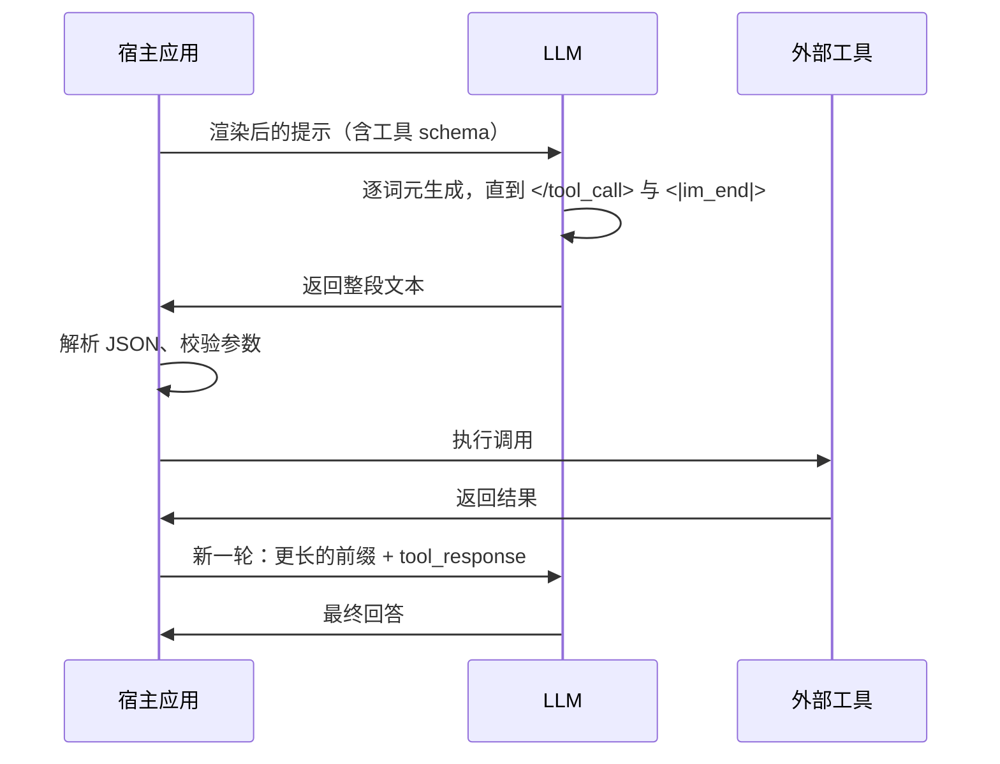
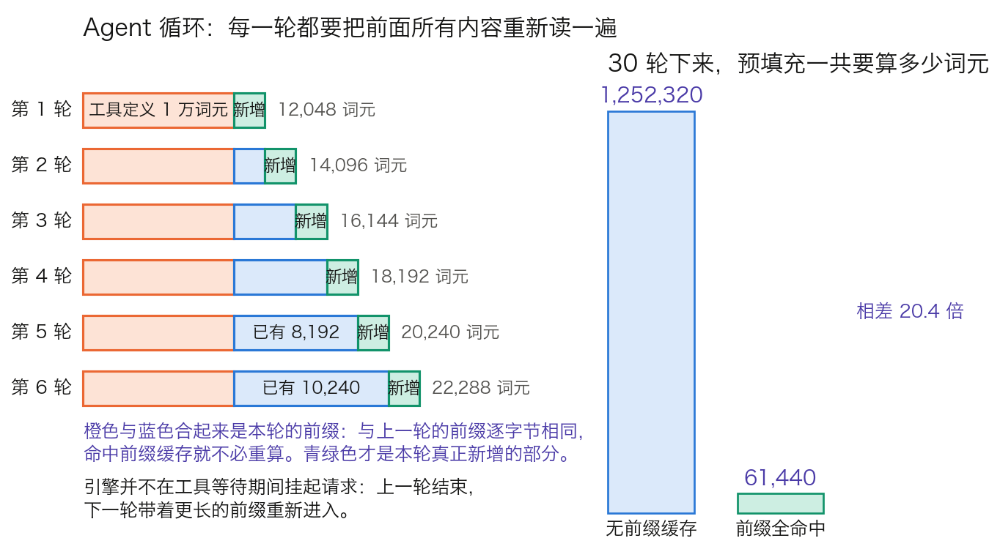
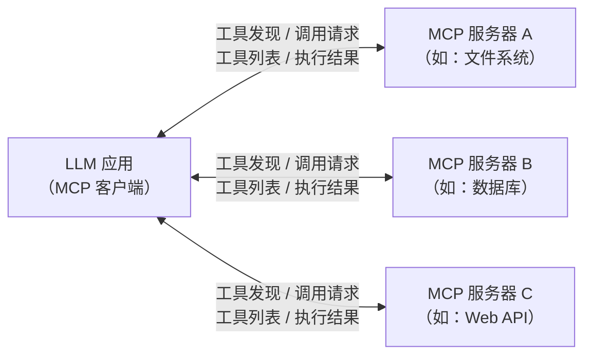

## 14.5 AI Agent 与工具调用：让模型从“说”到“做”

工具调用没有引入新的模型结构：它是一套聊天模板约定加相应的训练数据，模型照常生成词元，宿主解析、执行，再把结果作为更长的前缀送回来。成本与可靠性因此都可以算。每一轮都是前缀更长的新请求，不命中前缀缓存时总预填充量随轮数平方增长，前缀缓存是 Agent 能否运行的条件；多步串行的成功率按 $$p^k$$ 衰减，可靠性一侧的工程手段无非缩短链路、抬高单步成功率、让失败只回退一步。能力来自训练：监督微调学格式，面向环境的强化学习学把任务做完，工具结果只作条件、不计损失。今天的模型把“思考、调用、读结果”的交替当作默认行为，不再依赖手写的提示模板。

[14.4 节](14.4_multimodal.md)拓宽的是模型能读入的模态；模态再多，模型交付的仍然只是内容，让外部系统执行动作是另一回事。

### 14.5.1 为什么需要工具

裸模型的输出只是词元序列，工具补的是三类性质不同的缺口：

- **知识的时间边界**：训练数据有截止时间，实时信息不在权重里。
- **精确计算**：模型逐词元预测，大数乘法这类需要精确进位的运算不可靠。
- **副作用**：模型可以写出代码，但运行代码、发送邮件、修改文件都发生在权重之外。

后两条是“模型只能生成词元”的直接后果，与知识多少无关。Agent 的做法是把 LLM 当作推理与决策引擎，由宿主执行它选中的动作，再把结果回灌。

<a id="agent-tool-call"></a>

### 14.5.2 一次工具调用在词元层发生了什么

**工具调用**（Function Calling / Tool Use）的全部机制可以用一个公开的聊天模板讲完：工具定义是提示里的一段文本，调用是模型生成的一段文本，结果是下一轮提示里的一段文本。下面以 Qwen3 的聊天模板为例走六步。

**第 1 步：工具定义被渲染进提示。** 模板在有 `tools` 参数时，把工具的 JSON Schema 逐个写进系统段：

```text
<|im_start|>system
# Tools

You may call one or more functions to assist with the user query.

You are provided with function signatures within <tools></tools> XML tags:
<tools>
{"type": "function", "function": {"name": "get_weather", ...}}
</tools>

For each function call, return a json object with function name and arguments within <tool_call></tool_call> XML tags:
<tool_call>
{"name": <function-name>, "arguments": <args-json-object>}
</tool_call><|im_end|>
```

工具定义是普通文本，要占词元，而且每一轮请求都要重新渲染一遍。

**第 2 步：模型生成调用片段。** 模型照常逐词元生成，用的是同一套 logits、同一套采样，生成出的是：

```text
<tool_call>
{"name": "get_weather", "arguments": {"city": "北京"}}
</tool_call>
```

`<tool_call>` 与 `</tool_call>` 在 Qwen3 的词表里各是一个新增词元，不是逐字符拼出来的。

**第 3 步：生成停止。** 模型在这一轮末尾生成 `<|im_end|>`，即 Qwen3 的结束词元。请求到此结束，引擎把整段文本返回给宿主。

**第 4 步：宿主解析并执行。** 宿主切出 `<tool_call>` 与 `</tool_call>` 之间的 JSON，校验参数，执行，拿到结果。这一步完全在模型之外。

**第 5 步：结果以新一轮回灌。** 结果作为一条 `role = "tool"` 的消息加进消息列表。Qwen3 的模板把连续的 tool 消息合并进一个 **user** 轮次，每条包在 `<tool_response>` 与 `</tool_response>` 之间：

```text
<|im_start|>user
<tool_response>
{"temp_c": 25, "condition": "晴"}
</tool_response><|im_end|>
<|im_start|>assistant
```

“工具角色”存在于 API 的消息列表里，未必存在于最终的词元流里。末尾的 `<|im_start|>assistant\n` 是生成提示，下一轮从这里继续。

**第 6 步：重复。** 带着更长的前缀重新走一次完整的前向。

六步里没有一步需要改模型结构，能力来自训练中见过这套模板。图 14-8 把同样的流程画成时序图。



图 14-8：一次工具调用的完整往返。模型侧只有“生成”一件事，解析与执行全在宿主。

**约束解码管形状，不管语义。** 工具调用要求输出可被程序解析，这是[约束解码](../09_decoding/9.4_constrained.md)的典型场景：JSON Schema 编译成文法，每步为 logits 生成一个掩码。它保证括号配对、字段名在集合内、类型正确；它不保证参数语义正确（城市名写成邻市、单位写错），不保证调用被授权，也不保证操作幂等。执行前仍需要权限校验、参数审计、回滚设计和高风险操作确认。

### 14.5.3 Agent 循环的成本账

循环的成本有三笔：工具定义每轮固定付一次，预填充随轮数平方累积，解码词元少但墙钟占大头。第二笔决定了前缀缓存的地位。图 14-9 给出上下文逐轮变长的形状。



图 14-9：Agent 循环里上下文怎样逐轮变长，前缀缓存省掉了哪一块（[生成脚本](https://github.com/yeasy/llm_internals/blob/main/tools/figures/ch14a_agent_context.py)）。设定为工具定义 1 万词元、每轮新增 2048 词元。

**第一笔：工具定义的固定开销。** 一个工具的 JSON Schema 含名称、描述、参数类型与说明，约 200 词元是常见量级。10 个工具是 2000 词元，50 个是 1 万，100 个是 2 万。这笔开销与任务难度无关，只与挂了多少工具有关，每一轮都付一次。

**第二笔：预填充随轮次累积。** 设工具定义 1 万词元，每轮新增 2048 词元（模型的调用片段加工具返回结果），共 30 轮。第 $$k$$ 轮的前缀长度是 `10,000 + 2048k`。每轮都从头预填充，30 轮合计：

$$
\sum_{k=1}^{30}\left(10{,}000 + 2048k\right) = 300{,}000 + 2048 \times 465 = 1{,}252{,}320\ \text{词元}
$$

前缀缓存全命中时每轮只算增量，合计 $$2048 \times 30 = 61{,}440$$ 词元，相差 20.4 倍。把轮数记作 $$R$$，两者之比是 $$10{,}000/2048 + (R+1)/2$$，随轮数近似线性增长：30 轮 20.4 倍，60 轮 35.4 倍。常数项 4.9 是工具定义带来的，轮数再多也不消失。前缀缓存（[11.5 节](../11_serving/11.5_prefix_reuse.md)）对 Agent 因此是决定能否运行的条件。

**第三笔：解码。** 30 轮各输出 500 词元共 1.5 万词元，比预填充的 125 万小两个数量级，墙钟时间上却往往是它占大头。按 [10.1.2 节](../10_inference_optimization/10.1_bottleneck.md)的口径，Llama 3 8B 在单张 H100 上单请求解码受显存带宽限制，约 209 词元/秒，1.5 万词元约 72 秒；125 万词元的预填充受算力限制，算力用满时连同注意力的平方项约 37 秒，前缀缓存全命中后只剩约 1 秒。

针对前两笔账各有一种直接的做法。工具多时不把全部定义放进提示，改为按需检索后再加载；多次调用改由模型写一段代码来编排，中间结果留在执行环境里，只把最终结果放回上下文。Anthropic 的[工程报告](https://www.anthropic.com/engineering/advanced-tool-use)给出的量级是：前者在其大工具库的例子里把工具定义占用的词元降了 85%，后者在复杂研究任务上把平均词元用量从 43,588 降到 27,297。

### 14.5.4 误差怎样逐步累积

单步可靠不等于全程可靠。设每一步（选对工具、填对参数、正确理解返回结果）的成功率为 $$p$$，$$k$$ 步串行且任一步出错即失败，整体成功率是 $$p^k$$。表 14-9 代入三档单步成功率。

| 单步成功率 | 10 步 | 20 步 | 50 步 |
| ---: | ---: | ---: | ---: |
| 0.99 | 0.904 | 0.818 | 0.605 |
| 0.95 | 0.599 | 0.358 | 0.077 |
| 0.90 | 0.349 | 0.122 | 0.005 |

表 14-9：串行多步任务的整体成功率 $$p^k$$。

0.95 的单步成功率，20 步之后只剩 0.358。反过来算：要让 20 步任务整体达到 0.9，单步需要 $$0.9^{1/20} = 0.9947$$，即单步错误率低于 0.53%，约每 190 步才允许错一次。

可靠性一侧的工程设计都可以读成对这个式子的操作。**缩短链路**（一次并行调用几个工具而不是串起来）把指数 $$k$$ 变小；**验证与重试**把单步的 $$p$$ 拉高；**检查点**让失败只回退一步而不是全程重来；**人工确认**在高风险步骤上把 $$p$$ 提到接近 1。

$$p^k$$ 是不计纠错的简化模型。模型能发现并改正前面的错误时，实际成功率高于 $$p^k$$；各步相关时偏离的方向不定。量级判断仍然成立：链路长度是最强的一阶因素。度量上与它对应的是重复试验的一致通过率：[τ-bench](https://arxiv.org/abs/2406.12045) 的 pass^k 要求同一任务独立跑 $$k$$ 次全部成功，该文报告当时最强的函数调用 Agent 单次成功率不到 50%，零售场景的 pass^8 低于 25%。

### 14.5.5 Agent 架构模式

三种模式分别在链路长度、上下文长度与单步成功率之间做交换；其中 ReAct 已从提示词模式变成模型的默认行为。

**ReAct：推理与行动交替。** [ReAct](https://arxiv.org/abs/2210.03629)（Reasoning + Acting）让模型交替生成推理过程和工具调用，最初靠提示词里手写的“思考、行动、观察”模板实现。今天这种交替由训练而来，14.5.2 的六步循环本身就是它：在 Qwen3 的模板里，助手轮先渲染思考段再渲染调用片段；[DeepSeek-V3.2](https://arxiv.org/abs/2512.02556) 的报告把思考并入工具调用场景，同一个用户轮次内的思考内容在多次调用之间保留，新的用户消息到来才丢弃；14.5.7 的强化学习轨迹里，每个模型段都是“思考加调用”。按 14.5.4 的模型看，思考步本身也会失败，它用增加链路长度换取单步成功率，只有思考带来的 $$p$$ 提升超过多一步的代价时才划算，所以简单任务上显式推理常常没有收益。

**规划-执行分离。** 复杂任务先整体分解为有序子任务，再逐步执行并按中间结果调整。它避免了边想边做的短视决策，也把一条长链路切成若干条短链路。代价是计划可能在第一步就错，而错误要到执行很久之后才暴露。

**多 Agent 协作。** 主 Agent 分解任务并分派，子 Agent 各带自己的工具具体执行。它的实际收益主要来自上下文隔离：每个子 Agent 只看自己那段，避免 14.5.3 第二笔账的膨胀。代价是消息传递会丢信息，$$p^k$$ 的链路并没有变短，只是被拆到了不同的上下文里。

### 14.5.6 标准化协议：MCP

**MCP**（Model Context Protocol）是 Anthropic 在 2024 年提出的开放标准，把工具集成从“每个应用对每个工具各写一套”压成一套协议。它降低的是集成复杂度，不解决治理问题。图 14-10 给出它的分工：应用一侧是 MCP 客户端，每类工具由一个 MCP 服务器暴露，两者之间主要是“发现工具”与“调用工具”两类消息。



图 14-10：MCP 的客户端-服务器架构。

与本节相关的有三点。

- **发现到的 schema 就是提示里的那份。** 客户端用 `tools/list` 拿到工具清单，每个工具的 `inputSchema` 就是 14.5.2 第 1 步渲染进提示的 JSON Schema；调用用 `tools/call`，参数是工具名与实参。
- **工具出错与协议出错是两件事。** 工具执行失败时，结果里的 `isError` 标记让模型看见错误并自行纠正；协议层的错误才是 JSON-RPC 错误，由宿主处理。
- **服务器返回的一切按不可信输入处理。** 工具描述、资源内容和工具输出都可能携带注入的指令。宿主要固定批准的服务器与工具集合，限制凭据与文件权限的透传，隔离会话状态，并对提示注入、工具投毒和数据外传建立审计与回滚机制。身份认证、最小权限、数据驻留、速率限制与高风险操作确认，都不在协议解决的范围内。

传输方式与修订版本随规范演进，以规范的当前修订为准。

### 14.5.7 工具调用能力怎样训练出来

推理时没有新结构，能力全在权重里。训练有两类：监督微调学会格式与调用时机，面向环境的强化学习学会把任务做完。两类共用一条界线：损失只落在模型自己生成的词元上，工具结果只作条件。

**多轮轨迹的监督微调。** 训练样本是完整的交互过程“用户问题 → 工具调用 → 工具结果 → 最终回答”，按同一套聊天模板渲染成一条词元序列。工具返回的结果是环境给的，这些位置要从损失里排除，与 [8.1.2 节](../08_alignment/8.1_sft.md)对提示词位置做掩码是同一手法；漏掉这一步，模型会学着自己编造工具输出。数据里还要有两类样本：需要连续调用多个工具的多轮调用链，以及模型判断不必调用而直接回答的拒绝样本，后者用来抑制过度调用。生产系统的真实轨迹进入训练集之前要经过授权、脱敏与权限边界标注，否则模型可能学到越权调用或泄漏私有结果。

**面向环境的强化学习。** 监督微调只能模仿已有轨迹。强化学习让模型在环境里自己把任务做完，由判定器在轨迹结束后给出奖励，再按 [8.2.4 节](../08_alignment/8.2_rlhf.md)的组内相对优势更新策略，算法骨架与 [14.6.3 节](14.6_test_time_scaling.md)的长思维链 RL 相同。[Kimi K2](https://arxiv.org/abs/2507.20534)、[DeepSeek-V3.2](https://arxiv.org/abs/2512.02556) 与 [Kimi K3](https://arxiv.org/abs/2607.24653) 三份技术报告的做法各异，共同的规律有四条。

**规律一：轨迹里只有模型段计损失。** 一条 Agent 轨迹是从任务提示开始、模型段与环境段交替、到最终回答为止的整条词元序列：

$$
x,\ a_1,\ e_1,\ a_2,\ e_2,\ \dots,\ a_K,\ e_K,\ a_{K+1}
$$

$$x$$ 是系统段、工具定义与任务提示，$$a_k$$ 是模型第 $$k$$ 轮生成的思考与调用片段，$$e_k$$ 是宿主回灌的工具结果，$$a_{K+1}$$ 是最终回答。$$e_k$$ 由环境产生，不是策略采样出的动作，放进策略梯度等于训练模型去预测工具输出。通行的实现因此把 8.2.4 目标函数里的回答取为各轮模型段的拼接，$$e_k$$ 与 $$x$$ 一样只作条件，长度也只数模型段的词元。沿用 14.5.3 的设定：$$x$$ 取 1 万词元，30 轮，每轮新增的 2048 词元里模型段 256、工具结果 1792。整条序列长 `10,000 + 30 × 2048 = 71,440`，前向要处理全部位置，计损失的只有 `30 × 256 = 7,680` 个，占 10.8%。

**规律二：奖励落在轨迹末尾，整条轨迹共用一个优势。** V3.2 的写法是每条轨迹得到一个结果奖励 $$R_i$$，优势取 $$R_i$$ 减去同题各条轨迹的平均奖励，轨迹里的全部模型词元共用这一个值。一条 30 步的轨迹失败了该惩罚哪一步，这种做法没有逐步的答案：失败轨迹的每个模型词元受到同等的负向更新，区分各步靠的是同一任务的多条轨迹，成功轨迹里出现得更多的做法被净推高。

**规律三：任务要难解而易验，奖励取独立验证器对终态的判定。** 人工编写的可验证任务数量有限，三份报告都让模型参与合成，下表列出合成物与奖励来源。K3 不采信模型自报的完成情况，并用隐藏验证器和提交次数上限抑制奖励黑客（[8.2.4 节](../08_alignment/8.2_rlhf.md)）；V3.2 只保留 pass@100（[9.5.2 节](../09_decoding/9.5_test_time_scaling.md)）不为零的任务，保证奖励信号非空。

| 报告 | 合成的是什么 | 奖励由谁判定 |
| --- | --- | --- |
| Kimi K2 | 工具调用轨迹，用于监督微调：3000 多个真实 MCP 工具加 2 万多个合成工具，用户模拟器与工具模拟器配合生成，LLM 评审按评分细则筛选 | RL 的软件工程环境取自 GitHub 的 issue 与 PR，奖励是可执行的单元测试 |
| DeepSeek-V3.2 | 任务与环境，直接用于 RL：通用 Agent 的 1,827 个环境与 4,417 个任务全部合成，由一个 Agent 在沙箱里建数据库、生成工具函数、提出任务并逐轮加大难度 | 随任务生成的验证函数 |
| Kimi K3 | Agent 外壳：拆成工具接口、系统提示、上下文管理策略等模块，为不同任务组拼出不同外壳，避免过拟合某一种工具格式 | 独立验证器对环境终态的评估 |

**规律四：长尾轨迹用部分 rollout 处理，代价是陈旧度。** [8.2.3 节](../08_alignment/8.2_rlhf.md)指出长思维链的长度分布是重尾的，最慢的一条会拖住整批；Agent 轨迹更长，中途还要等环境。两份 Kimi 报告都用**部分 rollout**（partial rollout）：未完成的轨迹先暂停，下一轮迭代续跑，完成的轨迹占到设定比例就开始更新。一条长轨迹因此跨越多轮迭代，前段由旧权重生成，这就是 8.2.3 节的陈旧度；V3.2 对同类偏移的处理是给 GRPO 加序列级掩码，优势为负且偏离旧策略过远的序列不计入策略梯度。系统一侧，工具执行期间 GPU 空转，对策是把重型环境部署成独立服务并提高并发 rollout 数；沙箱等模型的时间在 K3 报告里最多占其生命周期的 98%，其间沙箱暂停；百万词元的上下文靠把空闲前缀的 KV 写回主机内存的缓存池、复用前预取。

### 14.5.8 Agent 对推理引擎的要求

Agent 对引擎（[第十一章](../11_serving/README.md)）的要求集中在一点：保住前缀缓存的命中率。

**每一轮都是新请求。** 主流引擎并不在工具等待期间挂起请求。14.5.2 第 3 步生成结束词元之后请求就正常结束，资源被释放；第 6 步是一个新请求，只是前缀更长。省掉重算靠的是前缀缓存命中（[11.5 节](../11_serving/11.5_prefix_reuse.md)），引擎里没有暂停的状态机。

**提示布局要对缓存友好。** 能复用的只有前缀，由此得到三条规则：稳定的内容放前面（系统段、工具定义），易变的内容放后面；历史只追加、不改写；压缩与裁剪只在明确的边界上做，并接受这一次缓存失效。任何打乱前缀的改动都会让命中率归零，在提示开头插入时间戳是典型的反例。上下文管理与缓存因此相互牵制：数十轮之后需要压缩历史、把长期信息移到外部存储，而压缩会改变前缀。

**并行工具调用由模型和模板决定。** 一次生成里输出多个 `<tool_call>` 片段，是模型学出来的行为、模板支持的格式；引擎只负责把整段文本原样返回，宿主解析出多个调用后并行执行，再把多条结果合并回灌。

### 14.5.9 评测与常见失效

能力侧的失效模式都能对到 14.5.4 的模型上：

- **工具选择错误**：可选工具多、描述相近时尤其常见，等价于降低单步 $$p$$。
- **幻觉出不存在的工具或参数**：约束解码可以挡住参数名不在 schema 里的情况，挡不住语义错误的取值。
- **循环**：反复调用同一个工具而不推进，常见于工具返回了模型看不懂的错误。
- **过早终止**：任务未完成就给出最终回答。
- **上下文膨胀导致的退化**：轮次多了之后早期指令的作用减弱，与 [14.7 节](14.7_long_context.md)的长上下文问题同源。

公开评测各测链路的一段：BFCL 侧重函数调用的格式与选择正确性，τ-bench 侧重多轮对话中遵守策略地完成任务，SWE-bench 侧重在真实代码仓库上完成可验证的修改。三者的链路长度不同，分数不可互相换算。

<a id="rag-workflow-agent"></a>

### 14.5.10 RAG、工作流与 Agent 的边界

三个概念各管一件事，可以组合：RAG 描述知识如何进入回答，工作流描述预设步骤如何执行，Agent 由模型根据中间结果选择后续动作。

**检索增强生成**（Retrieval-Augmented Generation，RAG）把外部资料检索出来，作为生成答案的上下文；一次检索和回答不更新模型权重。[RAG 原论文](https://arxiv.org/abs/2005.11401)研究了检索器与生成器的联合微调，应用中也可以直接组合现成模型。检索用到的向量、双塔与重排机制见 [12.3.6 节](../12_encoder_models/12.3_longformer_bigbird.md)。

同一个问题可以走固定的 RAG 工作流（检索、拼入提示、生成带引文的回答），也可以在模型发现信息缺失、决定追问并重新查询时进入 Agent 循环。无论哪种形态，有两条不变：检索正确不保证模型正确使用证据，有引文也不等于引文支持结论；检索到的外部文档始终是不可信输入，其中的“忽略规则”一类文字不能取得指令权限。
