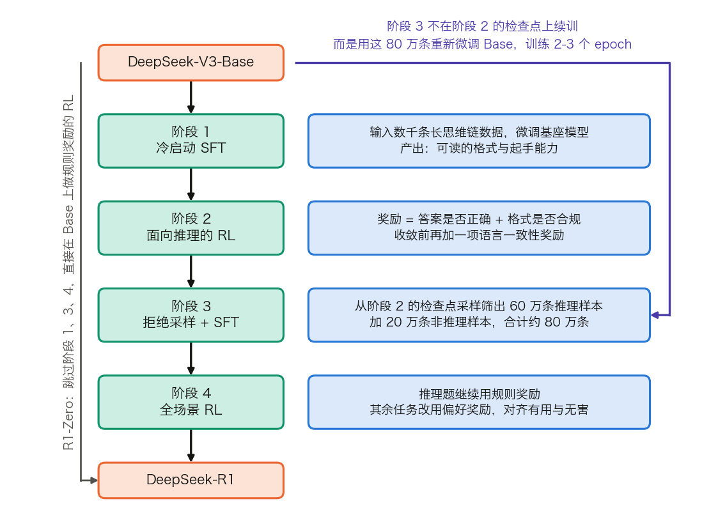

## 14.6 推理时计算扩展与推理模型

推理时扩展用推理期多花的词元换正确率，有两个轴。写长：增加串行步数，把中间结果写进上下文，使层数固定的网络能完成需要线性乃至多项式步数的计算。采宽：对同一问题生成多条候选，再由验证器挑选，上限是覆盖率。写长的能力靠可自动验证的奖励用强化学习训出来，前提是任务有客观判据；在公开的对照实验里，这类训练把基座偶尔做对的题变成稳定做对，提高的是采样效率，没有扩大可解题目的集合，投入的 RL 算力换来的通过率沿一条会饱和的 S 形曲线上升。代价是计算量、串行延迟与 KV 驻留三样同时增长（量级见 14.6.2），所以默认做法是按难度分配思考量，主流接口把它做成请求参数。写出来的思维链不保证忠实，只能当调试线索。

解码系统一侧的算式（多采几条能涨多少、并行采样的成本、预算强制）在 [9.5 节](../09_decoding/9.5_test_time_scaling.md)，长思维链 RL 的目标函数与典型病理在 [8.2.4 节](../08_alignment/8.2_rlhf.md)；本节讲模型一侧。

### 14.6.1 从直觉回答到深度思考

[第九章](../09_decoding/README.md)的解码策略每个位置做一次前向、选定一个词元，计算量与输出长度成正比，模型没有“想久一点”的机会。推理时扩展打破这一点，路径有两条：**延长思考过程**，答题前先生成一条更长的推理链；**扩大搜索范围**，对同一问题生成多个候选，再用验证机制选出最好的一个。两者都不修改模型参数，代价落在每次请求的时间与算力上。[14.5.5 节](14.5_agent_tool_use.md)算过思考步是用链路长度换单步成功率，本节讲这一步可以做多厚。

### 14.6.2 思维链推理：机制、表达力与代价

**思维链**（Chain-of-Thought，CoT）是让模型在给出答案之前先输出中间推理步骤。它买到的是串行步数：每一步的输出写回上下文，成为下一步的输入。

#### 从提示词引导到零样本思维链

CoT 最早靠 few-shot 提示实现：输入里给几个含推理步骤的示例，模型照着逐步推理（[思维链提示](https://arxiv.org/abs/2201.11903)）；只加一句“让我们一步一步思考”，零样本下也能激发同样的模式（[Zero-shot CoT](https://arxiv.org/abs/2205.11916)）。[ToT](https://arxiv.org/abs/2305.10601) 与 [GoT](https://arxiv.org/abs/2308.09687) 把线性思维链扩成树或图，在提示层面显式搜索、合并与回溯。今天的推理模型不再依赖这层提示脚手架：回溯与自我检查由强化学习训进了模型自己生成的轨迹（14.6.3），DeepSeek-R1 还把显式的蒙特卡洛树搜索列为未成功的尝试（14.6.4）。

#### 为什么有效：串行步数买到了什么

先看一个具体任务：模拟一台有限状态机。输入是一长串操作，每个操作按一张固定的转移表把当前状态换成下一个状态，问最后停在哪个状态。读完就答时，层数固定的网络要在一次前向里把整串操作的效果合成出来。逐步生成时，模型每步只写下“再读一个操作之后的状态”，查一次转移表即可，$$n$$ 个操作用 $$n$$ 步。

这件事在计算复杂性上有确切的刻画。[Merrill 与 Sabharwal 的分析](https://arxiv.org/abs/2310.07923)按中间生成的步数分三档：

- 步数与输入长度成对数关系时，能力只比“读完就答”的标准 Transformer 略有扩展。
- 步数与输入长度成线性关系时，在标准复杂性猜想下多出一项明确的新能力：识别全部正则语言，即有限状态机能判定的全部问题，上面的例子就属于这一档（前提是采用其所称的 projected pre-norm）。
- 步数为多项式量级时，识别的恰好是多项式时间可解的问题类（前提是采用其所称的 generalized pre-norm）。

中间生成扩展了仅解码器 Transformer 的计算能力，幅度取决于允许生成多少步。这种增益是深度式的：生成 $$T$$ 步之后，从输入到答案的最长计算路径约有 $$L \times T$$ 层。它与真正加深网络的区别在步与步之间的通道。同一层里，后面的位置可以经 KV 缓存读到前面位置的隐藏状态；第 $$t$$ 步在最后一层算出的结果要回到第 $$t+1$$ 步的第一层，却只能经过一个被采样出的离散词元。Llama 3 的词表有 128,256 项，一个词元至多携带约 17 比特；Llama 3 8B 一层的隐藏状态是 4096 个 16 位数，约 6.6 万比特。思维链的两个工程解释由此成立：中间结果写成文本，等于把工作记忆挪进上下文，容量随长度增长；每一步只需在单次前向的能力之内完成，难度被摊到多步上。14.6.6 的隐空间推理针对的正是那条窄通道。

#### 一笔账：思考 1 万个词元要花多少

按 [3.8.8 节](../03_components/3.8_gpt_inference_flow.md)的口径取 Llama 3 8B（$$N = 8.03 \times 10^9$$），思考 10,000 个词元：

- **计算量**：每个输出词元与权重相乘约 $$2N = 1.606 \times 10^{10}$$ FLOPs，合计 160.6 TFLOPs，是读完一个 200 词元问题的 50 倍；随上下文增长的注意力项再添约 16%。
- **延迟**：H100 单卡、BF16、单请求、逐词元解码，按 [10.1.2 节](../10_inference_optimization/10.1_bottleneck.md)每步读一遍 16.06 GB 权重的粗估，约 209 词元/秒，即约 48 秒。这是粗估而不是下界：[投机解码](../10_inference_optimization/10.6_speculative_decoding.md)一次确认多个词元，[张量并行](../11_serving/11.8_multi_gpu_inference.md)改变可用总带宽，随长度增长的 KV 读取又会拉长它。
- **显存**：每词元 KV 128 KiB，1 万个思考词元占 1.22 GiB，是一个普通短回答的几十倍。

长思考让计算、串行延迟与 KV 驻留三样同时增长。批处理摊薄的是跨请求的权重读取，单条轨迹内部的串行依赖仍在；KV 驻留直接压低同一张卡上的并发数。

### 14.6.3 长思维链与强化学习训练

提示词方法只能调出预训练里见过的推理模式。推理模型（OpenAI 的 o1 及其后继、DeepSeek-R1）用强化学习直接训练模型生成**长思维链**，相对 RLHF 只换了奖励来源。

#### 换掉的是奖励来源

RLHF（[8.2 节](../08_alignment/8.2_rlhf.md)）的奖励来自人类偏好，优化的是风格与安全性。长思维链训练把奖励换成可自动验证的规则：数学题是否算对、代码是否通过测试、格式是否合规。算法骨架不变，仍是采样、算优势、裁剪、更新。**GRPO**（Group Relative Policy Optimization）在这里的作用是用组内相对分数替掉价值网络，让“同一道题采一组回答、按相对好坏更新”的显存开销降到可接受；它的目标函数与病理见 [8.2.4 节](../08_alignment/8.2_rlhf.md)，回答中途夹有工具结果的多轮情形见 [14.5.7 节](14.5_agent_tool_use.md)。

#### DeepSeek-R1 的四个阶段

[DeepSeek-R1 论文](https://arxiv.org/abs/2501.12948)的训练流程分四段，图 14-11 列出每个阶段的输入与产出。

图 14-11：DeepSeek-R1 的四阶段训练流程与各阶段的数据来源（[生成脚本](https://github.com/yeasy/llm_internals/blob/main/tools/figures/ch14b_r1_pipeline.py)）。样本量与奖励构成取自论文。橙色是模型权重，青绿色是阶段名，蓝色是该阶段的数据，紫色标出容易看错的一处。

**冷启动 SFT** 用数千条长思维链数据微调基座，解决 R1-Zero（见下）输出混杂多语言、缺少格式的问题；**面向推理的 RL** 以答案正确性加格式为奖励，收敛前再加一项语言一致性奖励；**拒绝采样与 SFT** 从上一阶段的检查点采样筛出约 60 万条推理样本，加约 20 万条非推理样本，合计约 80 万条；**全场景 RL** 对推理题继续用规则奖励，其余任务改用偏好奖励。最容易读错的是第三阶段：它用这 80 万条样本**重新微调 DeepSeek-V3-Base**，而不是在第二阶段的检查点上接着训；后续的蒸馏模型用的也是这 80 万条。

#### R1-Zero：不给示范数据会怎样

DeepSeek-R1-Zero 跳过冷启动，直接在基座上做 RL。奖励只有两项规则：**准确性奖励**判断答案是否正确（数学题要求答案写进指定格式，代码题交给编译器与测试用例），**格式奖励**要求思考过程写在 `<think>` 与 `</think>` 之间。论文不用神经奖励模型，理由是它在大规模 RL 中会被奖励投机攻破，重训还要额外资源。可自动验证的**稀疏奖励**因此有一个前提：任务本身有客观判据；没有判据的任务只能退回神经奖励模型，连同它的全部风险。

训练中模型自发出现了“等等，让我重新检查一下”式的自我反思，以及在思维链里尝试多条解题路径的回溯。这可以由奖励结构推出：同一道题采样一组回答，只要多检查一步的轨迹答对的比例更高，它们的组内优势就为正，生成概率随之调高；两项奖励里又没有长度惩罚。论文的训练曲线与此相符：平均回答长度随训练稳步增长。

### 14.6.4 验证信号从哪里来：ORM 与 PRM

多路采样要选出最好的一条，就需要打分者。它的效果上界见 [9.5.2 节](../09_decoding/9.5_test_time_scaling.md)：覆盖率是上限，实际正确率取决于选择器认出正确答案的能力。默认的打分者是结果级的；逐步打分在搜索里有用，在大规模 RL 里通常不划算。

**结果奖励模型**（Outcome Reward Model，ORM）只对最终答案评分。训练数据是“问题、完整回答、最终答案对错”三元组，对错常可自动判定，标注便宜；弱点是分不出“碰巧蒙对的错误推理”与“严谨正确的推理”。

**过程奖励模型**（Process Reward Model，PRM）对推理链的每一步评分。实现上是在基座模型上加一个标量头，输入“问题加截至当前的部分解”，输出这一步正确的概率。它能定位最早出错的步骤，也能在按步骤搜索时（[9.5.5 节](../09_decoding/9.5_test_time_scaling.md)）提前剪掉注定失败的分支。代价在标注：[Let's Verify Step by Step](https://arxiv.org/abs/2305.20050) 人工标注了 80 万条步骤级标签（PRM800K），报告过程监督在 MATH 上显著优于结果监督，解出代表性子集上 78% 的题目；自动标注从某一步出发多次续写到底，用最终答对的比例估计该步的价值，省掉人工但引入噪声。

DeepSeek-R1 论文把 PRM 与蒙特卡洛树搜索一起列为未成功的尝试，理由有三：通用推理中很难定义什么算一个细粒度步骤；中间步骤的对错难判，自动标注质量不够而人工标注无法规模化；基于模型的 PRM 必然带来奖励投机。它的结论有分寸：PRM 在对前 N 条回答重排序或引导搜索时有用，在大规模 RL 里收益抵不过额外的计算。

### 14.6.5 推理时扩展与训练时扩展的权衡

两种扩展的成本落在不同的人身上：训练时扩展由模型提供方付一次，推理时扩展每次调用都付。所以推理预算要按难度分配，而 RL 训练这一侧的算力回报会饱和。表 14-10 对照两者。

| 维度 | 训练时扩展 | 推理时扩展 |
|------|-----------|-----------|
| 成本结构 | 一次性高投入，此后每次推理成本固定 | 训练成本不变，每次推理成本按需增加 |
| 灵活性 | 模型部署后能力固定 | 可按问题难度动态调整计算量 |
| 瓶颈 | GPU 集群规模、训练数据量 | 推理延迟、单次请求成本、KV 池容量 |
| 谁承担 | 模型提供方，一次 | 每一次调用，按量 |

表 14-10：两种扩展路径的对照。训练时扩展的成本已经沉没，推理时扩展的成本随调用量线性累加。

**按难度分配。** [Snell 等人](https://arxiv.org/abs/2408.03314)发现不同方法的效果随提示难度显著变化，按难度自适应分配预算，达到同样效果所需的计算量可比固定的 Best-of-N 少 4 倍以上（算式见 [9.5.5 节](../09_decoding/9.5_test_time_scaling.md)）。托管接口上的对应是把思考量做成请求参数，形态有两种：按档位设推理强度（[OpenAI](https://developers.openai.com/api/docs/guides/reasoning) 的 `reasoning.effort`），或设思考词元预算。[Anthropic](https://platform.claude.com/docs/en/build-with-claude/extended-thinking) 已把固定预算换成自适应思考加努力程度档位：档位定倾向，每次请求是否思考、想多少由模型按输入决定，低档位下简单输入可能完全不思考。两家返回给调用方的都是思考摘要而不是原始思考词元，思考词元按输出计费并占上下文；多轮工具调用之间要把思考内容原样传回。思考配置一变，消息部分的前缀缓存随之失效，所以一段会话里应保持不变。自托管模型的预算怎样在解码期强制执行见 [9.5.4 节](../09_decoding/9.5_test_time_scaling.md)，失效情形见 [13.1.6 节](../13_decoder_models/13.1_gpt_series.md)，接口字段与默认值见[附录 A.7](../appendix/a7_framework_recipes.md)。

**RL 训练的算力曲线是饱和的。** 预训练的损失与算力之间是幂律（[5.4 节](../05_pretraining/5.4_data_scaling.md)）。[ScaleRL](https://arxiv.org/abs/2510.13786) 在固定模型与训练数据的条件下，把 RL 的验证集通过率对训练算力 $$C$$（GPU 小时）拟合成 S 形曲线：

$$
R_C - R_0 = (A - R_0) \times \frac{1}{1 + (C_{\mathrm{mid}} / C)^{B}}
$$

$$R_0$$ 是起点，$$A$$ 是算力趋于无穷时的渐近通过率，$$C_{\mathrm{mid}}$$ 是拿到全部增益一半时的算力，$$B$$ 决定陡度，即算力效率。通过率有上界，幂律外推会高估：一次 10 万 GPU 小时的 8B 训练，幂律给出的渐近值是 1.0，S 形曲线给出 0.645，实际在 0.65 附近饱和。按这次拟合的 $$B = 1.70$$，算力从 $$C_{\mathrm{mid}}$$ 的 4 倍加到 8 倍，只多拿到全部增益的 5.8%。比较两套配方因此先比 $$A$$ 再比 $$B$$：小算力下领先的方法外推后可能落后，损失聚合、优势归一化这类改动主要改变 $$B$$，对 $$A$$ 影响很小。曲线的适用范围有三条限制：拟合的是与训练集同分布的验证集，不直接代表下游泛化；$$A$$ 随损失类型、批大小、生成长度与模型规模移动，换配方要重拟；实验限于数学与代码上的一个 8B 稠密模型和一个 MoE 模型，多轮与 Agent 式 RL 尚未验证。

### 14.6.6 推理时扩展的上界与突破方向

这里有两个上界，要分开说。推理时搜索的上界是基座覆盖率乘验证器：单条正确率为 0 的题，采多少条覆盖率都是 0（[9.5.6 节](../09_decoding/9.5_test_time_scaling.md)），覆盖到的正确答案还要靠验证器认出来。RL 训练的上界是另一回事：在公开的对照实验里，它不扩大覆盖，回报还会饱和（14.6.5）。两者合起来，推理时扩展是能力放大器，在基础模型已有的表征、工具、奖励与环境反馈中找更可靠的路径；模型缺知识、奖励分不清好坏、环境不给真实反馈时，加推理词元补不了能力。

**pass@k 曲线交叉。** 拿基座与它经 RLVR（[8.2.4 节](../08_alignment/8.2_rlhf.md)）训练后的版本比 pass@k（$$k$$ 次尝试内能解出的题目比例，[9.5.2 节](../09_decoding/9.5_test_time_scaling.md)）：$$k = 1$$ 时 RL 模型更高，$$k$$ 增大到几十至上百之后基座追平并反超。RL 把概率集中到基座已能解的题上，可解集合没有扩大，反而收窄。

交叉可以用两道题复现。单题的 pass@k 是 $$1 - (1-p)^k$$，$$p$$ 是单条正确率。设基座在两道题上的 $$p$$ 是 $$(0.05, 0.05)$$，RL 之后变成 $$(0.6, 0)$$。pass@1 从 0.05 升到 0.30；pass@k 则是基座的 $$1 - 0.95^k$$ 对 RL 模型的 $$0.5 \times (1 - 0.4^k)$$，后者封顶于 0.5，前者在 $$k = 14$$ 时为 0.512，已经超过，$$k = 64$$ 时为 0.962。

[Yue 等人](https://arxiv.org/abs/2504.13837)在数学、代码与视觉推理三类任务上得到同样的形状，正确率直方图里接近 1 与恰为 0 的题都在 RL 之后变多。以 Qwen2.5-7B 在 AIME24 上取 $$k = 1024$$ 为例，30 道题里基座能解出 23 道，RL 模型解出 19 道，全在基座的 23 道之内；训练过程中训练集的 pass@1 从 26.1 升到 42.5，pass@256 却逐步下降。结论的边界有四条：pass@k 量的是潜在边界，兑现成正确率仍要验证器；实验对象以 7B 到 32B 的开源模型为主，在一个推理能力与 DeepSeek-R1 相当的更大模型上做的初步检验方向一致；实验都是单轮作答，更多 RL 算力与多轮的 Agent 式 RL（[14.5.7 节](14.5_agent_tool_use.md)）能否突破仍是未决问题；从更强教师蒸馏的模型不在此列，它的 pass@k 曲线整体高于基座。

**绕开语言这条窄通道。** 14.6.2 指出，步与步之间只能经过一个离散词元。**隐空间推理**（Latent Space Reasoning）以 Meta 的 Coconut 为代表，把最后一层的隐藏状态直接作为下一步的输入，不落成词元，代价是轨迹不可读，14.6.7 的监控前提随之失效。循环深度模型 [Ouro](https://arxiv.org/abs/2510.25741) 在一次前向里把同一组层重复执行若干步（发布的模型取 4 步），由退出门决定每个词元算几步，加的是每个词元的计算深度而不是序列长度；步数外推到训练上限之外，成绩反而下降。让模型识别可独立求解的子任务、并行展开再汇聚的**并行推理**针对的是串行延迟。三者都还在研究阶段。

### 14.6.7 思维链的忠实性与可监控性

不少监控与审计方案假定：模型写出了思考过程，就能据此读懂它依据什么做出判断。测量表明这个前提不成立，思维链只能当调试线索。

Anthropic 的[测量](https://www.anthropic.com/research/reasoning-models-dont-say-think)（[论文](https://arxiv.org/abs/2505.05410)）用的是**成对提示**。同一道多选题准备两份，一份在题干里插入指向某个选项的**提示线索**（例如“斯坦福的一位教授认为答案是 A”）；只保留答案确实被线索改变的样本，这些样本里模型显然用了线索，于是可以检查思维链有没有说出来。在六类线索上平均，Claude 3.7 Sonnet 只有 **25%** 的情况提到了线索，DeepSeek R1 为 **39%**；在评分作弊、来路不正的信息这两类“不该用”的线索上更低，分别为 **20%** 和 **29%**。另有两个方向：

- **题目越难，忠实度越低**。在更难的 GPQA 上，两个模型的忠实度比 MMLU 分别相对下降约 44% 和 32%。越需要监控的场景，轨迹越不可信。
- **纯结果导向的强化学习治不好它**。只奖励任务做对、不监督思维链，忠实度先明显上升（相对提升 63% 与 41%），随后停在 MMLU 约 28%、GPQA 约 20% 的平台上。

**忠实性**（faithfulness）是轨迹自身的属性：它是否真实反映了驱动答案的原因。**可监控性**（monitorability）取决于轨迹与监控方两者：某个监控方能否据此发现问题（OpenAI 的 [Evaluating chain-of-thought monitorability](https://openai.com/index/evaluating-chain-of-thought-monitorability/) 沿这条线展开）。两者会分离：不够忠实的轨迹仍可能被足够了解模型的监控方识破，看似合理的轨迹也可能掩盖真实动因。

工程纪律因此是：判断模型为何这样做，回到可验证的外部依据，即输入、检索到的材料、工具调用与返回值。这也给 [14.8 节](14.8_interpretability.md)划了边界：读模型的自述与读模型的内部状态，是两件可信度不同的事。
