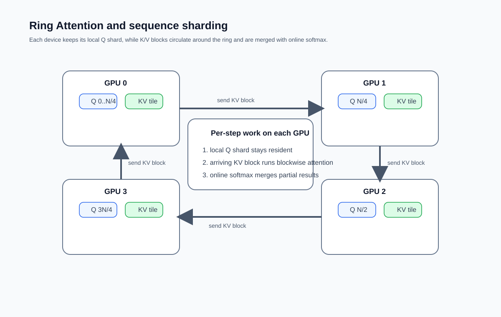
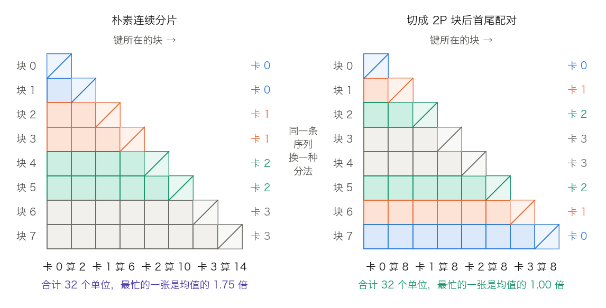
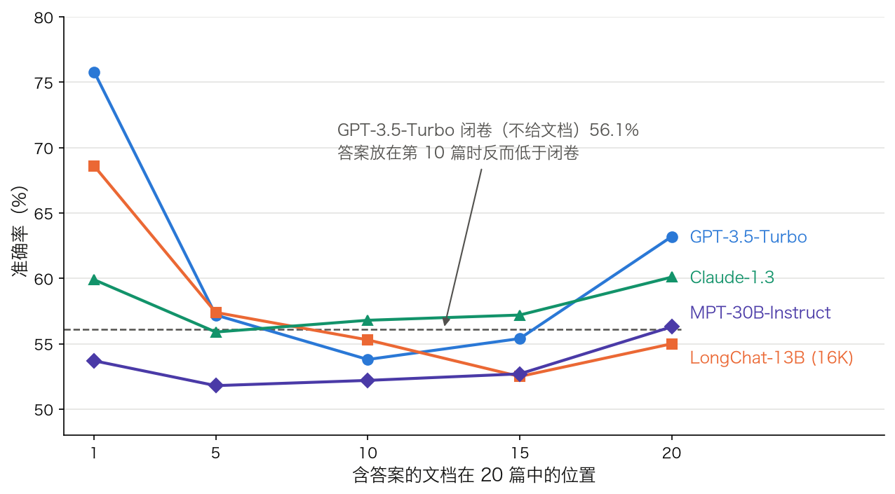

## 14.7 长上下文技术：从理论到工程实践

长上下文是两个独立的问题。一是装得下：计算的平方项只在长度超过约 $12.75d$ 之后才主导，先撞墙的是线性增长的 KV 缓存，Llama 3 70B 每 100 万词元要 305 GiB；序列切到多卡之后又多出通信一笔，Ring Attention 要求每卡的块长不小于算力与带宽之比，Ulysses 的并行度不超过头数。二是用得好：长度是训出来的，分阶段扩长与位置编码适配都要微调，而且有效长度远短于标称长度。今天的百万词元窗口靠几层手段叠加：架构上压缩 KV、减少存全量 KV 的层或每步读取的条目，服务上分页与前缀复用，预填充时切序列。成本按实际送入的词元算，不按窗口上限算；部署侧的第一判据是 KV 池能同时装下几个这样长的请求。窗口不是记忆，只放相关内容、保持前缀稳定，才用得起。

长度的增长同时撞上注意力的平方复杂度（[2.5 节](../02_attention/2.5_complexity_limits.md)）、KV 缓存的线性增长（[10.2 节](../10_inference_optimization/10.2_kv_cache.md)）与位置编码的外推极限（[4.3 节](../04_position_encoding/4.3_rope.md)）。本节只算三者交界处的账；[14.5 节](14.5_agent_tool_use.md)的 Agent 轮次与 [14.6 节](14.6_test_time_scaling.md)的思维链，占用的都是这个窗口。

### 14.7.1 三笔账：计算、显存、通信

三笔开销按 Llama 3 70B 的配置算（80 层、$d_{\mathrm{model}} = 8192$、64 个 Query 头、8 个 KV 头、$d_h = 128$，见 [3.8.7 节](../03_components/3.8_gpt_inference_flow.md)）。

**计算：平方项从多长开始主导。** 按 [3.8.8 节](../03_components/3.8_gpt_inference_flow.md)的口径，一层 Prefill 的计算量是线性项加平方项，后者已按因果掩码折半：

$$
25.5\,nd^2 + 2n^2d
$$

3.8.8 的 $24nd^2$ 只对 GPT-3 式的层成立。Llama 3 70B 用 SwiGLU 与 GQA，每层按实际形状数出 855,638,016 个参数，即 $12.75d^2$，每个参数对每个词元一次乘加，线性项因此是 $25.5nd^2$（[6.4.2 节](../06_training_techniques/6.4_batch_sequence.md)对 Llama 3 8B 数出的是 $26nd^2$）。两项相等于 $n = 12.75d$，这里是 104,448 个词元。8,192 词元时平方项只占线性项的 7.8%；100 万词元时它是线性项的 9.6 倍，80 层合计 $1.31 \times 10^{18}$ FLOPs，按 H100 的 990 TFLOPs/s 稠密峰值（[11.12 节](../11_serving/11.12_hardware.md)）且算力用满，光这一项就要约 22 分钟。“计算量与长度的平方成正比”只在超过约 $12.75d$ 之后才近似成立，短于这个门槛时主导的是 MLP 和投影。

**显存：KV 缓存随长度线性增长。** 每词元字节数为 $2 \times L \times n_{kv} \times d_h \times s$（[10.2 节](../10_inference_optimization/10.2_kv_cache.md)），FP16 下是 327,680 字节，即 0.3125 MiB：131,072 词元 40 GiB，100 万词元 305 GiB，超过任何单卡的显存。标准多头注意力（64 个 KV 头）会是它的 8 倍。

**通信：序列被切开之后才出现的一笔。** 序列一旦分片，每张卡的查询要读到别的卡上的 K、V，通信量取决于切法，14.7.2 单独算。

**百万窗口今天靠什么。** 四层手段各管一笔账。KV 的每词元字节靠 GQA、MLA 与压缩稀疏注意力压下去（[10.2 节](../10_inference_optimization/10.2_kv_cache.md)）；需要存全量 KV 的层数靠混合架构压下去，[14.3.7 节](14.3_ssm_hybrid.md)表 14-6 里的 Kimi Linear、Nemotron 3 Ultra、MiniMax-Text-01 都标 1M 上下文，3:1 混合把 KV 降 75%；每步读多少条目靠 [14.1.4 节](14.1_efficient_attention.md)的可训练稀疏压下去，但它不省存储。服务一侧靠分页管理 KV 池（[11.4 节](../11_serving/11.4_kv_memory_management.md)）、靠前缀复用避免重算（[11.5 节](../11_serving/11.5_prefix_reuse.md)），超长预填充靠 14.7.2 的序列切分。部署时的第一判据是并发数约等于 KV 池容量除以“每词元字节 × 上下文长度”：8 张 80 GB 的卡放下约 141 GB 的 Llama 3 70B 权重之后，余下约 499 GB，128K 上下文能装约 11 个请求；假设同样的结构撑到 100 万词元（Llama 3 系列的上限是 128K），只能装 1 个。分页的 KV 池按实际长度分配（[11.4 节](../11_serving/11.4_kv_memory_management.md)），把最大放行长度设成标称上限并不预占显存；但只要有几个请求真的长到那里，并发就跌到个位数，其余请求只能排队或被抢占。

### 14.7.2 分布式注意力：Ring Attention 与序列并行

一条序列切到多张卡上有两种切面：沿序列切（Ring 与上下文并行），每张卡的块长要够厚才能盖住通信；沿头切（Ulysses），并行度受头数限制。节点内头数够用时选 Ulysses，跨节点或头数不足时选 Ring。

#### Ring Attention

[**Ring Attention**](https://arxiv.org/abs/2310.01889)把 FlashAttention 的分块循环从片上搬到卡间：长度 $N$ 的序列均分到 $P$ 个设备；设备组成逻辑环，每一步用本地的 Q 与当前持有的 K、V 块算局部注意力，同时把 K、V 块发给下一个设备；$P$ 步之后各步的局部结果用在线 Softmax 合并，合并式与 [10.3 节](../10_inference_optimization/10.3_flash_attention.md)的单卡版本相同，结果与单卡稠密注意力一致，不是近似。

**重叠条件可以算出来。** Ring 的收益取决于算当前块的时间能否盖过传下一块的时间。块长 $c$、宽度 $d$ 时，一块的注意力计算约 $4dc^2$ FLOPs（打分与读取各 $2dc^2$）；每一步传出的 K、V 两块共 $2cd$ 个数，bf16 下是 $4cd$ 字节。设每卡算力 $F$、卡间单向带宽 $B$，令计算时间不短于传输时间：

$$
\frac{4dc^2}{F} \ge \frac{4cd}{B} \quad\Longrightarrow\quad c \ge \frac{F}{B}
$$

$d$ 被约掉，条件只剩“块长不小于算力与带宽之比”。取 $F = 990$ TFLOPs/s：节点内 NVLink 单向 450 GB/s 时 $c \ge 2{,}200$ 个词元，跨节点 400 Gb/s InfiniBand 单口 50 GB/s 时 $c \ge 19{,}800$ 个词元（带宽取值见 [11.12.4 节](../11_serving/11.12_hardware.md)与 [11.9.3 节](../11_serving/11.9_disaggregated_serving.md)）。每个数占 $s$ 字节时门槛是 $c \ge sF/(2B)$。上式按标准多头注意力推导；用 GQA 时计算仍按 $d$，传的只是 $n_{kv}d_h$，Llama 3 70B 下是 $d$ 的 1/8，两个门槛降到 275 与 2,475。每卡只分到几百个词元时跨节点的 Ring 藏不住传输，每卡上万个词元时带宽再慢也被计算盖住：Ring 的重叠只在超长序列上成立。

图 14-12：Ring Attention 中的序列分片与 KV 块环形传递。

#### 因果掩码下的负载不均

朴素分片把序列切成 $P$ 段连续块，第 0 张卡的查询只看自己，最后一张卡的查询要看全部前缀。把序列切成 $2P$ 个等长块，以“块 $i$ 的查询读块 $j$ 的键”为一格计数，读自己那一格受因果掩码只算半格，块 $i$ 的工作量是 $i + 0.5$。$P = 4$ 时连续分片的四张卡依次是 2、6、10、14 个单位，最忙的一张是均值的 1.75 倍，$P = 8$ 时升到 1.875；每一步都要等最慢的那张卡。[Llama 3](https://arxiv.org/abs/2407.21783) 的上下文并行改为让第 $i$ 张卡同时拿第 $i$ 块与第 $2P - 1 - i$ 块，一头一尾配成一对，每张卡的工作量是 $(i + 0.5) + (2P - 1 - i + 0.5) = 2P$ 个单位，完全配平。图 14-13 把两种分法并排画出。

图 14-13：把序列切成 $2P = 8$ 块后，两种分法的每卡工作量（[生成脚本](https://github.com/yeasy/llm_internals/blob/main/tools/figures/ch14b_causal_shard_balance.py)）。格子 $(i, j)$ 表示“第 $i$ 块的查询读第 $j$ 块的键”，对角块只算一半。左为连续分片，右为首尾配对；两者总工作量相同；连续分片下最忙的一张卡是均值的 1.75 倍，首尾配对下各卡相等。

Llama 3 在训练里也没有用环形重叠，而是先 all-gather 全部 K、V 再对本地 Q 块算注意力：这种形式更容易支持文档掩码等各种掩码，而用了 GQA 之后 K、V 远小于 Q，暴露出来的 all-gather 延迟很小。训练每步都是长序列 Prefill，计算足够厚，最简单的通信形式就够用。

#### 序列并行与 Ulysses 的硬上限

“序列并行”一词有三种用法：[7.3.6 节](../07_distributed_training/7.3_model_tensor_parallel.md)的窄义序列并行只切 LayerNorm 与 Dropout，注意力内部每张卡仍看到完整序列；上文把注意力本身沿序列维切开，也称上下文并行（Context Parallelism）；Ulysses 切的则是注意力头。

[**DeepSpeed Ulysses**](https://arxiv.org/abs/2309.14509)先让每张卡对本地分片做 Q、K、V 投影，再用一次 **All-to-All** 重组：通信后每张卡持有全部词元在一部分注意力头上的完整 Q、K、V，各自独立算完自己的头。序列长度与卡数同比例增加时，单卡通信量保持恒定。并行度的上界由“各卡分到互不重叠的头”直接推出：$P$ 不能超过可分配的头数。Llama 3 70B 只有 8 个 KV 头，不复制 KV 时 $P \le 8$，复制之后才能到 64；GQA 越激进，这个上限越紧。Ring 切的是序列，没有这条限制，所以两者互补。两族技术都在 FlashAttention 之上：卡内用 FlashAttention 算本地分块，卡间用环传或 All-to-All 协调。

#### 局部窗口、SWA 与 Attention Sinks

不做全局注意力也能处理长序列。**滑动窗口注意力**（SWA）只让每个词元看最近的窗口，配合滚动 KV 缓存，显存随窗口而不随总长度增长（Mistral 7B）；代价是远端信息只能靠多层逐步传递，精确检索弱于全局注意力。今天的长窗口模型更常用 [14.1 节](14.1_efficient_attention.md)的可训练稀疏与 [14.3 节](14.3_ssm_hybrid.md)的混合，保留少数全局层守住检索。

**Attention sinks** 解释了纯窗口缓存为什么会突然退化（[StreamingLLM](https://arxiv.org/abs/2309.17453)）。Softmax 要求权重之和为 1，某个头没什么需要看时也得把注意力质量倒到某处；训练中模型学会倒给位置固定、语义无害的开头几个词元。把开头四个词元换成换行符，模型照样重点关注它们，起作用的是位置而非语义。归一化只是必要条件，“沉到开头”是训练学出来的：自回归掩码下开头词元对几乎所有后续位置可见，最容易被训练成 sink。一旦窗口淘汰掉开头几个词元的 KV，Softmax 分母里那一大块消失，分数分布整体偏移，退化是突然的分布错位而非逐渐变差。对策有两层：保留约四个开头词元的 KV 加最近窗口，消融显示一两个不够、四个基本够用；更彻底的是引入一个可学习的 sink logit，相当于在 Softmax 分母里加一个与任何键无关的常数项，让权重之和可以小于 1，既不占 KV 缓存，也不依赖恰好留下几个开头词元。

### 14.7.3 长上下文训练策略

长度是训出来的，不是部署时的开关。默认做法是先在 4K–8K 上完成大规模预训练，再用较小的学习率和长序列数据分阶段扩窗，每次扩窗都配合位置编码的缩放与微调。

#### 渐进式长度扩展

[Llama 3](https://arxiv.org/abs/2407.21783) 在 405B 的预训练里**分六个阶段**把上下文从 8K 提到 128K，这一阶段用了约 **800B 词元**，是全部 15.6T 训练词元的 5.1%。每一阶段的推进标准是：短上下文评测完全恢复，且该长度上的大海捞针全部做对。不在早期就训长序列，理由正是 14.7.1 的平方项。分阶段扩长省的是长序列上的训练量，800B 词元本身仍是一笔可观的投入。

#### 位置编码的外推与适配

RoPE 的波长谱、临界维度，以及位置内插、NTK 感知缩放、NTK-by-parts、YaRN 的对照与逐维验算见 [4.3.4 节与 4.3.5 节](../04_position_encoding/4.3_rope.md)。与本节相关的结论只有一条：这些方法几乎都需要微调。YaRN 的 128K 模型是在 64K 检查点上再训 200 步得到的，位置内插需要千步量级的微调。

#### 长文本数据的构造

高质量长文本稀缺，常见来源是同领域短文档拼接（加分隔符）、书籍与论文、整个代码仓库、模型生成的长文本。数据质量决定上限：训练数据里的长距离信息若多为冗余重复，模型会学到忽略远端上下文，而这在训练集上是对的。

#### 配置里长什么样

长度扩展方案、头数与 KV 头数都写在模型配置里，引擎一侧另有一个最大放行长度，它决定单个请求最多能占多少 KV（其后果见 14.7.1 的并发估算）。字段名与逐项含义见[附录 A.7](../appendix/a7_framework_recipes.md)。

### 14.7.4 长上下文评测方法

支持长上下文与有效利用长上下文是两回事。经验规律是：检索类任务撑得最久，聚合与追踪最先掉；标称长度只说明这个长度训过、检索过关。选型时按自己的任务类型在目标长度上实测，不看标称值。

#### 大海捞针测试

**Needle-in-a-Haystack**（NIAH）在一段很长的无关文本中插入一条关键信息，末尾提问要求精确检索；改变插入位置与总长度，结果画成一张热力图。它只测最基础的精确检索，相当于看一个人能否在书里找到某句话，而不是理解这本书。

#### RULER 与其他基准

[RULER](https://arxiv.org/abs/2404.06654) 针对 NIAH 的局限设计了四类任务：多键多值的**检索**、跟踪变量传递链的**追踪**、对分散信息汇总计数的**聚合**、基于长文的**问答**。它的主要发现是几乎所有模型的有效长度都远短于标称值：一个标称 128K 的模型，在聚合类任务上可能 32K 之后就显著下降。[LongBench](https://arxiv.org/abs/2308.14508) 与 [InfiniteBench](https://arxiv.org/abs/2402.13718) 用真实任务（多文档问答、摘要、整本小说与长代码）补上检索之外的部分，后者专攻 100K 以上。

这条差距有一部分可以由前文的训练流程推出，以下是本书的推断而非 RULER 的结论。其一，长序列只在训练末段出现：Llama 3 的长上下文阶段只占全部训练词元的 5.1%，达到 128K 的又只是六个阶段的最后一个，窗口越靠后的位置练得越少。其二，新长度上的位置编码靠缩放加少量微调适配（[4.3.5 节](../04_position_encoding/4.3_rope.md)），不是从头学出来的。其三，各阶段针对新长度的过关标准只有大海捞针式的检索，聚合与追踪不在其中。

### 14.7.5 有效利用长上下文的挑战

拿到窗口之后有两件事决定用得好不好：信息放在哪里，以及送进去多少。

**位置效应。** [Lost in the Middle](https://arxiv.org/abs/2307.03172) 测的是准确率随相关信息位置的变化：多数模型在信息放在开头或末尾时最好，放在中间时显著下降；GPT-3.5-Turbo 在答案放在 20 篇中的第 10 篇时只有 53.8%，低于完全不给文档的闭卷准确率 56.1%（图 14-14）。成因尚无定论，常见的两种假说是注意力偏向两端，以及训练数据里两端（任务描述、最新一轮对话）信息密度更高。工程上的对应做法是把关键信息与指令放在两端。

图 14-14：多文档问答的准确率随含答案文档位置的变化（[生成脚本](https://github.com/yeasy/llm_internals/blob/main/tools/figures/ch14b_lost_in_middle.py)）。20 篇检索文档，约 4K 词元；数据取自 Lost in the Middle 论文附录表 6，虚线是 GPT-3.5-Turbo 的闭卷准确率，取自同文表 1。

**成本按实际送入的词元算。** 同一份约 5,000 词元的文档放进 1M 窗口与放进 32K 窗口，计算量完全相同，按 14.7.1 的式子都是每层 $8.97 \times 10^{12}$ FLOPs；贵的是把窗口填满，把 5,000 词元换成 100 万词元，平方项涨 4 万倍。多轮使用时还要算上前缀缓存（[11.5 节](../11_serving/11.5_prefix_reuse.md)）：命中时追加内容只付增量预填充与每步的 KV 读取，平方项只在第一次或缓存失效时付。

**长上下文与检索。** 无关内容多了，准确率反而可能下降，有选择地只给相关片段常常更好。两者的取舍落在两笔代价上：全部放进上下文，代价是首次预填充、KV 驻留与位置效应；先检索再放入，代价是漏掉关键片段的召回损失。常见的组合是先检索出最相关的片段，再放进长上下文综合。

### 14.7.6 长上下文窗口 ≠ 长期记忆

窗口解决的是单次推理能看多少，跨会话的持久记忆是系统设计问题，更大的窗口替代不了它。理由有两条。一是成本：即使每轮都命中前缀缓存、只付增量，全部历史的 KV 也要一直驻留，Llama 3 70B 每 100 万词元 305 GiB，直接压低并发；任何改动前缀的操作（压缩、改写、插入时间戳）都会让缓存失效，平方项要重付一遍。二是状态管理：窗口让模型看见全部信息，却不判断哪些已过时、哪些互相矛盾。用户三个月前说“我住在纽约”、上周说“我搬到了旧金山”，两条同时在窗口里，模型要自行推断时间关系，这并不可靠。

LongMemEval、LoCoMo、[ConvoMem](https://arxiv.org/abs/2511.10523) 等长期记忆基准测的正是跨会话推理、时间推理、知识更新与冲突消解。表现较好的系统靠应用层的结构，窗口大小是次要的：从对话中抽取事实、维护用户画像、处理时间变化与矛盾、遗忘过期信息，再把治理过的记忆与文档检索合并查询。窗口是工作台，记忆系统决定哪些材料该放上去。

以上结论都建立在外部观测上：FLOPs、字节、带宽、准确率曲线。[14.8 节](14.8_interpretability.md)打开模型内部。
