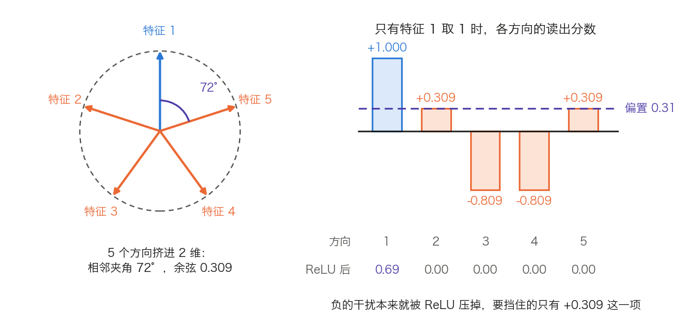

## 14.8 机制可解释性：打开黑箱

**机制可解释性**（Mechanistic Interpretability，MI）是把网络的权重与激活逆向工程成人类能读懂的计算过程。它的分析单位是激活空间里的方向：特征比维度多且稀疏时，模型用近似正交的方向叠加存储，靠非线性滤掉干扰。稀疏自编码器与转码器是把这些方向解出来的字典学习，质量看稀疏度、重构与下游损失恢复，并且带着重构误差、特征分裂与随种子而变的不唯一性。要从“有什么表示”走到“用了什么计算”，必须做因果干预；探针与 logit lens 只说明信息存在，钳制特征只证明这个方向足以改变输出。今天在生产级模型上能做到的，是对具体提示画出带误差节点的归因图，找到多跳推理、提前规划、默认拒答这类局部机制；探测已知概念时，线性探针常常比 SAE 特征更可靠，SAE 更适合发现未知现象、提出假说。

模型的自述靠不住：[14.6.7 节](14.6_test_time_scaling.md)测得 Claude 3.7 Sonnet 只有 25% 的情况会在思维链里说出自己用了提示线索。剩下的途径是绕开自述，直接读权重与激活。

### 14.8.1 叠加与多义性：为什么神经元不能直接解读

逐个神经元地解读行不通，因为绝大多数神经元是**多义的**（Polysemantic）：同一个神经元会对“学术引用”“中文文本”“DNA 序列”这类毫不相关的概念都强烈激活。

[Anthropic 的叠加玩具模型](https://transformer-circuits.pub/2022/toy_model/index.html)（Elhage 等人，2022）给出的解释是**叠加**（Superposition）。一个 $$d$$ 维激活空间只能容纳 $$d$$ 个互相正交的方向，却能容纳远多于 $$d$$ 个“近似正交”的方向：容许两两余弦不超过 $$\varepsilon$$ 时，可容纳的方向数随 $$d$$ 指数增长（这与 Johnson–Lindenstrauss 引理同源）。当真实特征远多于维度、且每个特征只在少数输入上激活时，模型就把多个特征挤进同一组神经元，以近似正交的方向叠加存储。

**一个可以手算的最小例子。** 把 5 个特征放进 2 维，最省事的排法是让它们指向正五边形的五个顶点，两两相隔 72°。任意两个方向的余弦只有两种取值：相邻的 $$\cos 72° = 0.309$$，相隔两个的 $$\cos 144° = -0.809$$。现在只让特征 1 取值 1，其余为 0，激活就是特征 1 的方向。用各个方向去读这个激活，得到的分数依次是 $$+1.000$$、$$+0.309$$、$$-0.809$$、$$-0.809$$、$$+0.309$$。

关键在读出这一步。负的干扰本来就被 ReLU 压掉，需要挡住的只有 $$+0.309$$。把每个方向的分数减去 0.31（即偏置取 $$-0.31$$）再过 ReLU：特征 1 是 $$1 - 0.31 = 0.69$$，两个 $$+0.309$$ 减完略小于 0，被压成 0。读出变成 $$0.69, 0, 0, 0, 0$$，只剩特征 1 自己。图 14-15 把这两步画在一起，图中标作“偏置 0.31”的紫色虚线就是被减去的这个阈值。

图 14-15：5 个特征挤进 2 维时的方向排布，以及只有特征 1 激活时各方向的读出（[生成脚本](https://github.com/yeasy/llm_internals/blob/main/tools/figures/ch14b_superposition_2d.py)）。余弦值由脚本算出。蓝色是当前激活的方向，橙色是其余方向，紫色是偏置线与 ReLU 之后的结果。

这个例子说明了叠加成立的两个前提。**稀疏性**：同时激活的特征越少，干扰项越少，偏置才压得住。特征 1 与特征 3 同时取 1 时，方向 1、3 的分数都只剩 $$1 - 0.809 = 0.191$$，过不了 0.31 的阈值；夹在中间的方向 2 反而得到 $$0.309 + 0.309 = 0.618$$，减去 0.31 后读成 0.308 的假激活。五个特征同时取 1 时，五个方向相互抵消，激活是零向量，什么也读不出。**非线性**：没有 ReLU 或类似的阈值，干扰无法被丢掉。这正是“特征的载体是激活空间中的方向，而非单个神经元”的机制来源，也解释了逐神经元解读为什么注定失败。

### 14.8.2 稀疏自编码器：从叠加中恢复单义特征

**稀疏自编码器**（Sparse Autoencoder，SAE）是解开叠加的字典学习：训练一个**过完备**的自编码器去重构某一层的激活，并在隐层施加稀疏约束，迫使每个样本只激活极少数隐单元，每个隐单元的解码方向就是一个候选特征（[Towards Monosemanticity](https://transformer-circuits.pub/2023/monosemantic-features)，Anthropic，2023）。它解出来的是方向，名字是事后加的，可信度要靠下面的指标与干预检验。

**前向与损失。** 记被解释的激活为 $$\mathbf{x} \in \mathbb{R}^{D}$$，字典大小为 $$F \gg D$$。[扩展单义性](https://transformer-circuits.pub/2024/scaling-monosemanticity/)（Scaling Monosemanticity，2024）写出的形式是：

$$
f_i(\mathbf{x}) = \mathrm{ReLU}\left(\mathbf{W}^{enc}_{i,\cdot} \cdot \mathbf{x} + b^{enc}_i\right), \qquad
\hat{\mathbf{x}} = \mathbf{b}^{dec} + \sum_{i=1}^{F} f_i(\mathbf{x})\, \mathbf{W}^{dec}_{\cdot,i}
$$

$$
\mathcal{L} = \mathbb{E}_{\mathbf{x}}\left[\ \lVert \mathbf{x} - \hat{\mathbf{x}} \rVert_2^2 + \lambda \sum_i f_i(\mathbf{x}) \cdot \lVert \mathbf{W}^{dec}_{\cdot,i} \rVert_2\ \right]
$$

形状是 `x[1, D] × W_enc^T[D, F] → f[1, F]`，再 `f[1, F] × W_dec^T[F, D] → x̂[1, D]`。稀疏项里那个 $$\lVert \mathbf{W}^{dec}_{\cdot,i} \rVert_2$$ 因子有其作用：没有它，模型可以把解码器方向的模长放大、把 $$f_i$$ 缩小来绕过 L1 惩罚。乘上这个因子之后，解码向量可以按单位长度解读为“特征方向”，$$f_i$$ 才是它的激活强度。

**规模。** Towards Monosemanticity 解释的是一个单层 Transformer 里 512 个神经元的 MLP 激活，字典最大 131,072 个特征；Scaling Monosemanticity 把方法搬到生产级模型 Claude 3 Sonnet 的中间层残差流，字典做到约 1M、4M、34M 三档。

**怎么判断一个 SAE 好不好。** 读公开 SAE 时要看四类指标：

- **L0**，即平均每个词元上有多少个特征非零。Scaling Monosemanticity 的三档都低于 300。
- **解释方差**，重构 $$\hat{\mathbf{x}}$$ 解释掉原激活方差的比例，该文三档都不低于 65%。
- **下游损失恢复率**，把原激活换成重构值后模型交叉熵的恢复程度，比重构误差更贴近“这个分解是否抓住了模型实际用到的东西”。
- **死特征比例**，在大样本上从不激活的特征占比。该文以 $$10^7$$ 个词元为样本，1M 档约 2%、4M 档约 35%、34M 档约 65%。字典越大，浪费越多，这是扩字典的直接代价。

**三种稀疏化各有取舍。** 差别在于用什么办法让大多数特征为零：

- **L1 惩罚**：可导、实现简单，代价是收缩偏差，它既压特征数，也把留下来的激活值一并压小。
- **TopK**：[OpenAI 的 k-稀疏自编码器](https://arxiv.org/abs/2406.04093)直接保留最大的 $$k$$ 个激活，稀疏度由 $$k$$ 精确控制，不必调 $$\lambda$$；它在 GPT-4 的激活上训到 1,600 万个隐单元，死特征仍很少。
- **JumpReLU**：[Gemma Scope](https://arxiv.org/abs/2408.05147) 给每个特征一个可学的阈值，低于阈值直接置零，在保住稀疏的同时不压低通过阈值的激活值；它把 SAE 训到 Gemma 2 2B 与 9B 的全部层与子层上并公开了权重。

**怎么知道一个特征代表什么。** Scaling Monosemanticity 用两条标准检验一个解释。其一是特异性：取使该特征激活的文本片段，看所称的概念是否确实出现，由另一个模型按统一量表打分。其二是对行为的影响：把该特征的激活钳到很高或很低的值，看输出是否朝所称的概念偏移；把“金门大桥”特征钳高之后，模型开始自称是金门大桥。干预比观察进了一步，但它给出的是充分性证据：这个方向足以改变输出，不说明模型在正常计算中用到了它，也不证明所起的名字准确；钳制值偏离正常激活范围越远，干预本身越是分布外操作，结论越弱。

**SAE 路线的现状。** 字典不是唯一的：在 Llama 3 8B 的一个 MLP 上用同样数据训练 131K 特征的 SAE，换随机种子后只有约 30% 的特征是共享的（[Paulo 与 Belrose](https://arxiv.org/abs/2501.16615)）。在下游任务上它也未必胜过简单基线：Google DeepMind 的可解释性团队用 SAE 特征做有害意图的探测，分布外泛化明显不如直接训练的线性探针，并因此[降低了 SAE 基础研究的优先级](https://www.alignmentforum.org/posts/4uXCAJNuPKtKBsi28/negative-results-for-saes-on-downstream-tasks)。默认分工由此而来：已知要找的概念，直接训练线性探针；要发现未知的现象、给奇怪的失效找线索、排查数据里的伪相关，才用 SAE 与 14.8.5 的转码器。

### 14.8.3 电路与归纳头：上下文学习的机制基础

一个注意力头可以拆成两条与输入无关的线性**电路**：QK 电路决定看哪里，OV 电路决定写什么；跨层组合之后，几个头就能实现一个算法。归纳头是最著名的样本，它为上下文学习提供了一个可以逐步追踪的机制（[Transformer 电路数学框架](https://transformer-circuits.pub/2021/framework/index.html)，Elhage 等人，2021）。

**QK 电路决定注意到哪里。** 按 [3.8 节](../03_components/3.8_gpt_inference_flow.md)的行向量写法，打分是 $$XW_Q(XW_K)^{\top} = X\,(W_QW_K^{\top})\,X^{\top}$$，于是 $$W_{QK} = W_QW_K^{\top}$$ 是一个 $$[d_{\mathrm{model}}, d_{\mathrm{model}}]$$ 的矩阵，秩不超过 $$d_h$$。GPT-3 Small 里它是 `[768, 768]`、秩 ≤ 64。

**OV 电路决定把什么写进残差流。** 输出是 $$A\,XW_VW_O$$，于是 $$W_{OV} = W_VW_O$$ 同样是 $$[d_{\mathrm{model}}, d_{\mathrm{model}}]$$。

把嵌入与反嵌入接上，两条电路都可以写成词元对词元的表：$$W_EW_{QK}W_E^{\top}$$ 给出“哪个词元会注意哪个词元”，$$W_EW_{OV}W_U$$ 给出“看到某个词元时输出会偏向哪个词元”，GPT-3 Small 下都是 `[50257, 50257]`。这两张表是单个头的完整行为描述，不依赖任何具体输入；多个头还能跨层**组合**（composition）。

**归纳头是这个框架最著名的成果。** [归纳头](https://transformer-circuits.pub/2022/in-context-learning-and-induction-heads/index.html)（Induction Heads，Olsson 等人，2022）由两层、两个头组成，实现规则“序列中出现过 [A][B]，再次遇到 [A] 时就预测 [B]”。用一个 6 词元的序列走一遍：

1. 序列是 `[A] [B] [C] [D] [A] ?`，位置编号 1 到 6。
2. **前序词元头**在第 1 层工作。它在位置 2 上注意位置 1，通过 OV 电路把“我前面是 A”写进位置 2 的残差流。这一步与内容无关，只依赖相对位置，所以它的 QK 电路学的是“盯住前一个”。
3. **归纳头**在第 2 层工作。位置 5 的查询携带“当前是 A”的信息，它的 QK 电路把这个查询与“前面是 A”这条键匹配上，于是位置 5 注意到位置 2。
4. 归纳头的 OV 电路从位置 2 读出的是该位置的词元 B，并把 B 复制进位置 5 的残差流，模型据此预测下一个词元为 B。

这条链路的关键是第 3 步的 K-composition：归纳头的键读的是第 1 层写进残差流的“前面是 A”，原始词元嵌入里没有这条信息。单看任何一个头都解释不了这个行为。

证据强度要分清：小型 attention-only 模型上有较强的因果证据，大型模型上更多是相关性或局部干预层面的证据。它能解释模式复制与不少少样本现象，解释不了全部少样本推理、工具使用或长思维链。归纳头在训练中伴随损失曲线的一次明显变化出现，是“能力如何形成”的少见机制级案例。

### 14.8.4 读取与干预的工具箱

读内部状态的工具按可信度排成一列：探针与 logit lens 只说明信息存在，激活补丁才给出因果结论，而补丁的结论又取决于用什么基线替换。

**探针**（Probing）在某层激活上训练一个简单的线性分类器，检验某种信息是否被线性可解码地表示。它的结论只有一个方向：能解码说明表示存在，不说明模型用到了它。

**Logit Lens** 把中间层的残差流直接送进最终归一化与反嵌入，看模型“当前的猜测”：

$$
p^{(\ell)} = \mathrm{softmax}\left(\mathrm{Norm}_{\mathrm{final}}\left(x^{(\ell)}\right)W_{\mathrm{vocab}}\right)
$$

常能看到正确答案在中后层才被锁定。它的失真来源是基不对齐：$$W_{\mathrm{vocab}}$$ 是为第 $$L$$ 层的表示训出来的，中间层的残差流未必在同一套基上。tuned lens 的做法是为每一层各学一个线性变换，先把 $$x^{(\ell)}$$ 映射到末层的基，再解码。

**激活补丁**（Activation Patching）是这组工具里唯一给出因果结论的：先跑一遍“干净”输入、再跑一遍“被破坏”输入，然后把某个组件的激活从一次运行移植到另一次，观察输出是否恢复。常用的度量是 logit 差恢复率，即被补丁的那个组件把“正确答案减错误答案”的 logit 差拉回了原值的百分之多少。

用补丁时要分清几个容易混用的概念。

- **因果追踪**是激活补丁的一个特例：破坏的方式是给输入加噪，再逐个恢复组件。它出自 [ROME](https://arxiv.org/abs/2202.05262)，该文用它定位事实记忆由哪些位置和层承载。
- **消融**的基线选择会改变结论。置零消融把激活换成 0，但 0 通常不在激活的分布内，效果被高估。均值消融换成数据集均值。重采样消融换成另一个样本在同一位置的激活，最接近“这个组件不提供信息时会怎样”。
- **路径补丁**只替换某条特定路径上的贡献，用来区分“这个头直接影响输出”与“它通过下游某个头间接影响输出”。

### 14.8.5 从特征到计算图：转码器与归因图

SAE 回答的是“某一层里有哪些特征”，回答不了“这些特征之间如何相互计算”。转码器把拟合目标从重构换成替代计算，归因图再把它用到具体提示上，并用误差节点标出没解释掉的部分。

**转码器**（transcoder）改变了拟合目标：SAE 用一层的激活重构同一层，转码器用某个 MLP 的输入去预测同一个 MLP 的输出，于是它学到的是一个可解释的**替代计算**，而不只是一个分解。Anthropic 的 [Sparse Crosscoders](https://transformer-circuits.pub/2024/crosscoders/index.html)（Lindsey 等人，2024）进一步让同一组稀疏特征同时读写多个层，甚至多个模型。论文列出的用途包括解决跨层叠加、简化电路，以及**模型对比**（model diffing）：用同一组特征去重构两个模型的激活，比较各特征在两侧的解码器范数，就能区分共享特征与某一方独有的特征。

**归因图**是把这件事用到具体提示上的产物。Anthropic 的 [Circuit Tracing](https://transformer-circuits.pub/2025/attribution-graphs/methods.html)（Ameisen、Lindsey 等人，2025）分三步走。先训一个**跨层转码器**（cross-layer transcoder，CLT）去逼近原模型的 MLP。再用它替换掉 MLP，得到一个**替代模型**。最后在替代模型上对某个具体提示画出计算图。图里的节点是提示各位置上激活的转码器特征、输入嵌入和输出词元，边是替代模型里的直接线性归因。图里还有一类**误差节点**，承载 CLT 没能解释的那部分 MLP 输出。它明确标出了这张图有多少没有解释清楚，这一点比“看上去讲得通”重要得多。

用这套方法，Anthropic 在 Claude 3.5 Haiku 上找到了几条[具体机制](https://transformer-circuits.pub/2025/attribution-graphs/biology.html)：回答“达拉斯所在州的首府”时，模型内部先得到“得克萨斯”再得到“奥斯汀”，真正的两步推理与捷径并存；写押韵诗时，下一行的候选韵脚在这一行开始之前就已激活，属于提前规划；模型有一条默认拒答的回路，认出熟悉的实体才会抑制它，[14.9.4 节](14.9_outlook.md)用它解释幻觉。这些都是在单个提示上、带着误差节点得到的局部结论。

### 14.8.6 动手入口

入门练习是在 GPT-2 small 上复现归纳头检测：喂进一段重复两遍的随机词元，看哪个头在第二遍稳定地注意到“上次出现处的下一个位置”。TransformerLens 一次前向就能缓存全部中间激活，SAELens 用来训练与分析 SAE，nnsight 用来做干预实验，Gemma Scope 提供公开的 SAE 权重。钩子名与张量形状见[附录 A.7](../appendix/a7_framework_recipes.md)。

### 14.8.7 意义与局限

机制可解释性对科学理解的价值，是让“原理”从行为层深入到算法层；对 AI 安全的价值，是有望不依赖模型的自述去检测欺骗、后门与危险能力。

局限有三层。字典本身不稳：SAE 有重构误差，特征随字典大小与随机种子变化；字典变大时同一个概念会被拆成多个特征（特征分裂），这是表示粒度的问题，与 14.8.2 的死特征比例（优化中从不激活的浪费）是两回事。干预只给充分性证据，14.8.2 与 14.8.4 都说明了它会被高估的条件。规模上，迄今没有任何一个大型语言模型被完整地、电路级地解释清楚，归因图的误差节点逐个提示地标出了还没解释的部分。
