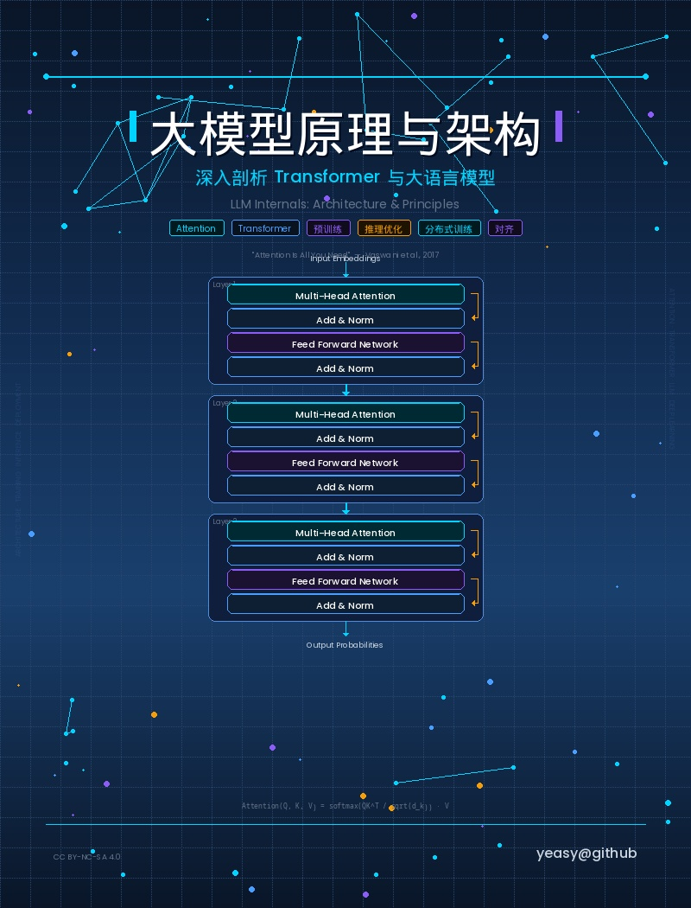
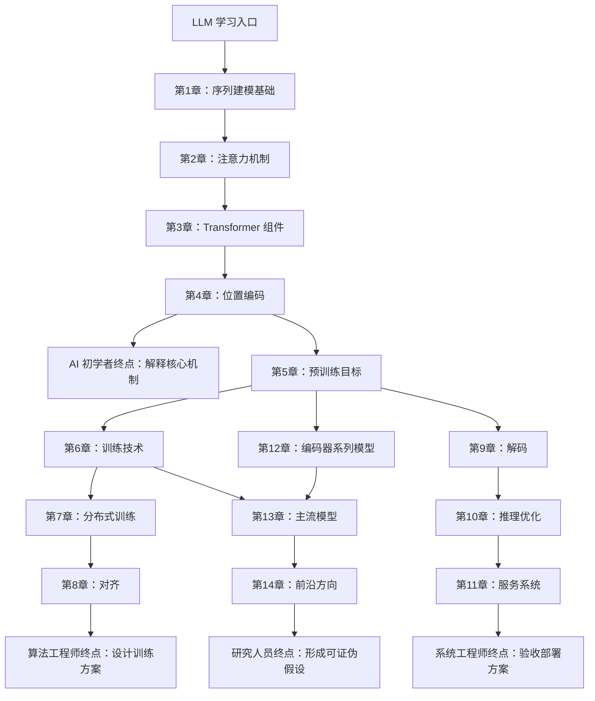

<div align="center">

# 大模型原理与架构

[](https://creativecommons.org/licenses/by-nc-sa/4.0/)
[](https://github.com/yeasy/llm_internals)
[](https://github.com/yeasy/llm_internals/releases)
[](https://yeasy.gitbook.io/llm_internals)
[](https://github.com/yeasy/llm_internals/releases/latest)

> 以 Transformer 为例，深入剖析大模型为什么能工作、为什么这样设计，系统掌握从架构原理到训练部署的完整知识体系。



</div>

---

## 本书简介

2017 年，Vaswani 等人在论文《Attention Is All You Need》中提出了 Transformer 架构。这一设计用注意力机制完全替代循环和卷积，看似简洁，却引发了深度学习领域影响最深远的一次变革。从 BERT 到 GPT-4，从 Llama 到 DeepSeek，几乎所有现代大语言模型的核心都建立在 Transformer 之上。

但知道 Transformer “是什么” 远远不够。**为什么自注意力需要除以 $\sqrt{d_k}$？为什么多头比单头更有效？为什么残差连接对深层网络如此关键？旋转位置编码只依赖相对位置，为什么直接外推到更长的序列仍会失败？** 这些 “为什么” 背后的设计直觉与数学原理，才是理解这一架构的关键。

本书的主张是：Transformer 及其后继的每一处设计，都对应前一代方案的一条具体不足，而这些不足可以用少数几把尺子量出来：两个位置之间的信息要走几步，有多少步必须排队，一层里与权重相乘的线性项和随长度平方增长的项谁占主导，推理时受显存容量还是显存带宽约束。全书用这几把尺子解释每个设计为什么出现、在什么条件下成立、又在哪里被取代，每个结论都给出可以手算的量级，并配有可运行的实验。

## 目标读者

- **AI/NLP 研究者**：需要深入理解 Transformer 设计原理及其变体的研究人员
- **算法工程师**：从事大模型架构、训练、微调与部署的研发人员
- **机器学习从业者**：希望从 “会用” 进阶到 “理解为什么” 的开发者
- **高校师生**：希望结合业界最新实践，研究深度学习与大模型方向

## 阅读本书，你将学到

1. **Transformer 为什么能取代 RNN**：常见长度下它并不比 RNN 省运算，快在必须排队的步数是常数，任意两个位置一跳可达
2. **注意力机制为什么这样设计**：除以 $\sqrt{d_k}$ 让分数尺度与头宽无关；多头把一个加权平均换成多个；因果掩码让旧位置的 K、V 永不改变，所以能缓存
3. **各组件如何协同工作**：残差给梯度留一条不经过子层的通路，Pre-Norm 让深层堆叠可训，前馈网络是每层参数的大头
4. **位置编码的取舍**：从正弦编码到 RoPE，注意力分数怎样只依赖相对位置，超出训练长度时又靠什么外推
5. **预训练为什么这样做**：“预测下一个词”与生成过程一致，每个位置都提供监督信号；规模定律让训练可以先算后练
6. **训练工程的设计依据**：学习率预热为什么必要，混合精度怎样保住精度，分布式训练怎样按通信量把各种并行分配到不同链路
7. **对齐技术的设计动机**：RLHF 要训练奖励模型并在线采样，DPO 把同一目标改写成偏好对上的损失
8. **推理优化的第一性原理**：Decode 每生成一个词元要把权重读一遍，速度受显存带宽限制；投机解码怎样在加速的同时保持输出分布不变
9. **主流 LLM 的架构选择**：Llama 把前置 RMSNorm、SwiGLU、RoPE、GQA 固定成配方，此后的偏离集中在 MoE 与更省缓存的注意力
10. **前沿趋势的开放问题**：线性注意力与状态空间模型拿回了 RNN 的恒定状态，代价是精确回忆受限；多模态融合的核心挑战是什么

## 如何阅读

先看 [1.0 技术全景：从 GPU 到 Agent](01_introduction/1.0_technology_map.md)，用一张图定位基础设施、算子、训练、推理、服务与应用；它描述系统依赖，下面的学习路线图描述阅读顺序。

全书分为四个部分和附录。第一部分（第 1 至 4 章）从序列建模的困境讲到注意力、Transformer 组件与位置编码；第二部分（第 5 至 8 章）讲预训练、训练技术、分布式训练与对齐；第三部分（第 9 至 11 章）讲解码、推理优化与服务系统；第四部分（第 12 至 14 章）对照编码器与解码器两条路线，再看前沿架构在改哪一处。附录提供数学基础、PyTorch 示例、模型参数速查、参考文献、快变事实核验表和面试题对照。

建议按顺序阅读第一部分，之后按训练或推理方向深入。阅读同时完成 [A.6 的可复现实验](appendix/a6_practice_path.md)，再进入 [A.7 的开源框架实践](appendix/a7_framework_recipes.md)。前者验证计算与状态是否正确，后者检验真实工作负载下的质量、性能与资源取舍。

## 学习路线图



图 0-1：本书学习路线图。

路线图是有向无环图：箭头表示前置知识，不是可任意跳过的推荐顺序。每个角色终点都需要同时通过推导、定量计算和可运行代码三类验收；“读完章节”本身不算完成。

向专家水平进阶，还需要完成四类工作：独立复现一个基线；通过对照实验解释改进来自哪里；在给定质量、延迟与资源约束下作出取舍；根据日志、张量和性能剖析定位失败。A.6 给出相应的项目验收要求。小模型实验验证机制，不能替代大规模训练、真实业务评测和生产运行经验。

| 读者角色 | 前置路线 | 推导验收 | 计算验收 | 代码验收 |
| --- | --- | --- | --- | --- |
| **AI 初学者** | [第 1 章](01_introduction/README.md) → [第 2 章](02_attention/README.md) → [第 3 章](03_components/README.md) → [第 4 章](04_position_encoding/README.md) | 独立写出[缩放点积注意力](02_attention/2.2_scaled_dot_product.md)并解释缩放因子 | 手算[正弦位置编码](04_position_encoding/4.1_sinusoidal.md)的一组二维旋转 | 运行并核对[附录 PyTorch 示例](appendix/a2_pytorch_examples.md)的 attention、RoPE、RMSNorm |
| **算法工程师** | [第 1-4 章](04_position_encoding/README.md) → [第 5 章](05_pretraining/README.md) → [第 6 章](06_training_techniques/README.md) → [第 7 章](07_distributed_training/README.md) → [第 8 章](08_alignment/README.md) | 从目标函数推导[自回归预训练](05_pretraining/5.1_autoregressive.md)与[DPO](08_alignment/8.3_dpo.md)的优化对象 | 重算[ZeRO 分片](07_distributed_training/7.2_zero.md)在 64 卡下的单卡状态显存 | 运行[混合精度](07_distributed_training/7.6_mixed_precision.md)与[检查点](07_distributed_training/7.7_checkpoint.md)示例并验证恢复一致性 |
| **系统工程师** | [第 1-5 章](05_pretraining/README.md) → [第 9 章](09_decoding/README.md) → [第 10 章](10_inference_optimization/README.md) → [第 11 章](11_serving/README.md) | 解释[Prefill/Decode 瓶颈](10_inference_optimization/10.1_bottleneck.md)如何决定调度策略 | 重算[KV cache](10_inference_optimization/10.2_kv_cache.md)和[权重显存](11_serving/11.12_hardware.md)是否能放入目标 GPU | 以[持续批处理](11_serving/11.2_continuous_batching.md)为基线实现微型调度实验并检查延迟分位数 |
| **研究人员** | [第 1-6 章](06_training_techniques/README.md) → [第 12 章](12_encoder_models/README.md) → [第 13 章](13_decoder_models/README.md) → [第 14 章](14_future_trends/README.md) | 为[推理时计算扩展](14_future_trends/14.6_test_time_scaling.md)写出可证伪机制假设 | 对[批量与序列长度](06_training_techniques/6.4_batch_sequence.md)的计算预算做敏感性分析 | 在[高效注意力](14_future_trends/14.1_efficient_attention.md)基线上实现对照实验，固定种子并报告误差 |

## 在线阅读

本书在线阅读，可直接访问 [GitBook](https://yeasy.gitbook.io/llm_internals/)。

## 下载离线版本

本书提供 PDF 版本供离线阅读，可前往 [GitHub Releases](https://github.com/yeasy/llm_internals/releases/latest) 页面下载最新版本。

如需获取默认分支自动更新的预览版，可直接下载 [llm_internals.pdf](https://github.com/yeasy/llm_internals/releases/download/preview-pdf/llm_internals.pdf)。该文件会随主线更新覆盖，不代表正式发布版本。

## 本地阅读

本仓库的预览 PDF 与本地阅读入口使用 [mdPress](https://github.com/yeasy/mdpress)：

```bash
brew tap yeasy/tap && brew install mdpress
mdpress serve
```

启动后访问 [本地阅读地址](http://localhost:9000) 即可阅读。

---

## 进阶阅读

读完本书后，你可以根据兴趣方向选择以下进阶读物：

| 书名 | 说明 |
|------|------|
| [《零基础学 AI》](https://yeasy.gitbook.io/ai_beginner_guide) | 普通人视角的 AI 入门与基础认知 |
| [《大模型提示词工程指南》](https://yeasy.gitbook.io/prompt_engineering_guide) | 系统掌握与 AI 高效对话的提示词技术 |
| [《大模型上下文工程权威指南》](https://yeasy.gitbook.io/context_engineering_guide) | 从提示词工程进阶到上下文工程 |
| [《Claude 技术指南》](https://yeasy.gitbook.io/claude_guide) | 深入掌握 Claude 的核心能力与最佳实践 |
| [《智能体 AI 权威指南》](https://yeasy.gitbook.io/agentic_ai_guide) | 全面学习智能体架构、多智能体协作与工程实践 |
| [《大模型安全权威指南》](https://yeasy.gitbook.io/ai_security_guide) | 了解大语言模型面临的安全威胁与防御机制 |
| [《OpenClaw 入门到精通》](https://yeasy.gitbook.io/openclaw_guide) | 开源智能体框架的实践入门 |
| [《智能体 Harness 工程指南》](https://yeasy.gitbook.io/harness_engineering_guide) | 深入智能体 Harness 的模型集成层与输出治理设计 |

---

## 参与贡献

欢迎贡献！您可以通过以下方式参与：

- [提交 Issue](https://github.com/yeasy/llm_internals/issues)：报告错误或提出建议
- [提交 PR](https://github.com/yeasy/llm_internals/pulls)：改进内容或修复 typo
- Star 本项目：帮助更多人发现这本书

---

## 许可证

本书采用 [CC BY-NC-SA 4.0](https://creativecommons.org/licenses/by-nc-sa/4.0/) 许可证。

您可以自由分享和演绎，但需署名、非商业使用、相同方式共享。
